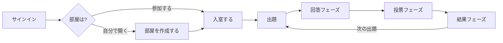
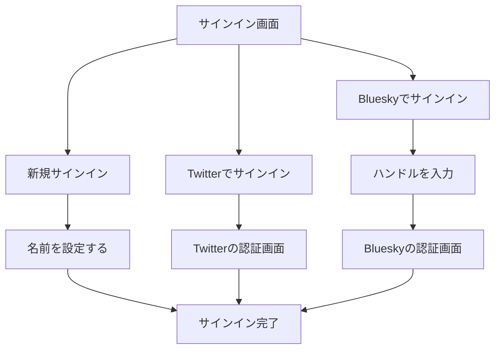
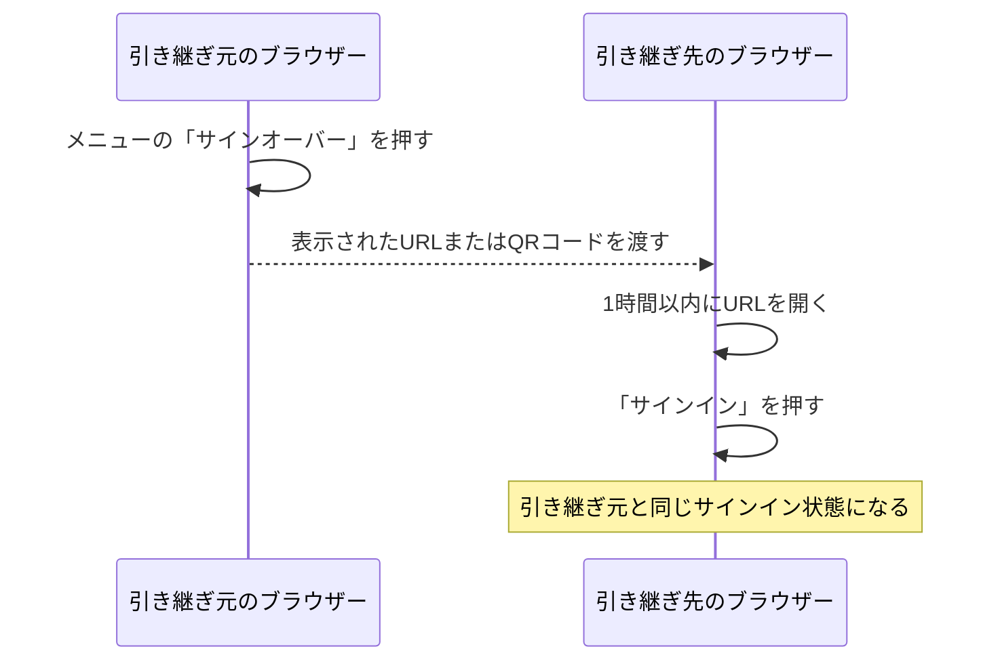
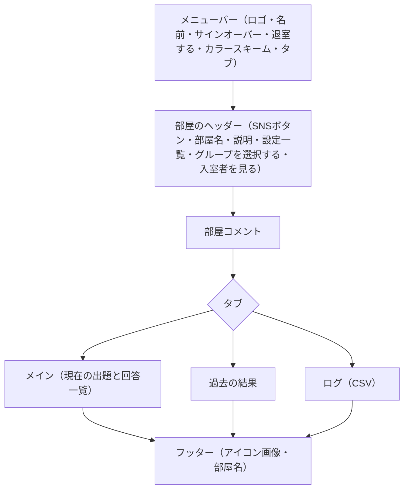
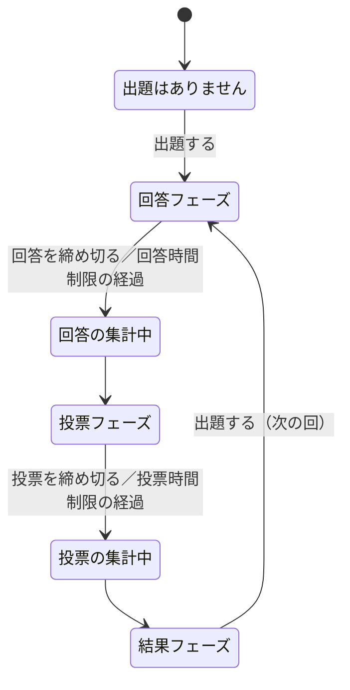
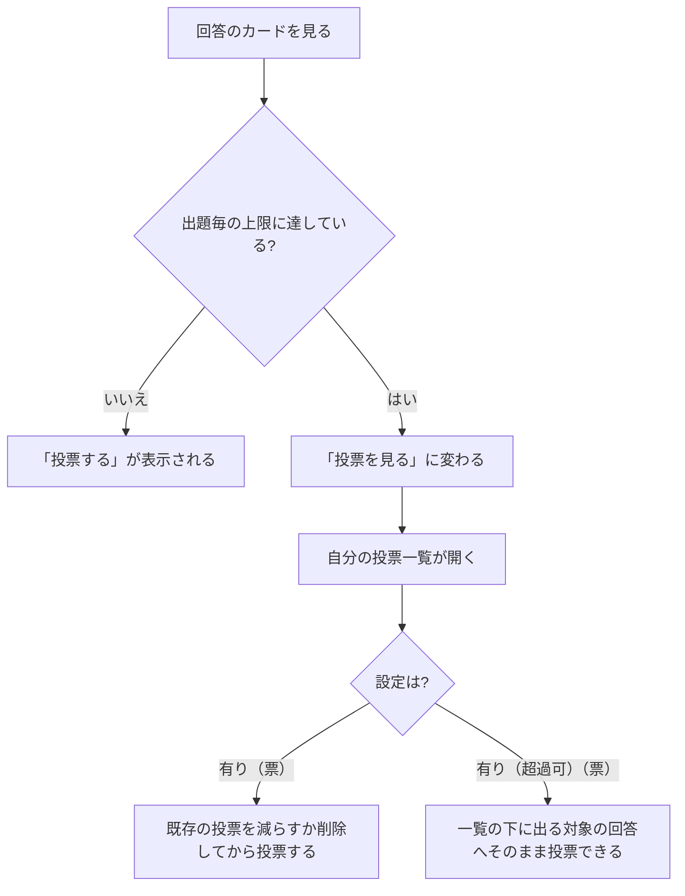
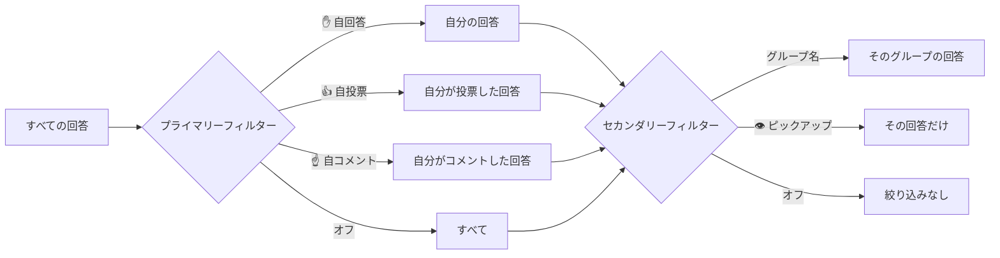
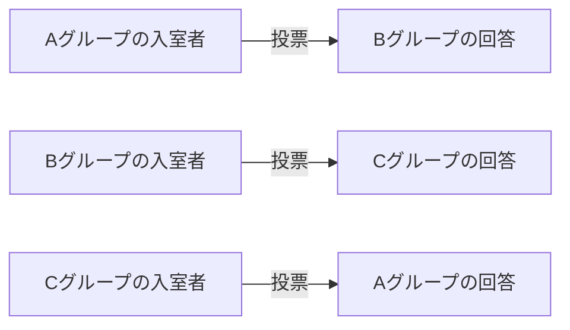
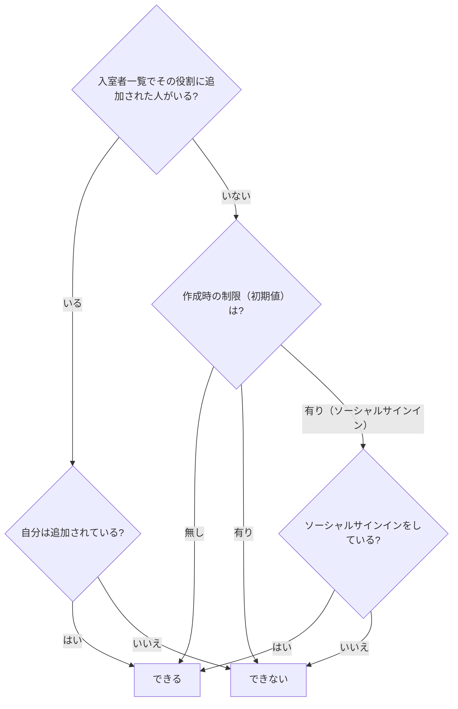

# bǃgǃrǃ（ビギリ）ユーザーマニュアル

- 作成日: 2026-11-10
- 対象バージョン: 1.138.10（2026-11-07 リリース）
- 作成者: Claude Fable 5.2（AI による生成）

本マニュアルは、bǃgǃrǃ（ビギリ）の更新情報（2017年6月の α 版から 2026年11月まで）と現行の画面構成をもとに、現在の仕様と操作方法をまとめ直したものです。ボタン名・設定名・メッセージは現行の画面の表記に合わせています。すでに廃止された機能は本文では扱わず、巻末の「26. 廃止・変更された機能」に整理しました。

本文中の「押す」は、パソコンでのクリックとスマートフォン・タブレットでのタップの両方を指します。

> **お読みになる前に**
> 画面に表示されるボタンや項目は、現在のフェーズ・部屋の設定・自分の権限（部屋作成者かどうか、出題者・回答者・投票者に含まれているか）によって変わります。「ボタンが見当たらない」ときは、まず「23. 困ったときは」を確認してください。

---

## 章の構成

| 章 | 内容 | 主な読者 |
| --- | --- | --- |
| 1 | bǃgǃrǃ とは（全体像・役割・用語） | 全員 |
| 2 | 動作環境と注意事項 | 全員 |
| 3 | クイックスタート | 初めての方 |
| 4 | トップ画面 | 全員 |
| 5 | サインイン・名前・サインオーバー | 全員 |
| 6 | 部屋を作成する | 主催者 |
| 7 | 部屋設定リファレンス | 主催者 |
| 8 | 入室と部屋画面 | 全員 |
| 9 | 出題から結果まで（フェーズ） | 全員 |
| 10 | 出題する | 出題者 |
| 11 | 回答する | 回答者 |
| 12 | 投票する | 投票者 |
| 13 | 結果を見る（順位・Zスコア・ユニコーン） | 全員 |
| 14 | コメントとリアクション | 全員 |
| 15 | 表示順とフィルター | 全員 |
| 16 | グループ | 全員・主催者 |
| 17 | 入室者の管理 | 主催者 |
| 18 | 過去の結果 | 全員 |
| 19 | ログ（CSV） | 主催者・集計担当 |
| 20 | カラースキーム | 全員 |
| 21 | キーボード操作とダイアログ | 全員 |
| 22 | 設定レシピ集 | 主催者 |
| 23 | 困ったときは | 全員 |
| 24 | 入力制限一覧 | 全員 |
| 25 | アイコン・記号一覧 | 全員 |
| 26 | 廃止・変更された機能 | 以前から利用している方 |
| 27 | 更新の歩み（年表） | 興味のある方 |
| 28 | 用語集 | 全員 |

---

## 1. bǃgǃrǃ とは

bǃgǃrǃ（ビギリ）は、誰でも使えるスーパーフレキシブルなネット大喜利催行サイトです。キャッチフレーズは「For Beautiful Oogiri Life」。ブラウザーだけで、出題・回答・投票・結果発表までをリアルタイムに進行できます。

主な特長は次のとおりです。

- **アカウント登録不要**: 名前を決めるだけで参加できます。Twitter・Bluesky のアカウントでサインインすることもできます。
- **部屋単位の進行**: 「部屋」を作成し、参加者はその部屋に入室して遊びます。
- **細かく調整できるルール**: 回答や投票の公開タイミング、名前の表示、時間制限、回答数・投票数の制限、参加資格などを部屋ごとに設定できます。
- **手描き回答**: 文字に加えて手描きの線画を回答に添えられます。
- **統計にもとづく演出**: 得票の偏り（Zスコア）に応じて、抜きん出た回答にユニコーン🦄が付きます。
- **チーム戦**: 入室者をグループに分け、グループ単位での投票制限や絞り込みができます。
- **記録**: 過去の結果の閲覧と、ログの CSV ダウンロードができます。

### 1.1 基本の流れ

1 つの出題（第 n 回）は「回答フェーズ → 投票フェーズ → 結果フェーズ」の順に進みます。結果フェーズで次の出題が行われると、新しい回が始まります。

### 1.2 登場する役割

| 役割 | 説明 |
| --- | --- |
| 部屋作成者 | 部屋を作成した人。フェーズの締め切り、部屋コメント、グループの作成・削除、入室者の権限管理、部屋の削除ができます。 |
| 入室者 | 部屋に入室している人すべて。 |
| 出題者 | 出題できる人。設定がなければ入室者全員です。 |
| 回答者 | 回答できる人。設定がなければ入室者全員です。 |
| 投票者 | 投票できる人。設定がなければ入室者全員です。 |
| 受刑者 | 部屋作成者（または不正アクセスの自動検知）によって参加を禁じられた人。強制退室となります。 |

### 1.3 画面上の言葉

| 言葉 | 意味 |
| --- | --- |
| 出題 | いわゆる「お題」。本文のほか、画像と出典を添えられます。 |
| 回答 | いわゆる「ボケ」。本文のほか、手描きの描画を添えられます。 |
| 投票 | 回答に入れる票。1 回の投票で複数票を入れることもできます。 |
| フェーズ | 進行段階。回答フェーズ・投票フェーズ・結果フェーズの 3 つ。 |
| 即時／一斉 | 「即時」は投稿された時点で公開、「一斉」は次のフェーズになってからまとめて公開。 |

---

## 2. 動作環境と注意事項

### 2.1 対応ブラウザー

- 最新版の主要ブラウザー（Chrome、Edge、Firefox、Safari など）でご利用ください。対象とする言語仕様は ECMAScript 2022 です。
- Internet Explorer や旧 Edge など、古い仕様のブラウザーには対応していません。
- Safari 26.4 および 26.5 では、不定期にデータ取得が遅れる現象への対処として、通信方法を一時的に切り替えています。

### 2.2 ブラウザーに保存される情報

次の情報は、利用しているブラウザーの中に保存されます。別のブラウザーや別の端末には引き継がれません。

- 「部屋を作成する」画面の直近の設定値と作成履歴
- 「グループを作成する」画面の作成履歴
- サインイン時の名前の初期値、Bluesky のハンドル、部屋内で設定したリンクの URL

サインイン状態そのものを別のブラウザーに引き継ぎたい場合は、「5.6 サインオーバー」を利用します。

### 2.3 利用上の注意

- **著作物の利用**: 出題に著作物を用いる場合は、適切な出典を入力してください（「10. 出題する」）。
- **作品のライセンス**: 各部屋の中の作品は、特に注記がない限りクリエイティブ・コモンズ 表示 4.0 国際（CC BY 4.0）で提供される旨がトップ画面に掲示されています。
- **部屋の存続期間**: 部屋は、最後に更新されてからおよそ 11.5 日が経過すると存続期間を終えます。残しておきたい記録は、ログ（CSV）で保存してください。
- **更新後のリロード**: サービスが更新された後は、開いたままの画面をリロード（再読み込み）してください。

---

## 3. クイックスタート

### 3.1 参加する（3 ステップ）

1. トップ画面の部屋一覧から参加したい部屋を探し、**入室する**を押します。主催者から部屋の URL を受け取っている場合は、その URL を開きます。
2. サインインしていない場合はサインイン画面が開きます。**新規サインイン**を押して名前を入力し、**設定する**を押します。
3. 部屋画面で、フェーズに応じて**回答する**・**投票する**を押して参加します。

### 3.2 主催する（5 ステップ）

1. トップ画面で**部屋を作成する**を押します（サインインしていない場合は先にサインイン画面が開きます）。
2. 部屋名を入力し、必要に応じて各設定を選んで**部屋を作成する**を押します。迷ったら初期状態（すべて「無し」「即時」「表示」）のままで構いません。
3. 部屋一覧に現れた自分の部屋の**入室する**を押し、参加者に部屋の URL を伝えます（部屋名の上にある Twitter・Bluesky のボタンから告知の投稿もできます）。
4. **出題する**を押してお題を出します。
5. 頃合いを見て**回答を締め切る**、続いて**投票を締め切る**を押します。時間制限を設定している場合は自動で締め切られます。結果フェーズになったら、次の**出題する**で次の回へ進みます。

---

## 4. トップ画面

トップ画面は、上から順に次の要素で構成されています。

| 位置 | 要素 | 内容 |
| --- | --- | --- |
| 最上部 | メニューバー | ロゴ、自分の名前、サインイン関連のメニュー |
| 上部 | タイトルエリア | ロゴ、キャッチフレーズ、連絡先、更新情報、使用方法 |
| 中央 | 部屋一覧 | Atom フィード、**部屋を作成する**ボタン、ライセンス表示、部屋カードの一覧 |

### 4.1 メニューバー

| 状態 | 表示されるもの |
| --- | --- |
| サインイン前 | **サインイン** |
| サインイン後 | 自分の名前、（ソーシャルサインイン時）SNS へのリンクとプロフィール画像、**サインオーバー**、**サインアウト** |

- 自分の名前を押すと「名前を変更する」画面が開きます（「5.4 名前を変更する」）。
- プロフィール画像を読み込めない場合は、既定の画像が表示されます。

### 4.2 更新情報と使用方法

- **更新情報**: 直近 3 件の更新（日付・バージョン・内容）が表示されます。**更新情報を全て見る**を押すと、すべての履歴がダイアログで表示されます。
- **使用方法**: AI に生成させたユーザーマニュアルへのリンクと、質問・提案を受け付けている GitHub ディスカッションへのリンクがあります。
- **連絡先**: メール、Bluesky、Twitter の公式アカウントへのリンクがあります。

### 4.3 部屋一覧

#### 部屋を作成する

**部屋を作成する**を押すと、部屋の作成画面が開きます（「6. 部屋を作成する」）。

#### 表示順と自入室フィルター

部屋一覧の右上に 2 つの操作があります。

| 操作 | 内容 |
| --- | --- |
| 表示順のドロップダウン | **作成順**（作成日時の新しい順・初期状態）または**更新順**（更新日時の新しい順）を選びます。 |
| 🖖 自入室フィルター | オンにすると、自分が入室している部屋だけが表示されます。もう一度押すと解除されます。 |

#### 部屋カードの見方

部屋 1 つにつき 1 枚のカードが表示されます。

| 場所 | 内容 |
| --- | --- |
| 左上 | Twitter・Bluesky のボタンと部屋名のリンク。ボタンは部屋名・説明の 1 行目・部屋の URL・ハッシュタグ入りの投稿画面を開き、リンクは部屋名での検索結果を開きます。 |
| 左 | 部屋名、説明（説明文中の URL は自動的にリンクになります）、アイコン画像 |
| 右 | 作成者、作成日時、入室制限の有無と、出題・回答・投票に関する設定の一覧（「7. 部屋設定リファレンス」） |
| 右下 | **部屋を削除する**（部屋作成者にのみ表示）、**入室する** |
| 下端 | 更新日時、現在の入室者の名前（自分の名前は色付きで表示） |

#### 部屋を削除する

自分が作成した部屋のカードで**部屋を削除する**を押すと、部屋名を表示した確認ダイアログが開きます。**削除する**を押すと部屋が削除されます。

### 4.4 Atom フィード

部屋一覧の見出しの上に Atom フィードへのリンクがあります。フィードリーダーに登録すると、部屋の情報（部屋作成者名を含む）を購読できます。

---

## 5. サインイン・名前・サインオーバー

### 5.1 サインインの種類

| 種類 | 手順 | 特徴 |
| --- | --- | --- |
| 新規サインイン | **新規サインイン** → 名前を入力 → **設定する** | 登録不要。サインアウトすると同じサインイン状態には戻れません。 |
| Twitter でサインイン | **Twitterでサインイン** → Twitter の認証画面で許可 | ソーシャルサインイン。同じアカウントで何度でも同じ状態に戻れます。 |
| Bluesky でサインイン | **Blueskyでサインイン** → ハンドルを入力 → **サインイン** → Bluesky の認証画面で許可 | ソーシャルサインイン（OAuth）。入力したハンドルは次回の初期値になります。 |

サインイン画面は、次のいずれかのときに開きます。

- トップ画面のメニューバーで**サインイン**を押したとき
- サインインしていない状態で**部屋を作成する**を押したとき
- サインインしていない状態で部屋に入室しようとしたとき（サインイン後、その部屋へ進みます）

> **補足**
> - 新規サインインの際、自動操作でないことを確かめるための確認（reCAPTCHA）が行われます。
> - Twitter でのサインインは、画面遷移を変更する暫定措置がとられています。この措置は予告なく終了する場合があります。
> - Bluesky のハンドルは、たとえば「example.bsky.social」のようなドメイン形式で入力します（先頭の @ は入力欄の外に表示されています）。

### 5.2 ソーシャルサインインの利点

- サインアウトしても、同じアカウントでサインインし直せば同じサインイン状態に戻れます。
- 入室者一覧などに SNS へのリンクとプロフィール画像が表示されます（部屋ごとに変更・非表示も可能。「5.5」）。
- 「有り（ソーシャルサインイン）」に設定された出題者・回答者・投票者の制限を満たせます。
- まだ出題されていない自分の部屋があっても、さらに部屋を作成できます。

### 5.3 名前の決まり

- 名前は 1〜20 文字です。先頭と末尾に空白は使えません。
- 新規サインイン時の初期値は「お客さん」です。

#### 名前にハッシュ値を付ける（なりすまし対策）

名前の後ろに「#」と任意の文字列（合言葉）を付けると、「#」以降が 8 文字のハッシュ値（暗号学的ハッシュ関数による値）に変換されて表示されます。

| 入力した名前 | 表示される名前 |
| --- | --- |
| びぎりちゃん | びぎりちゃん |
| びぎりちゃん#abc | びぎりちゃん#（8 文字のハッシュ値） |

- 同じ名前と同じ合言葉からは、いつでも同じハッシュ値が得られます。合言葉を知らない人は同じ表示を再現できないため、本人確認の目印として使えます。
- ハッシュ値は名前と合言葉の両方から計算されます。名前の部分を変えると、合言葉が同じでもハッシュ値は変わります。
- 合言葉そのものは画面に表示されません。

### 5.4 名前を変更する（サインインでの名前）

1. トップ画面のメニューバーで自分の名前を押します。
2. 「名前を変更する」画面で新しい名前を入力し、**変更する**を押します。

ここで変更されるのは「サインインでの名前」で、これ以降に入室する部屋での初期の名前になります。すでに入室している部屋での名前は、部屋画面のメニューから変更します。

### 5.5 部屋の中だけで名前やリンクを変更する

1. 部屋画面のメニューバーで自分の名前を押します。
2. 「名前やリンクを変更する」画面で、次の項目を設定して**変更する**を押します。

| 項目 | 内容 |
| --- | --- |
| 名前 | その部屋の中だけで使う名前（1〜20 文字）。ほかの部屋やサインインでの名前には影響しません。 |
| リンク | **無し**または**有り（URL）**。有りにすると、入室者一覧などで名前の横にリンクが表示されます。URL は http または https で始まる 150 文字以内のものを入力します。空欄にすると、ソーシャルサインインのプロフィール URL が使われます。 |

- ソーシャルサインインをしている場合、入室時点では SNS のプロフィールへのリンクとプロフィール画像が設定されています。リンクを**無し**にすれば、その部屋では表示されなくなります。
- リンクのアイコンは URL に応じて変わります（Twitter、X、Bluesky、それ以外は人型のアイコン）。
- プロフィール画像は、リンクがソーシャルサインインのプロフィール URL と同じ場合に表示されます。

### 5.6 サインオーバー（別のブラウザーへの引き継ぎ）

サインオーバーは、現在のサインイン状態を別のブラウザーや端末に引き継ぐ機能です。パソコンで作った部屋をスマートフォンから操作したい、といった場合に使います。

1. トップ画面または部屋画面のメニューバーで**サインオーバー**を押します。
2. 表示されたリンクまたは QR コードを、引き継ぎ先のブラウザーで **1 時間以内**に開きます。**URLをコピーする**を押すと、URL をクリップボードにコピーできます。
3. 引き継ぎ先に「サインオーバー元からサインイン状態を引き継いでサインインします。」と表示されるので、**サインイン**を押します。

> **注意**
> サインオーバーの URL と QR コードは、あなたのサインイン状態そのものです。他人に見せたり、公開の場に貼り付けたりしないでください。

### 5.7 サインアウト

トップ画面のメニューバーで**サインアウト**を押し、確認ダイアログで**サインアウト**を押します。

サインオーバーもソーシャルサインインもしていない場合、サインアウトすると**同じサインイン状態には戻れません**（作成した部屋の作成者としての権限や、部屋内での自分の回答との結び付きを失います）。必要な場合は、先にサインオーバーで別のブラウザーへ引き継いでおいてください。

---

## 6. 部屋を作成する

### 6.1 作成の手順

1. トップ画面で**部屋を作成する**を押します。
2. 「部屋を作成する」画面で各項目を入力・選択します（詳細は「7. 部屋設定リファレンス」）。
3. **部屋を作成する**を押します。入力に誤りがあると、該当項目の下にメッセージが表示されます。

作成した部屋は部屋一覧に現れます。作成しただけでは入室していないので、続けて**入室する**を押してください。

### 6.2 直近の設定と履歴

- **直近の設定の引き継ぎ**: 作成画面を開くと、同じブラウザーで直前に作成した部屋の設定（アイコン画像を含む）が初期値として入力されています。
- **履歴を見る**: 部屋名の横の**履歴を見る**を押すと、同じブラウザーで作成した部屋の一覧（部屋名と作成日時）が表示されます。
  - **履歴を読み込む**: その部屋の設定を作成画面に読み込みます。
  - **履歴を削除する**: その履歴を削除します（確認ダイアログが開きます）。
- 同じ部屋名で作成した場合、履歴には最新の設定だけが残ります。

定例の会を開く場合は、毎回同じ部屋名で作成しておくと、履歴から設定を呼び出すだけで準備が整います。

### 6.3 作成時の決まり

- **未出題の部屋は 1 つまで**: 自分が作成してまだ一度も出題されていない部屋がある間は、新しい部屋を作成できません（**部屋を作成する**ボタンが押せなくなります）。ソーシャルサインインをしている場合は、この制限なく複数の部屋を作成できます。
- **設定は作成後に変更できません**: 部屋名・説明・各種設定を後から編集する画面はありません。変更したい場合は、履歴から設定を読み込んで新しい部屋を作り直してください。なお、出題者・回答者・投票者の顔ぶれとグループは、作成後に部屋の中で変更できます。

---

## 7. 部屋設定リファレンス

作成画面の項目を、画面の並び順に説明します。設定した内容は、トップ画面の部屋カードと部屋画面の上部に一覧表示されます。

### 7.1 基本項目

| 項目 | 選択肢・入力 | 説明 |
| --- | --- | --- |
| 部屋名 | 1〜150 文字（必須） | 部屋の名前。SNS への投稿ではハッシュタグにも使われます（空白は取り除かれます）。 |
| 説明 | 1500 文字まで・複数行可 | 部屋の説明。文中の URL は自動的にリンクになります。1 行目は SNS への投稿文にも使われます。 |
| アイコン画像 | 画像ファイル | 部屋画面の右下とトップ画面の部屋カードに表示される画像。大きな画像は自動的に縮小されます（7.5）。**削除する**で取り消せます。 |
| カラースキーム | 無し／ライト／ダーク | 部屋を開いたときの配色の初期値。無しの場合はブラウザーや OS の設定に従います（「20. カラースキーム」）。 |
| 入室制限 | 無し／有り（パスワード） | 有りにすると、入室時にパスワードの入力が必要になります。パスワードは空白を含まない 1〜15 文字です。 |

### 7.2 出題に関する設定

| 項目 | 選択肢 | 説明 |
| --- | --- | --- |
| 出題優先時間 | 無し | 結果フェーズになると、出題者であれば誰でもすぐ次の出題ができます。 |
| | 有り（部屋作成者）（秒） | 指定した秒数の間、部屋作成者だけが出題できます。 |
| | 有り（首位回答者）（秒） | 指定した秒数の間、投票に参加した回答者のうち最上位の回答の回答者だけが出題できます（9.4）。 |
| 出題者制限（初期値） | 無し | 入室者全員が出題できます。 |
| | 有り | 誰も出題できない状態で始まります。部屋作成者が入室者一覧で出題者を追加します。 |
| | 有り（ソーシャルサインイン） | ソーシャルサインインをしている入室者だけが出題できます。 |
| 出題画像制限 | 無し／有り（禁止） | 有りにすると、出題に画像を付けられなくなります。 |
| 出題コメント制限 | 無し／有り（部屋作成者） | 有りにすると、出題へのコメントとリアクションは部屋作成者だけができます。 |

### 7.3 回答に関する設定

| 項目 | 選択肢 | 説明 |
| --- | --- | --- |
| 回答表示 | 即時 | 回答は投稿された時点で全員に表示されます。 |
| | 一斉（投票フェーズまで非表示） | 回答は投票フェーズになるまで他の人には表示されません。自分の回答は自分にだけ表示され、回答フェーズ中は変更・削除ができます。 |
| 回答時間制限 | 無し／有り（秒） | 有りにすると、出題から指定秒数で回答が自動的に締め切られます。 |
| 回答シャッフル時間 | 無し | 回答は設定どおりの順番で表示されます。 |
| | 有り（秒） | 出題から指定秒数以内に投稿された回答が、投票フェーズで入室者ごとに異なるランダムな順番で表示されます。秒数を空欄にすると（入力欄には ∞ と表示）、すべての回答がシャッフルの対象になります（11.6）。 |
| 回答数制限 | 無し／有り（答） | 有りにすると、1 人が 1 つの出題に投稿できる回答数が制限されます。 |
| 回答者名表示 | 表示 | 回答者名を常に表示します。 |
| | 非表示 | 回答者名を最後まで表示しません。 |
| | 一斉（結果フェーズまで非表示） | 結果フェーズになってから回答者名を表示します。 |
| 回答者制限（初期値） | 無し／有り／有り（ソーシャルサインイン） | 出題者制限と同じ考え方で、回答できる人を制限します。 |
| 回答コメント制限 | 無し／有り（部屋作成者） | 有りにすると、回答へのコメントとリアクションは部屋作成者だけができます。 |
| 回答描画制限 | 無し／有り（禁止） | 有りにすると、回答に手描きの描画を付けられなくなります。 |

### 7.4 投票に関する設定

| 項目 | 選択肢 | 説明 |
| --- | --- | --- |
| 投票表示 | 即時 | 投票は入れた時点で全員に表示されます。 |
| | 一斉（結果フェーズまで非表示） | 投票は結果フェーズになるまで他の人には表示されません。投票フェーズ中は自分の投票を変更・削除できます。 |
| 投票時間制限 | 無し／有り（出題毎+回答毎×）（秒） | 有りにすると、投票が自動的に締め切られます。時間は「出題毎の秒数」に「回答毎の秒数 × 回答数」を加えたものです（下の式）。 |
| 投票数制限（出題毎） | 無し | 1 つの出題に対して何票でも投票できます。 |
| | 有り（票） | 1 つの出題に対して 1 人が投票できる合計票数を制限します。 |
| | 有り（超過可）（票） | 目安となる票数を設定しますが、投票画面では超過して投票できます（12.5）。 |
| 投票数制限（回答毎） | 無し／有り（票） | 有りにすると、1 つの回答に 1 人が入れられる票数を制限します。 |
| 投票者名表示 | 表示／非表示／一斉（結果フェーズまで非表示） | 回答者名表示と同じ考え方で、投票者名の表示を制御します。 |
| 投票者制限（初期値） | 無し／有り／有り（ソーシャルサインイン） | 出題者制限と同じ考え方で、投票できる人を制限します。 |
| 投票グループ制限 | 無し | グループに関係なく、すべての回答が投票対象になります。 |
| | 有り（自グループに投票） | 投票フェーズでは、自分と同じグループの回答だけが表示されます。 |
| | 有り（次グループに投票） | 投票フェーズでは、自分のグループの次に作成されたグループの回答だけが表示されます（16.5）。 |

#### 投票時間の計算

投票時間制限を「有り」にした場合の投票時間 $T$（秒）は、次の式で決まります。

$$
T = T_{0} + t \times N
$$

- $T_{0}$: 「出題毎」の欄に入力した秒数（整数）
- $t$: 「回答毎×」の欄に入力した秒数（小数第 1 位まで入力可。空欄は 0）
- $N$: 回答数。投票グループ制限が有りでグループが作成されている場合は、回答数が最も多いグループの回答数

たとえば $T_{0} = 60$、$t = 2.5$、回答が 20 件の場合、投票時間は $60 + 2.5 \times 20 = 110$ 秒になります。回答が多いほど読む時間が必要になるため、回答毎の秒数を入れておくと投票時間が自動的に伸びます。

#### 補足: 自分の名前の見え方

回答者名表示・投票者名表示の設定にかかわらず、**自分の回答の回答者名と自分の投票の投票者名は、自分自身には常に表示されます**。他の人に見えているわけではありません。

#### 補足: 「制限（初期値）」という名前の意味

出題者・回答者・投票者の制限に「（初期値）」と付いているのは、部屋の作成後に部屋作成者が入室者一覧から個別に追加・削除できるためです。入室者一覧で 1 人でも追加すると、その役割については**追加された人だけ**が対象となり、作成時の設定よりも優先されます（17.3）。

### 7.5 数値の入力と画像の縮小

- 秒数・回答数・票数は 6 桁までの整数で入力します（投票時間制限の「回答毎×」だけは小数第 1 位まで入力できます）。数字以外の文字は自動的に取り除かれます。
- アイコン画像と出題画像は、画素数が上限を超える場合に縦横比を保ったまま自動的に縮小されます。元の画像の幅を $w$、高さを $h$、上限の面積を $A$ とすると、縮小率 $s$ は次のとおりです（$s \ge 1$ の場合は縮小されません）。

$$
s = \sqrt{ \frac{A}{w \times h} }
$$

| 画像 | 上限の面積 $A$ |
| --- | --- |
| アイコン画像 | 180 × 180 ピクセル相当 |
| 出題画像 | 320 × 320 ピクセル相当 |

- アイコン画像は、縮小後もデータ量が大きすぎる場合に「アイコン画像が容量制限を超えているまたは有効ではありません」と表示されます。より単純な画像や、別の形式の画像を試してください。

---

## 8. 入室と部屋画面

### 8.1 入室する

- トップ画面の部屋カードで**入室する**を押すか、部屋の URL を直接開きます。
- 入室制限が「有り（パスワード）」の部屋では、「部屋のパスワードを入力する」画面が開きます。パスワードを入力して**入力する**を押してください。**キャンセル**を押すとトップ画面に戻ります。
- 受刑者に追加されている場合は入室できず、トップ画面に戻ります。

入室すると、トップ画面の部屋カードの下端と部屋内の入室者一覧に自分の名前が表示されます。

### 8.2 部屋画面の構成

### 8.3 メニューバー

| 要素 | 内容 |
| --- | --- |
| ロゴ | 押すとトップ画面に戻ります（退室にはなりません）。 |
| 自分の名前 | 押すと「名前やリンクを変更する」画面が開きます（5.5）。 |
| ＠グループ名 | グループに入っている場合、名前の後ろに自分のグループ名が表示されます。 |
| リンク・プロフィール画像 | リンクを設定している場合に表示されます。 |
| 🦄 | その部屋で獲得したユニコーンの累計が、数の分だけ並びます（13.4）。 |
| サインオーバー | サインイン状態を別のブラウザーへ引き継ぎます（5.6）。 |
| 退室する | 部屋から退室します（8.6）。 |
| カラースキーム | オート／ライト／ダークを切り替えます（「20. カラースキーム」）。 |
| タブ | 「**メイン**」「**過去の結果**」「**ログ（CSV）**」を切り替えます。切り替えると、タブごとに内容が変わる部分まで自動的にスクロールします。 |

### 8.4 部屋のヘッダー

- **SNS ボタンとリンク**: トップ画面の部屋カードと同じく、Twitter・Bluesky への投稿ボタンと、部屋名での検索リンクがあります。
- **部屋名・説明**: 説明文中の URL はリンクになります。
- **設定一覧**: 出題・回答・投票に関する設定が 3 つの表で表示されます。出題者制限・回答者制限・投票者制限は、個別に追加された人がいる場合はその名前が、ソーシャルサインインに限定されている場合は Twitter と Bluesky のアイコンが表示されます。
- **グループを選択する**: グループの選択画面を開きます（「16. グループ」）。
- **入室者を見る**: 入室者一覧を開きます（「17. 入室者の管理」）。

### 8.5 部屋コメント（部屋作成者のお知らせ）

部屋作成者は、部屋のヘッダーの下に全員向けのコメントを表示できます。進行の案内やルールの補足に使います。

- **コメントする**: コメント（150 文字まで）を入力して投稿します。文中の URL はリンクになります。部屋コメントはフェーズに関係なくいつでも投稿できます。
- **コメントを削除する**: 最新のコメント 1 件を削除します（確認ダイアログが開きます）。繰り返せば、新しいものから順に削除できます。

### 8.6 退室する

メニューバーの**退室する**を押すと、「（部屋名）を退室します」という確認ダイアログが開きます。**退室する**を押すと退室し、トップ画面に戻ります。

- 退室しても、それまでの出題・回答・投票は残ります。
- 部屋作成者によって出題者・回答者・投票者に追加されている人は、退室しても入室者一覧に薄い色で残ります。
- 退室すると、選んでいたグループは解除されます。再入室した場合は選び直してください。
- ブラウザーのタブを閉じただけ、あるいはロゴからトップ画面に戻っただけでは退室になりません。

### 8.7 画面下部のアイコン画像

アイコン画像が設定されている部屋では、画面の右下にアイコン画像と部屋名が表示されます。スクリーンショットを撮ったときに、どの部屋のものかが分かります。

---

## 9. 出題から結果まで（フェーズ）

### 9.1 フェーズの遷移

- フェーズ名は、メイン画面の上部に表示されます。集計中は処理中を示す回転マークが表示されます。
- フェーズが切り替わると、開いていた入力ダイアログ（回答・投票・コメントなど）は自動的に閉じ、表示順とフィルターは初期状態に戻ります。

### 9.2 フェーズごとにできること

| フェーズ | 回答者・投票者 | 部屋作成者 |
| --- | --- | --- |
| 出題前 | **出題する**（出題者） | 同左 |
| 回答フェーズ | **回答する**、（回答表示が一斉の場合）**回答を変更する**・**回答を削除する** | **回答を締め切る** |
| 投票フェーズ | **投票する**、**👍0**、**投票を見る**、（投票表示が一斉の場合）**投票を変更する**・**投票を削除する** | **投票を締め切る** |
| 結果フェーズ | 順位・投票内訳の閲覧、**コメントする**、リアクション、次の**出題する**（出題者） | **出題優先を締め切る**（出題優先時間中） |

回答表示と投票表示がどちらも「即時」の部屋では、回答フェーズのうちから、表示された回答にその場で投票できます。投票表示が「一斉」の部屋では、投票は投票フェーズになってから行います。

### 9.3 締め切りとタイマー

- 部屋作成者が**回答を締め切る**・**投票を締め切る**を押すと確認ダイアログが開き、**締め切る**を押すと次の段階へ進みます。
- 時間制限が設定されている場合は、円形のタイマーが残り時間を表示します。時間が経過すると自動的に締め切られます。部屋作成者は、時間が残っていても手動で締め切れます。
- タイマーは、フェーズ名の横（大）、**回答する**・**投票する**などのボタンの横（小）、回答・投票の入力ダイアログの下部にも表示されます。

| タイマーの色 | 意味 |
| --- | --- |
| 緑 | 通常の残り時間 |
| 赤 | 出題優先時間中で、自分は出題できない状態 |

### 9.4 出題優先時間

結果フェーズに入ってから一定時間、次の出題ができる人を限定する仕組みです。**出題する**ボタンの横にタイマーが表示されます。

| 設定 | 優先時間中に出題できる人 |
| --- | --- |
| 有り（部屋作成者） | 部屋作成者だけ。他の人の**出題する**ボタンは押せず、タイマーが赤く表示されます。 |
| 有り（首位回答者） | 首位回答者だけ。該当する回答の回答者名が明滅して示されます。 |

「首位回答者」は、**その回で投票に参加した回答者の回答のうち、順位が最も高い回答の回答者**です。得票が 1 位でも、自分で投票をしていない回答者は対象にならず、次の順位の回答者に権利が移ります。該当者が 1 人もいない場合は、出題者であれば誰でも出題できます。

- 優先時間が経過すると、出題者であれば誰でも出題できるようになります。
- 部屋作成者は、**出題優先を締め切る**を押して優先時間を途中で終わらせることができます。
- 優先されている人も、出題者制限を満たしている必要があります。

---

## 10. 出題する

### 10.1 手順

1. メイン画面で**出題する**を押します（出題前、または結果フェーズに表示されます）。
2. 「出題する」画面で内容を入力します。
3. **出題する**を押します。

| 項目 | 内容 |
| --- | --- |
| 出典 | 出題に用いた著作物などの出典（150 文字まで）。URL を書くとリンクになります。 |
| 画像 | **画像有り**を押すと画像ファイルを選べます。選んだ画像はプレビューされ、**削除する**で取り消せます。**画像無し**で画像の欄を閉じます。 |
| 出題 | 出題の本文（1500 文字まで、改行可）。 |

- 画像を選ぶと、出典が空欄の場合は「file:（ファイル名）」が出典に自動入力され、出典欄にカーソルが移ります。正しい出典に書き換えてください。
- 画像だけで本文を空にした場合、本文には 🖌️ が自動的に入ります。
- 出題画像制限が「有り（禁止）」の部屋では、**画像有り**ボタンは表示されません。
- 大きな画像は自動的に縮小されます（7.5）。

### 10.2 出題の表示

- 出題には「第 n 回」という通し番号と出題者名が表示されます。自分の出題は名前が色付きになります。
- 出典は本文の上に「出典」として表示されます。
- 出題画像は白い背景の上に表示されます。マウスが使える環境では、画像にポインターを重ねると拡大表示されます。
- 本文が 10 行または 150 文字を超える場合、超えた部分は折りたたまれ、残りの文字数を示すボタンが表示されます。ボタンを押すと全文が表示され、もう一度押すと折りたたまれます。

### 10.3 出題できないとき

| 状況 | 原因 |
| --- | --- |
| **出題する**ボタンが表示されない | 出題者制限により、自分が出題者に含まれていません。 |
| **出題する**ボタンが押せない（タイマーが赤い） | 出題優先時間中で、自分は優先されていません。 |
| 回答フェーズ・投票フェーズである | 次の出題は結果フェーズになってから行います。 |

---

## 11. 回答する

### 11.1 手順

1. 回答フェーズで**回答する**を押します。
2. 「回答する」画面の上部に出題（画像がある場合は画像も）が表示されるので、確認しながら回答を入力します。
3. **回答する**を押します。

| 項目 | 内容 |
| --- | --- |
| 回答 | 回答の本文（1500 文字まで、改行可）。 |
| 描画 | **描画有り**を押すと手描き用のキャンバスが開きます。**描画無し**で閉じます（閉じた状態で送信すると描画は付きません）。 |

- 回答時間制限がある場合、ダイアログの下部にもタイマーが表示されます。
- 入力欄は、行数に応じて自動的に伸びます。

### 11.2 手描きの描画

- キャンバス上をマウス・指・ペンでなぞると、黒い細線で描けます。
- キャンバスの下に 3 つの操作が並んでいます。

| 操作 | 内容 |
| --- | --- |
| ↶（元に戻す） | 直前の 1 画を取り消します。 |
| 数字 | 描画のデータ量（要素数）。上限は 1500 です。 |
| ↷（やり直す） | 取り消した 1 画を元に戻します。 |

- 要素数が上限を超えると「描画は最大1500要素です」と表示され、送信できません。↶ で画数を減らしてください。
- 描画だけで本文を空にした場合、本文には 🖊️ が自動的に入ります。
- 回答描画制限が「有り（禁止）」の部屋では、**描画有り**ボタンは表示されません。
- 描画はライトの配色では白地に黒い線で、ダークの配色では明暗を反転して表示されます。マウスが使える環境では、ポインターを重ねると拡大表示されます。

### 11.3 回答の表示

回答は 1 件ずつカードで表示されます。

| 場所 | 内容 |
| --- | --- |
| カード上部・左 | 回答者名（設定により非表示）。自分の回答は名前が色付きになります。 |
| カード上部・右 | 回答番号（その出題の中での通し番号） |
| カード中央 | 描画と本文。本文が 10 行または 150 文字を超えると折りたたまれます。 |
| カード右側 | 得票数（👍 と数字）。押すと、その回答の投票のうち自分の投票だけを表示します。 |
| カード下部 | 投票の内訳、操作ボタン、（結果フェーズでは）コメント |

回答一覧の右下には、✋ のマークとともに回答の総数が表示されます。回答表示が「一斉」の部屋でも、総数はリアルタイムに増えていくので、盛り上がり具合が分かります。

### 11.4 回答の変更と削除

回答表示が「一斉」の部屋では、回答フェーズの間、自分の回答に次のボタンが表示されます。

- **回答を変更する**: 回答の内容を書き直します。変更すると回答時刻も更新されます。
- **回答を削除する**: 確認ダイアログで**削除する**を押すと、回答を取り下げます。

回答表示が「即時」の部屋では、回答は投稿と同時に全員に公開され、変更・削除のボタンは表示されません。送信前によく確認してください。

### 11.5 回答数制限

回答数制限が設定されている部屋では、上限に達すると**回答する**ボタンが押せなくなります。回答表示が「一斉」の部屋では、回答を削除すれば再び回答できます。回答フェーズでは、✋ フィルターボタンの横に自分の回答数が表示されます。

### 11.6 回答シャッフル

回答シャッフル時間が設定されている部屋では、投票フェーズでの回答の並びが次のようになります（表示順が「設定順」の場合）。

- 出題から指定秒数以内に投稿された回答は、**入室者ごとに異なるランダムな順番**で表示されます。
- 指定秒数を過ぎて投稿された回答はシャッフルされず、投稿順に従って並びます。
- 秒数が空欄（∞）の場合、または回答時間制限がシャッフル時間以下の場合は、すべての回答がシャッフルされます。

先に投稿された回答ほど上に表示されて有利になる、という偏りを減らすための機能です。並び順は同じ人には常に同じに見えます。結果フェーズでの順位は、この設定に関係なく得票にもとづいて決まります。

---

## 12. 投票する

### 12.1 手順

1. 投票したい回答のカードで**投票する**を押します。
2. 「投票する」画面に出題と回答が表示されます。票数を調整します。
3. **投票する**を押します。

票数の調整には、👍 の横に並ぶ操作を使います。

| 操作 | 内容 |
| --- | --- |
| −（マイナス） | 票数を 1 減らします（0 のときは押せません）。 |
| 数字 | 現在の票数。初期値は 1 です（制限により 1 票も入れられない場合は 0）。 |
| ＋（プラス） | 票数を 1 増やします（制限に達すると押せません）。 |

- 投票時間制限がある場合、ダイアログの下部にもタイマーが表示されます。
- キーボードでも操作できます（「21. キーボード操作とダイアログ」）。
- 自分の回答には投票できません（投票のボタンが表示されません）。

### 12.2 0 票と 0 票クイック投票

票数を 0 にして投票することもできます。0 票は得票数には加算されませんが、「その回答に目を通して 0 票と判断した」という投票の記録になります（投票者名が表示される設定では、👍 の付かない名前だけが投票内訳に並びます）。

**投票する**ボタンの横にある **👍0** ボタンを押すと、ダイアログを開かずに 0 票を投票できます。

### 12.3 投票の変更と削除

投票表示が「一斉」の部屋では、投票フェーズの間、投票済みの回答に次のボタンが表示されます。

- **投票を変更する**: 票数を増減し直します（0 票への変更も可能）。
- **投票を削除する**: その回答への投票を取り消します（確認なしですぐに削除されます）。

投票表示が「即時」の部屋では、投票は入れた時点で全員に公開され、変更・削除のボタンは表示されません。同じ回答に対して、制限の範囲内で追加の投票をすることはできます。

### 12.4 投票を見る（自分の投票の一覧）

投票フェーズでは、回答一覧の上に**投票を見る**ボタンが表示されます（1 件以上投票すると押せるようになります）。押すと、自分が投票した回答だけを集めた一覧が開きます。

- 各回答に対して、その場で**投票を変更する**・**投票を削除する**ができます（投票表示が一斉の場合）。
- 一覧の末尾に、自分の投票数の合計が 👍 とともに表示されます。投票数制限（出題毎）がある場合は「合計／上限」の形で表示されます。

### 12.5 投票数の制限

| 設定 | 動作 |
| --- | --- |
| 投票数制限（出題毎）有り（票） | 自分の合計票数が上限に達すると、未投票の回答の**投票する**ボタンが**投票を見る**に変わります。開いた一覧で既存の投票を減らすか削除すると、再び投票できます。 |
| 投票数制限（出題毎）有り（超過可）（票） | 上限に達すると同じくボタンが**投票を見る**に変わりますが、一覧の合計の下に対象の回答が表示され、そこから上限を超えて投票できます。「目安は n 票だが厳密には縛らない」という運用に向きます。 |
| 投票数制限（回答毎）有り（票） | 1 つの回答に入れられる票数が上限までになります。上限に達すると＋ボタンが押せなくなります。 |

投票フェーズでは、👍 フィルターボタンの横に自分の投票数の合計が表示されます。

### 12.6 投票できる時間

| 回答表示 | 投票表示 | 投票できる時間 |
| --- | --- | --- |
| 即時 | 即時 | 回答が表示された時点から投票できます。投票時間制限がある場合、制限時間は**回答ごとに、その回答が投稿された時刻から**計られます。 |
| 即時 | 一斉 | 投票フェーズの間。投票時間制限は投票フェーズの開始から計られます。 |
| 一斉 | 即時／一斉 | 投票フェーズの間。投票時間制限は投票フェーズの開始から計られます。 |

投票時間制限がない部屋では、部屋作成者が**投票を締め切る**を押すまで投票できます。

### 12.7 投票の内訳の表示

回答カードの下部には、投票の内訳が「投票者名 👍 票数」の形で並びます（票数が 1 の場合は数字が省略されます）。

- 並び順は票数の多い順で、票数が同じ場合は投票の早い順です。
- 投票者名表示が「非表示」「一斉」の部屋では、名前は設定に従って隠されます。
- 回答の得票数（👍 と数字）を押すと、その回答の内訳のうち自分の投票だけが表示されます（回答毎の自投票フィルター）。もう一度押すと元に戻ります。

---

## 13. 結果を見る

### 13.1 結果フェーズの画面

投票が締め切られると集計が行われ、結果フェーズになります。回答は順位順に並び、各回答のカードの上に次の情報が表示されます。

| 場所 | 内容 |
| --- | --- |
| 左 | 順位（n 位）と、ユニコーン🦄 またはアイスクリーム🍦 |
| 右 | 回答者のグループ名（グループがある場合。押すとグループフィルター） |
| 右端 | 👁 回答ピックアップ（その回答だけを表示） |

回答者名表示・投票者名表示が「一斉」の部屋では、このタイミングで名前が公開されます。

### 13.2 順位の決まり方

順位は次の優先順で決まります。

1. **得票数**が多い回答が上位
2. 得票数が同じ場合は、**回答者自身の投票数**が多い回答が上位
3. それも同じ場合は、**回答が早い**方が上位

2 番目の決まりにより、他の人の回答にきちんと投票した回答者が同点のときに有利になります。

### 13.3 Zスコアとユニコーン

bǃgǃrǃ では、単純な順位に加えて「その回答がどれだけ抜きん出ていたか」を Zスコアで評価します。Zスコアの計算には、得票数に回答者自身の投票数にもとづく補正を加えた**補正得票数**を使います。

回答 $i$ の補正得票数を $x_i$、回答の総数を $n$ とすると、平均 $\mu$ と標準偏差 $\sigma$ は次のとおりです。

$$
\mu = \frac{1}{n}\sum_{i=1}^{n} x_i , \qquad \sigma = \sqrt{\frac{1}{n}\sum_{i=1}^{n}\left(x_i - \mu\right)^2}
$$

回答 $i$ の Zスコア $z_i$ は次の式で求めます（すべての回答が同じ得票で $\sigma = 0$ の場合は $z_i = 0$ として扱われます）。

$$
z_i = \frac{x_i - \mu}{\sigma}
$$

Zスコアに応じて、順位の表示が次のように変わります。

| Zスコア | 表示 |
| --- | --- |
| $z \ge 3$ | 順位に下線 ＋ 🦄🦄（以降、1 上がるごとに 🦄 が 1 つ増える） |
| $2 \le z < 3$ | 順位に下線 ＋ 🦄 |
| $1 \le z < 2$ | 順位に下線 |
| $-1 < z < 1$ | 順位のみ |
| $-2 < z \le -1$ | 順位に上線 |
| $-3 < z \le -2$ | 順位に上線 ＋ 🍦 |
| $z \le -3$ | 順位に上線 ＋ 🍦🍦（以降、1 下がるごとに 🍦 が 1 つ増える） |

ユニコーンの数 $U$ とアイスクリームの数 $I$ を式で書くと次のようになります。

$$
U = \max\left(\lfloor z \rfloor - 1,\ 0\right), \qquad I = \max\left(\lfloor -z \rfloor - 1,\ 0\right)
$$

- **順位を押すと、その回答の Zスコアの数値（小数第 4 位まで）に表示が切り替わります。** もう一度押すと順位の表示に戻ります。
- Zスコアは「平均からどれだけ離れているか」を標準偏差を単位として表した値です。全体の票が割れた回では 1 位でもユニコーンが付かないことがあり、逆に 1 つの回答に票が集中した回では複数のユニコーンが付くことがあります。
- 回答数や投票数が少ない回では、Zスコアは大きくなりにくい傾向があります。

> **例**
> 10 件の回答があり、1 件が 12 票、残りの 9 件がそれぞれ 2 票だったとします（補正は無視します）。平均は $\mu = 3$、標準偏差は $\sigma = 3$ となり、12 票の回答の Zスコアは $(12 - 3) / 3 = 3$ です。この回答には 🦄🦄 が付きます。

### 13.4 ユニコーンの累計

各入室者がその部屋で獲得したユニコーンは累計され、次の場所に 🦄 の数で表示されます。

- 部屋画面のメニューバー（自分の累計）
- 入室者一覧（全員の累計。**多🦄順**・**少🦄順**で並べ替え可能）

### 13.5 名前とトークンの切り替え

出題者・回答者・投票者・コメントした人の名前を押すと、名前の代わりにその人の**トークン**（入室者ごとに割り当てられた 8 文字の文字列。ディスクリミネーターとも呼びます）が表示されます。もう一度押すと名前に戻ります。

同じ名前の人が複数いる場合でも、トークンを見れば別人かどうかを区別できます。トークンは入室者一覧の右側にも表示されています。

---

## 14. コメントとリアクション

### 14.1 コメントの種類

| 種類 | 投稿できる人 | 投稿できる時期 | 削除 |
| --- | --- | --- | --- |
| 部屋コメント | 部屋作成者 | いつでも | 最新の 1 件ずつ削除可能 |
| 出題コメント | 入室者全員（出題コメント制限が有りの場合は部屋作成者のみ） | 結果フェーズ | 不可 |
| 回答コメント | 入室者全員（回答コメント制限が有りの場合は部屋作成者のみ） | 結果フェーズ | 不可 |

### 14.2 コメントする

1. 結果フェーズで、出題の上（出題コメント）または回答カードの下部（回答コメント）にある**コメントする**を押します。
2. コメント（150 文字まで）を入力し、**コメントする**を押します。

- コメントは「名前 ☝ 本文」の形で表示されます。自分のコメントは名前が色付きになります。
- 文中の URL はリンクになります。
- 出題コメント・回答コメントは削除できません。投稿前に内容を確認してください。

### 14.3 リアクション（クイックコメント）

**コメントする**ボタンの隣にあるスマイルマーク（🙂）のボタンを押すと絵文字の一覧が開き、選んだ絵文字がそのままコメントとして投稿されます。出題にも回答にも使えます。

現在選べる絵文字は次の 9 種類です（絵文字の顔ぶれは時々入れ替わります）。

😂 🤣 🥰 🥹 😭 😳 🤔 😡 🫡

---

## 15. 表示順とフィルター

回答一覧の右上には、表示順のドロップダウンとフィルターボタンが並んでいます。下にスクロールしても画面上部に残るので、いつでも切り替えられます。

### 15.1 表示順

| 表示順 | 並び方 | 使えるフェーズ |
| --- | --- | --- |
| 設定順 | 部屋設定による既定の順番（下記） | すべて |
| 先着順 | 回答の早い順 | すべて |
| 後着順 | 回答の遅い順 | すべて |
| 上位順 | 得票の多い順 | すべて |
| 下位順 | 得票の少ない順 | すべて |
| 多コ順 | コメントの多い順 | 結果フェーズ・過去の結果 |
| 少コ順 | コメントの少ない順 | 結果フェーズ・過去の結果 |

「設定順」の並び方は、フェーズと設定によって次のように変わります。

| フェーズ | 回答表示が即時 | 回答表示が一斉 |
| --- | --- | --- |
| 回答・投票フェーズ | 新しい回答が上 | 早い回答が上（回答シャッフルが有りの場合は 11.6 のとおり） |
| 結果フェーズ | 順位順 | 順位順 |

### 15.2 フィルターの種類

フィルターには 2 つの階層があります。まずプライマリーフィルターで絞り込み、その結果をさらにセカンダリーフィルターで絞り込みます。

#### プライマリーフィルター（回答一覧の右上のボタン）

| ボタン | 名前 | 表示される回答 | 使えるフェーズ |
| --- | --- | --- | --- |
| ✋ | 自回答フィルター | 自分の回答 | すべて |
| 👍 | 自投票フィルター | 自分が投票した回答 | 投票フェーズ・結果フェーズ・過去の結果 |
| ☝ | 自コメントフィルター | 自分がコメントした回答 | 結果フェーズ・過去の結果 |

- 3 つのうち同時に使えるのは 1 つです。別のボタンを押すと切り替わり、同じボタンをもう一度押すと解除されます。
- プライマリーフィルターを切り替えると、セカンダリーフィルターは解除されます。
- ボタンの横に数字が表示されることがあります。回答フェーズでは ✋ の横に自分の回答数、投票フェーズでは 👍 の横に自分の投票数の合計、結果フェーズでは ☝ の横に自分のコメント数です。

#### セカンダリーフィルター（結果フェーズ・過去の結果の各回答の上）

| 操作 | 名前 | 動作 |
| --- | --- | --- |
| グループ名を押す | グループフィルター | そのグループの回答だけを表示します。 |
| 👁 を押す | 回答ピックアップ | その回答だけを表示します。 |

- どちらも、もう一度押すと解除されます。
- プライマリーフィルターと併用できます。たとえば「自分が投票した回答のうち、A グループのものだけ」という絞り込みができます。
- 回答ピックアップは、1 つの回答だけを画面に映して紹介したいとき（配信や発表）に便利です。

#### 回答毎の自投票フィルター

回答カードの得票数（👍 と数字）を押すと、その回答の投票内訳のうち自分の投票だけを表示します（12.7）。

### 15.3 オン・オフの見分け方

フィルターボタンのアイコンは、**オフのときは線だけ（白抜き）、オンのときは塗りつぶし**で表示されます。

---

## 16. グループ

グループは、入室者をチームに分ける機能です。チーム対抗戦や、グループごとの投票制限・結果の絞り込みに使います。グループは作成された部屋の中だけで有効です。

### 16.1 グループを作成する（部屋作成者）

1. 部屋画面で**グループを選択する**を押します。
2. **グループを作成する**を押します。
3. グループ名（1〜20 文字）と説明（1500 文字まで、任意）を入力し、**グループを作成する**を押します。

- **履歴を見る**: 同じブラウザーで過去に作成したグループの一覧から、**履歴を読み込む**で名前と説明を呼び出せます。**履歴を削除する**で履歴を消せます。同じグループ名で作成した場合、履歴には最新の内容だけが残ります。
- **グループを削除する**: グループのカードにあるボタンを押し、確認ダイアログで**グループを削除する**を押します。

### 16.2 グループを選ぶ（入室者）

1. **グループを選択する**を押します。
2. 入りたいグループの丸いボタン（ラジオボタン）を押します。押した時点で選択が反映されます。
3. **閉じる**を押します。

グループの選択画面には、グループごとに名前、説明、所属人数（🖖 と数字）、所属している入室者の名前が表示されます。入室者の名前を押すとトークンに切り替わります。グループは、新しく作成されたものが上に並びます。

次の場合には、グループの選択画面が自動的に開きます。

- 最初のグループが作成されたとき（その時点でグループに入っていない入室者）
- グループが存在する部屋に入室したとき
- 自分が選んでいたグループが削除されたとき

グループは、いつでも選び直せます。

### 16.3 グループ名が表示される場所

| 場所 | 表示 |
| --- | --- |
| 部屋画面のメニューバー | 自分の名前の後ろに ＠ とグループ名 |
| 結果フェーズ・過去の結果の各回答の上 | 回答者のグループ名（押すとグループフィルター） |
| グループの選択画面 | 各グループの所属者 |
| ログ（CSV） | 9 番目の列にグループ名 |

回答に記録されるのは、**回答を投稿した時点で選んでいたグループ**です。

### 16.4 グループフィルター

結果フェーズと過去の結果画面で、回答の上に表示されたグループ名を押すと、そのグループの回答だけが表示されます（15.2）。

### 16.5 投票グループ制限

部屋設定の「投票グループ制限」を有りにすると、投票フェーズで表示される（＝投票できる）回答がグループによって限定されます。

| 設定 | 投票フェーズで表示される回答 |
| --- | --- |
| 有り（自グループに投票） | 自分と同じグループの回答 |
| 有り（次グループに投票） | 自分のグループの直後に作成されたグループの回答。自分のグループが最後に作成されたものである場合は、最初に作成されたグループの回答 |

「次グループに投票」は、作成順に輪になって隣のグループを審査する形になります。A・B・C の順に作成した場合は次のとおりです。

補足事項は次のとおりです。

- グループを選んでいない入室者には、グループを選ばずに投稿された回答だけが表示されます。
- 投票グループ制限を設定していても、グループが 1 つも作成されていなければ、設定が「無し」の場合と同じ動作になります。
- 投票時間制限の「回答毎×」には、全体の回答数ではなく、回答数が最も多いグループの回答数が使われます（7.4）。
- 回答一覧の右下の回答数は、結果フェーズになるまで「表示対象のグループの回答数／全体の回答数」の形で表示されます。
- 結果フェーズになると、すべてのグループの回答が表示されます。

---

## 17. 入室者の管理

### 17.1 入室者を見る

部屋画面の**入室者を見る**を押すと、入室者一覧が開きます。入室者 1 人につき、次の情報が表示されます。

| 表示 | 内容 |
| --- | --- |
| 名前 | 部屋内での名前。自分は色付きで表示されます。 |
| リンク・プロフィール画像 | リンクを設定している入室者に表示されます。 |
| 🦄 | その部屋で獲得したユニコーンの累計 |
| トークン | 入室者ごとに割り当てられた 8 文字の文字列（ディスクリミネーター） |

- 出題者・回答者・投票者に追加されている人は、退室しても一覧に残り、薄い色で表示されます。
- 受刑者は取り消し線付きで表示されます。
- 一覧の末尾に、🖖 のマークとともに人数が表示されます。

### 17.2 入室者の表示順

一覧の右上のドロップダウンで並べ替えができます。初期状態は**後入順**です。

| 表示順 | 並び方 |
| --- | --- |
| 先入順／後入順 | 入室日時の古い順／新しい順 |
| 多🦄順／少🦄順 | ユニコーンの累計の多い順／少ない順 |
| 昇名順／降名順 | 名前の文字コード（Unicode）の昇順／降順 |
| 昇Di順／降Di順 | トークン（ディスクリミネーター）の文字コードの昇順／降順 |
| 古サ順／新サ順 | サインイン日時の古い順／新しい順 |

### 17.3 出題者・回答者・投票者の管理（部屋作成者）

部屋作成者には、各入室者の行に次のボタンが表示されます。幅の狭い画面では、**…** ボタンを押すとボタン群が開閉します。

| ボタン | 動作 |
| --- | --- |
| 出題者へ追加する／出題者から削除する | その入室者を出題者に追加／出題者から削除します。 |
| 回答者へ追加する／回答者から削除する | その入室者を回答者に追加／回答者から削除します。 |
| 投票者へ追加する／投票者から削除する | その入室者を投票者に追加／投票者から削除します。 |
| 受刑者へ追加する／受刑者から削除する | その入室者を受刑者に追加／受刑者から削除します（自分自身は追加できません）。 |

権限は、役割（出題・回答・投票）ごとに次の順で判定されます。

- 入室者一覧で 1 人でも追加すると、その役割は**追加された人だけ**のものになります。部屋作成者自身も例外ではないので、自分も出題・回答・投票をする場合は自分自身を追加してください。
- 追加した人を全員削除すると、作成時の制限（初期値）による判定に戻ります。
- 追加された人の名前は、部屋のヘッダーとトップ画面の部屋カードの「出題者制限」「回答者制限」「投票者制限」に表示されます。

使い方の例:

- **審査員制**: 投票者に審査員だけを追加する。
- **出題は主催者のみ**: 出題者に自分だけを追加する（または出題優先時間を活用する）。
- **選抜メンバーの対戦**: 回答者に出場者だけを追加し、観客は投票だけを行う。

### 17.4 受刑者

受刑者は、部屋への参加を禁じられた入室者です。

- 受刑者に追加された入室者は強制的に退室となり、再入室もできません。
- 受刑者を追加すると、同じ発信元から出題・回答・投票・コメントをしている入室者も合わせて受刑者に追加されます。
- 不正なアクセスによって出題・回答・投票・コメントを行おうとした入室者は、自動的に受刑者に追加されます。
- 部屋作成者は、**受刑者から削除する**でいつでも解除できます。

---

## 18. 過去の結果

メニューバーの「**過去の結果**」タブを押すと、その部屋でこれまでに行われた出題の結果を閲覧できます。

- 画面上部に回の番号が並びます。番号を押すと、その回の結果に切り替わります。回数が多い部屋では、100 回ごとの範囲（1〜100、101〜200 など）を選ぶボタンも表示されます。
- 開いた直後は、最新の結果が表示されます。
- 表示内容は結果フェーズと同じです。出題・出典・画像、出題コメント、順位、Zスコアの表示、投票の内訳、回答コメントを確認できます。
- 表示順（7 種類）、3 つのプライマリーフィルター、グループフィルター、回答ピックアップが使えます。
- 過去の結果は閲覧専用です。投票やコメントの追加はできません。
- 閲覧できるのは、34.5 日以内の出題です。

---

## 19. ログ（CSV）

メニューバーの「**ログ（CSV）**」タブを押すと、部屋の記録を CSV ファイルとしてダウンロードするためのリンクが表示されます。

### 19.1 ダウンロードの手順

1. 「**ログ（CSV）**」タブを開きます。
2. 必要に応じて**ディスクリミネーター付き**のスイッチをオンにします。
3. 表示されている URL のリンクを押します。サーバーが処理している間は、リンクの横に処理中のマークが表示されます。

### 19.2 仕様と注意

- ダウンロードするには、その部屋に入室している必要があります。
- ダウンロードできる範囲は、34.5 日以内の出題です。
- CSV の 9 番目の列には、回答者のグループ名が出力されます。
- **ディスクリミネーター付き**をオンにすると、名前の後ろに改行とディスクリミネーター（入室者一覧に表示される 8 文字の文字列）が付いた形で出力されます。同じ名前の参加者を区別して集計したい場合に使います。
- 処理に長い時間がかかった場合は、時間切れのメッセージが表示されます。時間をおいてやり直してください。
- 表示されている URL は自分専用のものです。他人と共有せず、記録を渡したい場合はダウンロードした CSV ファイルを渡してください。

---

## 20. カラースキーム

部屋画面の配色は、ライト（明るい背景）とダーク（暗い背景）を切り替えられます。

### 20.1 自分の画面の配色を変える

部屋画面のメニューバーにあるカラースキームのボタンを押し、次のいずれかを選びます。

| 選択肢 | 動作 |
| --- | --- |
| ◐ オート | ブラウザーや OS の設定に従います。 |
| ☀ ライト | 明るい配色にします。 |
| ☾ ダーク | 暗い配色にします。 |

この選択は保存されません。部屋を開き直すと、部屋の既定の配色（または オート）に戻ります。

### 20.2 部屋の既定の配色を決める（部屋作成者）

部屋の作成時に「カラースキーム」で**ライト**または**ダーク**を選ぶと、その部屋を開いたときの配色の初期値になります。**無し**の場合はオートです。部屋の雰囲気に合わせた演出に使えます。入室者は、メニューバーから自分の画面だけ配色を切り替えることができます。

---

## 21. キーボード操作とダイアログ

### 21.1 キーボード操作

| 場面 | キー | 動作 |
| --- | --- | --- |
| 出題・回答の入力欄 | Ctrl + Enter | 入力内容を送信します。 |
| 出題・回答の入力欄 | メタキー（Windows キー・Command キー）+ Enter | 入力内容を送信します。 |
| 出題・回答の入力欄 | Enter | 改行します（送信はされません）。 |
| 投票する画面（票数の欄にフォーカスがあるとき） | スペース | 票数を 1 増やします。 |
| 投票する画面（同上） | Delete | 票数を 1 減らします。 |
| 投票する画面（同上） | Enter | 投票を送信します。 |
| すべてのダイアログ | Esc | ダイアログを閉じます。 |

「投票する」画面を開くと、票数の欄に最初からフォーカスが当たっています。**投票する**を押した後、そのまま Enter を押せば 1 票、スペースを 1 回押してから Enter を押せば 2 票、というようにキーボードだけで素早く投票できます。

### 21.2 ダイアログの操作

- ダイアログは、右上の × ボタン、**キャンセル**／**閉じる**ボタン、または Esc キーで閉じます。
- 一覧を表示するダイアログ（入室者を見る、グループを選択する、投票を見る、履歴を見る、更新情報を全て見る、サインオーバー）は、ダイアログの外側を押しても閉じます。
- ダイアログは、タイトル部分をドラッグしている間、位置をずらすことができます。下に隠れた出題や回答を確認したいときに使えます。
- 送信中は、押したボタンの上に処理中のマークが重なって表示され、二重送信を防ぎます。

### 21.3 入力時のメッセージ

- 文字数が上限を超えると、入力欄の下に「（項目名）は最大 n 文字です」と表示されます。
- 内容が条件に合わない場合は「（項目名）が有効ではありません」と表示されます。
- 送信時に問題があった場合は、ダイアログの下部に赤い枠でエラーメッセージが表示されます。メッセージは × ボタンで閉じられます。

---

## 22. 設定レシピ集

目的別の設定例です。記載のない項目は初期状態（無し・即時・表示）のままで構いません。

### 22.1 気軽な雑談大喜利（すべて公開）

| 項目 | 設定 |
| --- | --- |
| 回答表示 | 即時 |
| 投票表示 | 即時 |
| 回答者名表示・投票者名表示 | 表示 |

回答が出るそばから全員に見え、その場で投票も入ります。少人数でテンポよく遊びたいときに向きます。回答と投票は後から変更・削除できない点に注意してください。

### 22.2 匿名の本格勝負

| 項目 | 設定 |
| --- | --- |
| 回答表示 | 一斉（投票フェーズまで非表示） |
| 回答者名表示 | 一斉（結果フェーズまで非表示） |
| 投票表示 | 一斉（結果フェーズまで非表示） |
| 投票者名表示 | 一斉（結果フェーズまで非表示） |
| 回答時間制限 | 有り（例: 180 秒） |
| 回答シャッフル時間 | 有り（空欄＝すべてシャッフル） |
| 投票時間制限 | 有り（例: 60 + 3 ×） |
| 回答数制限 | 有り（例: 3 答） |
| 投票数制限（回答毎） | 有り（例: 1 票） |

誰の回答か分からない状態で、他人の回答や票の動きに影響されずに審査できます。回答の並びも人によって変わるため、投稿順による有利・不利が減ります。結果フェーズで名前が一斉に公開されます。

### 22.3 持ち票制

| 項目 | 設定 |
| --- | --- |
| 投票数制限（出題毎） | 有り（例: 5 票） |
| 投票数制限（回答毎） | 有り（例: 3 票） |
| 投票表示 | 一斉（結果フェーズまで非表示） |

1 人 5 票の持ち票を、気に入った回答に最大 3 票まで配分する方式です。投票表示を一斉にしておくと、**投票を見る**から配分を何度でも見直せます。

### 22.4 勝ち抜き出題（勝者が次のお題を出す）

| 項目 | 設定 |
| --- | --- |
| 出題優先時間 | 有り（首位回答者）（例: 120 秒） |

結果フェーズで首位回答者の名前が明滅し、その人が次の出題をする権利を得ます。時間内に出題されなければ誰でも出題できるようになるので、進行が止まりません。

### 22.5 主催者が出題するイベント

| 項目 | 設定 |
| --- | --- |
| 出題優先時間 | 有り（部屋作成者）（十分に長い秒数） |
| 出題コメント制限・回答コメント制限 | 有り（部屋作成者） |

出題を主催者だけに限定し、講評コメントも主催者だけが付けられる構成です。出題者制限を「有り」にして、入室者一覧で自分だけを出題者に追加する方法もあります。

### 22.6 チーム対抗・相互審査

| 項目 | 設定 |
| --- | --- |
| 投票グループ制限 | 有り（次グループに投票） |
| 回答表示 | 一斉（投票フェーズまで非表示） |

入室後にグループを作成し、参加者にグループを選んでもらいます。各グループは隣のグループの回答だけを審査するため、自分のチームに票を入れることができません。結果フェーズではグループフィルターでチームごとの結果を確認できます。

### 22.7 身内だけの部屋

| 項目 | 設定 |
| --- | --- |
| 入室制限 | 有り（パスワード） |

パスワードを知っている人だけが入室できます。部屋そのものはトップ画面の部屋一覧に表示され、「入室制限: 有り（パスワード）」と示されます。

### 22.8 なりすましを避けたい公開イベント

| 項目 | 設定 |
| --- | --- |
| 回答者制限（初期値） | 有り（ソーシャルサインイン） |
| 投票者制限（初期値） | 有り（ソーシャルサインイン） |

Twitter または Bluesky でサインインした人だけが回答・投票できます。入室者一覧に SNS へのリンクが表示されるため、誰が参加しているかが分かりやすくなります。

---

## 23. 困ったときは

### 23.1 ボタンが見当たらない・押せない

| 症状 | 考えられる原因と対処 |
| --- | --- |
| **部屋を作成する**が押せない | 自分が作成した未出題の部屋があります。その部屋で出題するか、部屋を削除してください。ソーシャルサインインをしている場合はこの制限がありません。 |
| **出題する**が表示されない | 出題者制限により出題者に含まれていません。部屋作成者に追加を依頼してください。 |
| **出題する**が押せない | 出題優先時間中です。タイマーが終わるまで待つか、部屋作成者に**出題優先を締め切る**を依頼してください。 |
| **回答する**が表示されない | 回答者制限により回答者に含まれていないか、回答が締め切られています。 |
| **回答する**が押せない | 回答数制限に達しています。 |
| **回答を変更する**・**回答を削除する**がない | 回答表示が「即時」の部屋では変更・削除できません。また、回答フェーズが終わると変更・削除できません。 |
| **投票する**が表示されない | 自分の回答である、投票者制限により投票者に含まれていない、投票時間が終了している、のいずれかです。 |
| **投票する**が**投票を見る**に変わった | 投票数制限（出題毎）に達しています（12.5）。 |
| ＋ボタンが押せない | 投票数制限（出題毎・回答毎）に達しています。 |
| **投票を変更する**・**投票を削除する**がない | 投票表示が「即時」の部屋では変更・削除できません。 |
| **コメントする**が表示されない | 結果フェーズ以外である、コメント制限により部屋作成者に限定されている、過去の結果画面（閲覧専用）である、のいずれかです。 |
| **画像有り**・**描画有り**が表示されない | 出題画像制限・回答描画制限が「有り（禁止）」に設定されています。 |
| **履歴を見る**が押せない | そのブラウザーに作成履歴がありません。 |

### 23.2 表示に関すること

| 症状 | 考えられる原因と対処 |
| --- | --- |
| 他の人の回答が見えない | 回答表示が「一斉」の部屋では、投票フェーズまで他の人の回答は表示されません。 |
| 投票フェーズで一部の回答しか見えない | 投票グループ制限により、対象グループの回答だけが表示されています（16.5）。フィルターがオンになっていないかも確認してください。 |
| 回答者名・投票者名が見えない | 名前の表示が「非表示」または「一斉」に設定されています。 |
| 自分の名前だけ表示されている | 自分の回答・投票の名前は自分にだけ常に表示されます。他の人には見えていません。 |
| 名前の後ろに見慣れない文字列が付いた | 名前に「#」を含めると、それ以降がハッシュ値に変換されます（5.3）。 |
| 回答の並びが人によって違う | 回答シャッフルが設定されています（11.6）。 |
| 長い出題・回答が途中で切れている | 10 行または 150 文字を超える部分は折りたたまれます。文字数の付いたボタンを押すと全文が表示されます。 |
| 画面が暗い（明るい） | メニューバーのカラースキームで切り替えられます（「20. カラースキーム」）。 |
| 表示が更新されない・動作がおかしい | ブラウザーをリロードしてください。サービスの更新直後は特にリロードが必要です。 |

### 23.3 サインイン・入室に関すること

| 症状 | 考えられる原因と対処 |
| --- | --- |
| 急にトップ画面に戻された | 受刑者に追加された、部屋が削除された、同じサインイン状態で別のタブやブラウザーから同じ部屋に入り直した、などが考えられます。 |
| 入室できない | パスワードが違う、または受刑者に追加されています。 |
| 別の端末で同じ自分として参加したい | サインオーバーを使ってください（5.6）。 |
| サインアウトしたら部屋作成者の権限がなくなった | 新規サインインの状態は、サインアウトすると元に戻せません。ソーシャルサインインか、事前のサインオーバーを利用してください。 |
| 名前を変えたのに部屋の中の名前が変わらない | トップ画面で変えられるのは「サインインでの名前」です。入室済みの部屋では、部屋画面のメニューバーの名前を押して変更してください（5.5）。 |
| グループが外れている | 退室するとグループは解除されます。**グループを選択する**から選び直してください。 |

### 23.4 記録に関すること

| 症状 | 考えられる原因と対処 |
| --- | --- |
| ログ（CSV）がダウンロードできない | 入室した状態で、ログ（CSV）タブのリンクから取得してください。対象は 34.5 日以内の出題です。 |
| 過去の結果に古い回がない | 閲覧できるのは 34.5 日以内の出題です。 |
| 部屋が一覧から消えた | 最終更新から約 11.5 日が経過した部屋は存続期間を終えます。 |

### 23.5 問い合わせ先

質問や提案は、トップ画面の「使用方法」からリンクされている GitHub ディスカッションで受け付けられています。トップ画面にはメールと公式 SNS アカウントへのリンクもあります。

---

## 24. 入力制限一覧

| 画面 | 項目 | 制限 |
| --- | --- | --- |
| 名前を設定する／名前を変更する | 名前 | 1〜20 文字（先頭・末尾に空白不可） |
| 名前やリンクを変更する | 名前 | 1〜20 文字（先頭・末尾に空白不可） |
| 名前やリンクを変更する | リンク | http または https で始まる URL、150 文字まで（空欄可） |
| Blueskyでサインイン | ハンドル | ドメイン形式、253 文字まで |
| 部屋を作成する | 部屋名 | 1〜150 文字 |
| 部屋を作成する | 説明 | 1500 文字まで |
| 部屋を作成する | パスワード | 空白を含まない 1〜15 文字 |
| 部屋を作成する | 秒数・回答数・票数 | 6 桁までの整数 |
| 部屋を作成する | 投票時間制限（回答毎×） | 小数第 1 位までの数値 |
| グループを作成する | グループ名 | 1〜20 文字（先頭・末尾に空白不可） |
| グループを作成する | 説明 | 1500 文字まで |
| 出題する | 出題 | 1〜1500 文字 |
| 出題する | 出典 | 150 文字まで |
| 回答する | 回答 | 1〜1500 文字 |
| 回答する | 描画 | 1500 要素まで |
| コメントする | コメント | 150 文字まで |

---

## 25. アイコン・記号一覧

本マニュアルでは、画面上のアイコンを形の近い絵文字や記号で表しています。実際の画面では、同じ意味の線画アイコンで表示されます。

| 記号 | 名前 | 場所 | 意味・動作 |
| --- | --- | --- | --- |
| ✋ | 自回答フィルター | 回答一覧の右上 | 自分の回答だけを表示 |
| ✋ ＋ 数字 | 回答数 | 回答一覧の右下 | 回答の総数 |
| 👍 | 自投票フィルター | 回答一覧の右上 | 自分が投票した回答だけを表示 |
| 👍 ＋ 数字 | 得票数 | 回答カード | その回答の得票数。押すと自分の投票だけを表示 |
| 👍0 | 0 票クイック投票 | 回答カード | 0 票をすぐに投票 |
| ☝ | 自コメントフィルター／コメント | 回答一覧の右上／コメント | 自分がコメントした回答だけを表示／コメントの印 |
| 👁 | 回答ピックアップ | 結果の各回答の上 | その回答だけを表示 |
| 🖖 | 自入室フィルター／人数 | トップ画面／入室者一覧・グループ | 入室中の部屋だけを表示／人数 |
| 🙂 | リアクション | コメントするボタンの隣 | 絵文字でコメント |
| 🦄 | ユニコーン | 順位の横、メニューバー、入室者一覧 | Zスコア 2 以上の回答／累計 |
| 🍦 | アイスクリーム | 順位の横 | Zスコア −2 以下の回答 |
| 順位の下線 | — | 順位 | Zスコア 1 以上 |
| 順位の上線 | — | 順位 | Zスコア −1 以下 |
| ＠ | グループ | メニューバーの名前の後ろ | 自分のグループ名 |
| ＋数字／−数字のボタン | 折りたたみ | 長い出題・回答 | 残りを表示／折りたたむ |
| … | 開閉 | 入室者一覧（狭い画面） | 管理ボタン群の開閉 |
| ↶ ↷ | 元に戻す／やり直す | 描画キャンバス | 1 画ずつ取り消し／復元 |
| ◐ ☀ ☾ | カラースキーム | メニューバー | オート／ライト／ダーク |
| 色付きの名前 | — | 各所 | 自分自身 |
| 明滅する名前 | — | 結果フェーズの回答 | 出題が優先されている首位回答者 |
| 薄い色の名前 | — | 入室者一覧 | 退室した人 |
| 取り消し線の名前 | — | 入室者一覧 | 受刑者 |

フィルターボタンとコピーボタンは、オフのときは線だけ、オンのとき（コピー済みのとき）は塗りつぶしで表示されます。

---

## 26. 廃止・変更された機能

以前の情報や古い解説を見て混乱しないよう、現在は存在しない機能と、名前や動作が変わった機能をまとめます。

### 26.1 廃止された機能

| 機能 | 廃止時期 | 補足 |
| --- | --- | --- |
| 通知（Discord）・Discord 公式サーバー | 2025年3月 | 部屋の作成を Discord に通知する機能でした。 |
| 称号を付与する機能 | 2021年12月 | 部屋作成者が入室者に称号を付ける機能でした。 |
| 名前のプリフィックス（接頭辞）・サフィックス（接尾辞） | 2022年11月 | グループ機能の導入に伴い廃止されました。 |
| 部屋設定「グループ分離」 | 2024年6月 | 現在は「投票グループ制限」で投票時の表示を制御します。 |
| 初期グループの設定 | 2024年6月 | 現在は、入室者が自分でグループを選びます。 |
| 新規登録者のマーク | 2026年6月 | 入室者一覧の「古サ順」「新サ順」でサインインの新旧を確認できます。 |
| 「名前を変更する」メニュー | 2026年4月 | 現在は、メニューバーの名前そのものを押します。 |
| 投票数ボタンのドラッグによる増減 | 2021年9月 | 現在は＋・−ボタンとキーボードで操作します。 |
| 回答のヘッダー部分のクリックでスクロール | 2026年2月 | — |
| 投票を見る画面での自動スクロール（最後に投票した回答へ） | 2026年3月 | — |
| 「出題する」ボタンの明滅（出題優先時間中） | 2026年8月 | 現在は、首位回答者の回答者名が明滅します。 |
| 直近の結果画面 | 2020年8月 | 「過去の結果」に統合されました。 |
| 回答開始時間制限 | 2022年5月 | 「回答シャッフル時間」に置き換えられました。 |
| 部屋設定の URL 欄 | 2018年9月 | 説明文中の URL が自動でリンクになります。 |
| 入室者 ID 列付きの CSV | 2022年6月 | ディスクリミネーター付きの CSV に置き換えられました。 |
| 並行稼動サイト（TYO bǃgǃrǃ・旧ロケーション） | 2021年9月 | 現在のサイトに一本化されました。 |
| マイストックドン | —（現行の画面にはありません） | Mastodon のホームタイムラインからお題を設定する、α 版時代の機能でした。 |

### 26.2 名前や動作が変わった機能

| 現在 | 以前 | 変更時期 |
| --- | --- | --- |
| 出題優先時間「有り（首位回答者）」 | 「有り（投票者首位）」「有り（投票者内1位）」 | 2026年8月 |
| 出題優先時間「有り（部屋作成者）」 | 「有り（禁止）」（誰も出題できない） | 2024年8月 |
| 投票グループ制限「有り（次グループに投票）」 | 「グループ外に投票」（自分と違うグループすべて） | 2025年6月 |
| グループを選択する | グループを見る／グループを選ぶ | 2024年6月以降 |
| Zスコア | 標準化変量 | 2026年4月 |
| 🍦（Zスコア −2 以下） | 🗿 | 2024年1月 |
| 残りを表示するボタン | 記号のデザインを数回変更 | 2025年7月・8月 |
| 回答毎の投票の表示順: 票数の多い順 | 投票順 | 2025年6月 |
| 部屋コメントの削除: 最新 1 件 | すべて削除 | 2023年4月 |
| 出題・回答の文字数上限: 1500 文字 | 150 文字 | 2023年6月・7月 |
| 出題コメント制限・回答コメント制限: 無し／部屋作成者 | 「有り（自回答）」などの選択肢 | 2021年4月 |
| 制限の選択肢「有り（ソーシャルサインイン）」 | 「有り（Sign in with Twitter）」 | Bluesky サインインの導入以降 |
| サインイン画面: **新規サインイン**ボタンから名前を設定 | サインイン画面で直接名前を入力 | 2026年7月 |

---

## 27. 更新の歩み（年表）

| 年 | 主なできごと |
| --- | --- |
| 2017 | α 版テスト開始（0.1.0）。回答数・投票数の制限、投票者の匿名、出題への画像添付、回答時間制限・回答表示・投票表示、出題者制限・出題優先、回答者制限と入室者一覧を順次実装。 |
| 2018 | ベースシステムを刷新して 1.0.0 に。出題毎・回答毎の投票数制限の併用、回答数に比例する投票時間、受刑者、出題画像制限、説明文中の URL の自動リンク。 |
| 2019 | アイコン画像、Atom フィード、部屋コメント、名前のハッシュ値、投票一覧ボタン、ダークモード（試験）、回答を変更するボタン、出題コメント・回答コメント、ログ（CSV）の URL ダウンロード。 |
| 2020 | Twitter アカウントでのサインイン、サインアウトなしの名前変更、ユニコーン🦄（Zスコア 2 以上）、過去の結果、入室者一覧でのユニコーン累計、Ctrl + Enter での送信、トークン表示。 |
| 2021 | 回答ピックアップ、回答描画、自回答・自投票フィルター、不正アクセスの自動対処、国内ロケーションへの移行、部屋作成の履歴、サインオーバー、0 票の投票と投票の変更。 |
| 2022 | 出典の入力、回答シャッフル時間、投票数制限の超過可、部屋名での SNS リンク、Zスコアによる下線・上線、回答の表示順の切り替え、自コメントフィルター、グループ、リアクション、上位順・下位順。 |
| 2023 | 入室者の表示順、プロフィール画像の表示、絵文字フォントの統一、出題・回答の上限を 1500 文字に拡大、未出題のままの複数部屋作成（ソーシャルサインイン）。 |
| 2024 | 🗿 から 🍦 へ、10 行超の折りたたみ、内部データ構成の移行、部屋内での名前変更、グループを選ぶ方式への変更、コ多順・コ少順、出題優先時間（部屋作成者）、ライセンスの掲示、投票を見るボタン。 |
| 2025 | Bluesky アカウントでのサインイン、グループの説明欄、グループフィルター、Discord 通知の廃止、カラースキームの切り替え、グループ作成の履歴、投票グループ制限、更新情報の一覧ダイアログ、出題コメントへのリアクション、部屋一覧の表示順。 |
| 2026 | 投票する画面のキーボード操作、0 票クイック投票、Esc でダイアログを閉じる、ユニコーン累計のメニューバー表示、部屋内でのリンク設定、退室する画面、回答毎の自投票フィルター、プライマリー／セカンダリーフィルターの整理、自入室フィルター、古サ順・新サ順、入力欄の自動伸張、新規サインインボタン、首位回答者名の明滅。 |

### 27.1 直近の主な変更（1.134.0 以降）

| バージョン | 日付 | 内容 |
| --- | --- | --- |
| 1.134.0 | 2026-06-13 | 回答毎の自投票フィルター。フィルターをプライマリー／セカンダリーに整理。フィルターボタンのオン・オフのデザインを交換。 |
| 1.134.1 | 2026-06-14 | トップ画面に GitHub ディスカッションへのリンクを追加。 |
| 1.135.0 | 2026-06-20 | 自入室フィルター。入室者一覧の新規登録者マークを廃止。 |
| 1.136.0 | 2026-06-27 | 入室者の表示順に「古サ順」「新サ順」を追加。 |
| 1.136.1 | 2026-07-04 | 複数行の入力欄が行数に応じて伸びるように変更。 |
| 1.137.0 | 2026-07-18 | サインイン画面で、通常のサインインは**新規サインイン**ボタンから行う方式に変更。 |
| 1.137.2 | 2026-08-01 | トップ画面の更新情報を「更新情報」と「使用方法」に分割。 |
| 1.137.3 | 2026-08-08 | 処理中のマークが実行ボタンに重なって表示されるように変更。 |
| 1.137.5 | 2026-08-22 | フェーズ名の表示アニメーションを変更。 |
| 1.138.0 | 2026-08-29 | 「投票者首位」を「首位回答者」に改称。**出題する**ボタンの明滅を廃止し、首位回答者の回答者名が明滅するように変更。 |
| 1.138.3 | 2026-09-19 | リアクションの絵文字を一部入れ替え。 |
| 〜1.138.10 | 〜2026-11-07 | 使用パッケージの更新（機能の変更なし）。 |

---

## 28. 用語集

| 用語 | 説明 |
| --- | --- |
| 部屋 | 大喜利を行う場。作成者が設定を決め、入室者が参加します。 |
| 部屋作成者 | 部屋を作成した人。進行と管理の権限を持ちます。 |
| 入室／退室 | 部屋に参加すること／部屋から抜けること。 |
| 出題 | お題。本文・画像・出典で構成されます。回ごとに通し番号（第 n 回）が付きます。 |
| 出典 | 出題に用いた著作物などの出どころ。 |
| 回答 | お題への答え（ボケ）。本文と描画で構成されます。 |
| 回答描画 | 回答に添える手描きの線画。 |
| 投票 | 回答に票を入れること。0 票の投票もできます。 |
| フェーズ | 回答フェーズ・投票フェーズ・結果フェーズの 3 段階。 |
| 即時 | 投稿された時点で公開する方式。 |
| 一斉 | 次のフェーズでまとめて公開する方式。 |
| 出題優先時間 | 結果フェーズの開始後、特定の人だけが出題できる時間。 |
| 首位回答者 | 投票に参加した回答者のうち、最上位の回答の回答者。 |
| 回答シャッフル | 投票フェーズで回答の並びを入室者ごとにランダムにする機能。 |
| 超過可 | 投票数制限（出題毎）を目安として扱い、超過を認める設定。 |
| 補正得票数 | 得票数に、回答者自身の投票数にもとづく補正を加えた値。 |
| Zスコア | 補正得票数が平均から標準偏差いくつ分離れているかを表す値。 |
| ユニコーン 🦄 | Zスコアが 2 以上の回答に付く印。部屋ごとに累計されます。 |
| アイスクリーム 🍦 | Zスコアが −2 以下の回答に付く印。 |
| トークン（ディスクリミネーター） | 入室者ごとに割り当てられた 8 文字の文字列。同名の人の区別に使います。 |
| ハッシュ値 | 名前に付けた「#合言葉」から計算される 8 文字の文字列。 |
| ソーシャルサインイン | Twitter または Bluesky のアカウントによるサインイン。 |
| サインオーバー | サインイン状態を別のブラウザーへ引き継ぐ機能。 |
| グループ | 部屋内で入室者をまとめる単位。 |
| 投票グループ制限 | 投票フェーズで表示する回答をグループによって限定する設定。 |
| プライマリーフィルター | 自回答・自投票・自コメントの各フィルター。 |
| セカンダリーフィルター | グループフィルターと回答ピックアップ。 |
| 回答ピックアップ | 1 つの回答だけを表示する機能。 |
| リアクション（クイックコメント） | 絵文字 1 つをコメントとして投稿する機能。 |
| 部屋コメント | 部屋作成者が部屋の上部に表示するお知らせ。 |
| 受刑者 | 部屋への参加を禁じられた入室者。 |
| カラースキーム | 画面の配色（オート・ライト・ダーク）。 |
| ログ（CSV） | 部屋の記録をまとめた CSV ファイル。 |
| Atom フィード | 部屋の情報を配信するフィード。 |

---

本マニュアルは、公開されている更新情報と画面構成から AI が作成したものです。実際の動作と異なる点に気付いた場合は、トップ画面の「使用方法」にある GitHub ディスカッションまでお知らせください。
