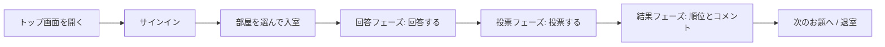
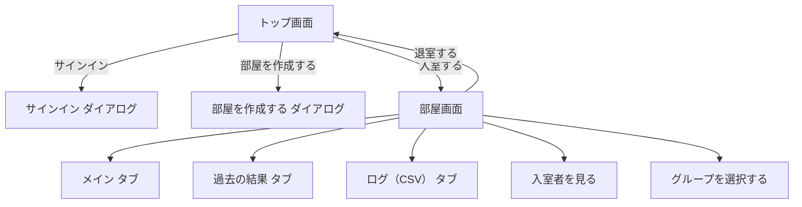
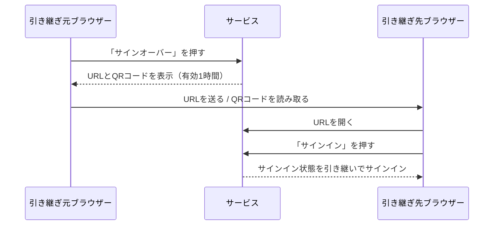
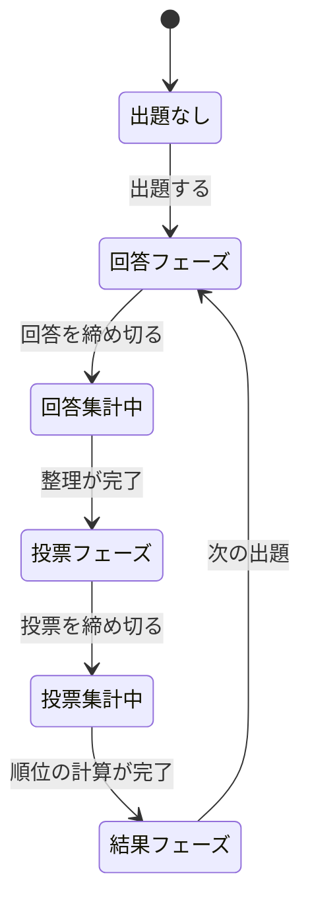
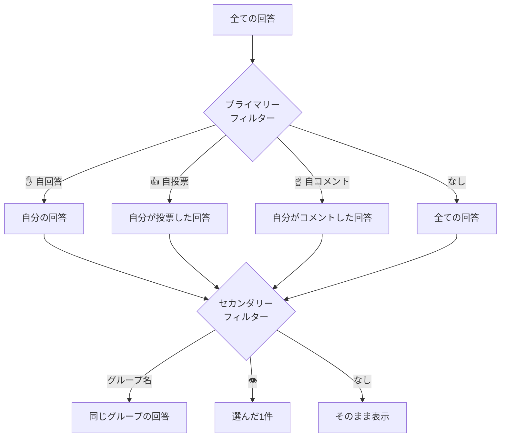
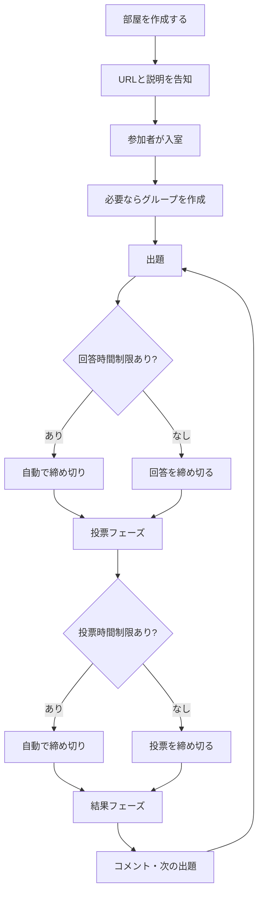
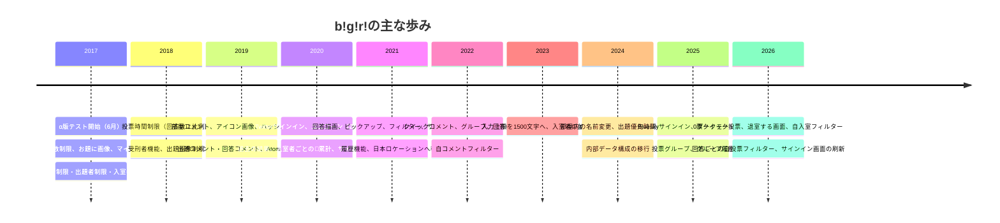

# bǃgǃrǃ ユーザーマニュアル

作成日：2026年10月6日
対象バージョン：1.138.5（2026年10月3日公開）
作成：Claude Sonnet 5.5（リリースノートと現行の画面構成をもとに生成）

本書は、大喜利サービス **bǃgǃrǃ（びぎり）** の使い方を、初めての参加者から部屋を運営する人までを対象にまとめたマニュアルです。2017年のα版から現在までのリリースノートを通読し、現在の画面の表記や動作と照らし合わせて、**現時点で有効な仕様**を中心に記述しています。すでに廃止された機能は、第22章にまとめました。

> **本書の読み方**
> - 画面上のボタンや項目名は「**太字**」または「」で表記します。
> - 絵文字やアイコンで表示される部分は、括弧書きで意味を併記します。
> - 部屋ごとに設定が異なるため、「ボタンが出ない」「押せない」ときは、まず第21章の確認事項を見てください。
> - 本書は AI が生成した文書です。画面の表示と本書が食い違う場合は、画面の表示が正しい情報です。

---

## 目次

1. [bǃgǃrǃとは](#1-bǃgǃrǃとは)
2. [基本用語](#2-基本用語)
3. [画面の全体像](#3-画面の全体像)
4. [サインイン・サインアウト・サインオーバー](#4-サインインサインアウトサインオーバー)
5. [名前・リンク・プロフィール画像](#5-名前リンクプロフィール画像)
6. [トップ画面](#6-トップ画面)
7. [入室と退室](#7-入室と退室)
8. [部屋画面の見方](#8-部屋画面の見方)
9. [大喜利の進み方（フェーズ）](#9-大喜利の進み方フェーズ)
10. [出題する](#10-出題する)
11. [回答する](#11-回答する)
12. [投票する](#12-投票する)
13. [結果フェーズと順位の見方](#13-結果フェーズと順位の見方)
14. [表示順とフィルター](#14-表示順とフィルター)
15. [コメントとリアクション](#15-コメントとリアクション)
16. [グループ](#16-グループ)
17. [入室者を見る](#17-入室者を見る)
18. [過去の結果とログ（CSV）](#18-過去の結果とログcsv)
19. [部屋を作成する](#19-部屋を作成する)
20. [部屋作成者の運営ガイド](#20-部屋作成者の運営ガイド)
21. [困ったときの確認事項](#21-困ったときの確認事項)
22. [廃止・変更された機能](#22-廃止変更された機能)
23. [操作・表示の早見表](#23-操作表示の早見表)
24. [更新の歴史](#24-更新の歴史)
25. [お問い合わせ・ライセンス](#25-お問い合わせライセンス)

---

## 1. bǃgǃrǃとは

bǃgǃrǃは、ウェブブラウザーだけで遊べる**大喜利の部屋サービス**です。ソフトのインストールは不要で、パソコン・タブレット・スマートフォンのブラウザーから利用できます。サブタイトルは「For Beautiful Oogiri Life」です。

### 1.1 できること

- お題（出題）を投稿する。お題には画像と出典を付けられます。
- お題に対して文字で回答する。手描きの線画を添えることもできます。
- 回答に票を入れて、順位を決める。
- 結果に対してコメントやリアクション（絵文字）を付ける。
- 回答時間・投票数・名前の公開方法・参加できる人などを、**部屋ごとに細かく設定**して運営する。
- 入室者をグループに分け、グループ別に遊ぶ。
- 過去の結果を見直し、ログをCSVファイルで保存する。

### 1.2 利用環境

- 最近のバージョンのウェブブラウザー（Chrome、Edge、Firefox、Safari など）を利用してください。対象とするブラウザーの条件は、サービスの更新に合わせて少しずつ引き上げられています（古いInternet Explorer、旧Edge、古いFirefox・Safari・Chromeは対象外です）。
- スマートフォンなど画面の狭い端末でも、同じ機能を使えるようにレイアウトが切り替わります。
- 画面が古いまま動かないときは、ブラウザーの再読み込み（リロード）を行ってください。

### 1.3 全体の流れ（最短ルート）

---

## 2. 基本用語

| 用語 | 意味 |
| --- | --- |
| 部屋 | 参加者と大喜利のルールをひとまとめにした場。部屋ごとに独立した設定を持ちます。 |
| 部屋作成者 | 部屋を作った人。締め切り操作、参加権限の管理、グループ作成、部屋コメントなどができます。 |
| 入室者 | 部屋に入っている参加者。 |
| 出題者 | お題を出せる人。 |
| 回答者 | お題に回答できる人。 |
| 投票者 | 回答に票を入れられる人。 |
| 受刑者 | 部屋作成者によって参加を禁止された入室者。強制的に退室になります。 |
| お題 / 出題 | 回答を募る問い。画像・出典を付けられます。 |
| 回答 | お題に対する答え。文字（最大1500文字）と、任意の手描き線画。 |
| 投票 | 回答に票を入れること。0票を入れる操作もできます。 |
| フェーズ | 進行段階。**回答フェーズ → 投票フェーズ → 結果フェーズ**の順に進みます。 |
| 出題優先時間 | 結果フェーズの直後、特定の人にだけ次の出題を譲る時間。 |
| グループ | 入室者をまとめる単位。部屋の中でのみ有効です。 |
| ユニコーン（🦄） | 高く評価された回答の回答者に付く、評価の目印。 |
| トークン／ディスクリミネーター | 入室者ごとに割り当てられる**8文字の識別文字列**。同じ名前の人を見分けるために使います。 |
| サインオーバー | サインイン状態を別のブラウザーへ引き継ぐ機能。 |
| ソーシャルサインイン | TwitterまたはBlueskyのアカウントによるサインイン。 |

### 2.1 アイコンの意味

画面には文字の代わりにアイコンで示されるボタンがあります。

| アイコン | 名称・働き |
| --- | --- |
| ✋（手のひら） | **自回答フィルター**。自分の回答だけを表示します。回答フェーズでは自分の回答数も併記されます。 |
| 👍（いいね） | **自投票フィルター**。自分が投票した回答だけを表示します。投票フェーズでは自分の投票数の合計が併記されます。 |
| ☝️（指さし） | **自コメントフィルター**。自分がコメントした回答だけを表示します（結果フェーズ・過去の結果）。コメントした数が併記されます。 |
| 👁（目） | **ピックアップ**。その回答だけを表示します。 |
| 🖖（バルカン挨拶） | 入室者を表します。部屋一覧では**自入室フィルター**、入室者を見る画面では入室者数の表示です。 |
| 🙂（スマイル） | **リアクション（クイックコメント）**の絵文字選択。 |
| ⊕（四角のプラス） | 長文の**残りを表示**する（隠れている文字数付き）。 |
| ⋯（三点） | 操作ボタン群の開閉（入室者を見る画面で、画面が狭いとき）。 |
| ◐ ☀ ☾ | カラースキーム（オート／ライト／ダーク）の切り替え。 |
| 🐦 / 🦋 | Twitter／Blueskyで部屋を投稿するリンク。 |

---

## 3. 画面の全体像

bǃgǃrǃの画面は、大きく**トップ画面**と**部屋画面**の二つに分かれます。ダイアログ（ポップアップの小窓）が重なって表示される操作も多くあります。

### 3.1 トップ画面

- 画面上部：サービス名ロゴ、サインイン関連のメニュー。サインイン後は自分の名前とプロフィール画像が表示されます。
- 「更新情報」と「使用方法」の案内。
- 「部屋一覧」と「部屋を作成する」ボタン。
- 部屋のカード一覧（表示順の切り替えと自入室フィルター付き）。

### 3.2 部屋画面

- **メニューバー**：サービスロゴ（トップへ戻る）、「メイン」「過去の結果」「ログ（CSV）」の三つのタブ、「サインオーバー」「退室する」、カラースキーム切り替え、自分の名前（押すと名前とリンクの変更）。
- 部屋名と説明、部屋の**設定一覧**（出題・回答・投票に関する三つの表）。
- 「グループを選択する」「入室者を見る」ボタン。
- 部屋作成者からの部屋コメント。
- 現在のお題と回答の一覧（メインタブ）。
- 画面最下部：部屋に設定されたアイコン画像と部屋名。

---

## 4. サインイン・サインアウト・サインオーバー

部屋に入る前に、まず**サインイン**が必要です。サインインしていない状態で部屋のURLを開くと、サインイン画面に移動し、サインイン後に元の部屋へ戻ります。

### 4.1 新規サインイン（通常のサインイン）

アカウント登録なしで使える、最も手軽な方法です。

1. トップ画面のメニューから「**サインイン**」を押します。
2. 「サインイン」ダイアログの「サインイン」欄にある「**新規サインイン**」ボタンを押します。
3. 「**名前を設定する**」ダイアログで名前を入力します。初期値は「**お客さん**」です。
4. 「**設定する**」を押します。必要に応じて、ロボットでないことの確認（reCAPTCHA）が表示されます。
5. 画面上部に自分の名前が表示されればサインイン完了です。

> **ポイント**
> - 名前は**最大20文字**です。超過や無効な文字があると、入力欄の下にエラーが表示されます。
> - 通常のサインインはブラウザーに紐づく状態です。**サインアウトすると、同じサインイン状態には戻れません**（サインオーバーやソーシャルサインインをしている場合を除く）。
> - 「新規サインイン」を押す方式は、2026年7月（1.137.0）に現在の形になりました。

### 4.2 ソーシャルサインイン

TwitterまたはBlueskyのアカウントでサインインできます。

| ボタン | 手順 |
| --- | --- |
| 「Twitterでサインイン」 | ボタンを押し、Twitterの認証画面の案内に従います。 |
| 「Blueskyでサインイン」 | 「ハンドル」欄にBlueskyのハンドル（例：`alice.bsky.social` のような形式、`@` は入力済み）を入力し、「サインイン」を押します。認証画面で許可します。 |

ソーシャルサインインをすると、次の利点があります。

- 入室者の名前に**プロフィールへのリンク**が付き、入室者を見る画面などでアイコンから相手のページへ移動できます（Twitter／X／Blueskyのアイコンで表示）。
- プロフィール画像が表示されます。
- 部屋によっては、**ソーシャルサインインした人だけ**が出題・回答・投票できる設定があります（第19章）。
- 未出題の部屋を、複数作成できます（第19章）。
- サインアウトしても、再度同じアカウントでサインインすれば同じ利用者に戻れます。

> **注意（Twitterサインイン）**
> Twitter側の仕様変更に合わせて、サインイン時の画面遷移を調整する措置が行われたことがあります（2026年4月にも実施）。この措置は予告なく終了する場合があります。画面に表示される案内に従って操作してください。なお、Blueskyのサインインは当初「当面は試験稼動」として始まった機能です。

### 4.3 サインオーバー（別ブラウザーへの引き継ぎ）

別のブラウザー（たとえばパソコンからスマートフォン）で、**今のサインイン状態をそのまま引き継ぐ**機能です。

1. 引き継ぎ元で、トップ画面または部屋画面のメニューから「**サインオーバー**」を押します。
2. 表示される**URL**または**QRコード**を、引き継ぎ先のブラウザーで開きます。URLは「**URLをコピーする**」ボタンでコピーできます。
3. 引き継ぎ先に「サインオーバー元からサインイン状態を引き継いでサインインします。」と表示されるので、「**サインイン**」を押します。

> **注意**
> - リンクの有効時間は**1時間以内**です。
> - URLを知っている人は誰でも引き継げてしまうため、**他人に見せたり共有したりしないでください**。
> - 通常のサインイン（新規サインイン）の利用者が端末を替えるときは、サインアウトする前に必ずサインオーバーを使います。

### 4.4 サインアウト

トップ画面のメニューから「**サインアウト**」を押し、ダイアログで再度「サインアウト」を押します。

> サインオーバーまたはソーシャルサインインをしていない場合、**このサインイン状態には二度と戻れません**。ダイアログにもその旨が表示されます。部屋の作成者などは特に注意してください。

---

## 5. 名前・リンク・プロフィール画像

### 5.1 名前の変更（トップ画面）

トップ画面のメニューに表示されている**自分の名前を押す**と、「**名前を変更する**」ダイアログが開きます。名前を入力して「**変更する**」を押します（最大20文字）。サインアウトせずに名前を変えられます。

ここで変えた名前は、サインイン全体の名前です。

### 5.2 部屋での名前とリンクの変更（部屋画面）

部屋画面のメニューバーに表示されている**自分の名前を押す**と、「**名前やリンクを変更する**」ダイアログが開きます。

- **名前**：**その部屋の中だけ**で使う名前を設定できます。空欄の場合は、サインイン時の名前が使われます（入力欄には現在の名前が薄く表示されます）。
- **リンク**：「無し」または「有り（URL）」を選べます。入室者を見る画面で、あなたの名前に付けるリンクのURLを自由に設定できます（自分のサイトやSNSのページなど）。

> 部屋内で名前を変えても、リンクの表示有無が自動で変わることはありません。リンクを出したくない場合は、「リンク」を「無し」にしてください。

### 5.3 名前にハッシュ値を付ける（トリップのような機能）

名前の末尾に「**#**」と任意の文字列を付けると、その文字列が**暗号学的ハッシュ（8文字）に変換**されて表示されます。

- `名前#文字列` → `名前#（8文字の英数字）`
- 同じ名前と同じ文字列からは、いつも同じハッシュ値になります。
- 文字列は本人にしか分からないため、同じ名前を他人に名乗られても、**本人かどうかを見分ける目印**になります。

> 注意：ハッシュの計算方法はサービスの更新で何度か変更されており、変更の際は表示されるハッシュ値も変わりました。

### 5.4 プロフィール画像

- ソーシャルサインインした人には、プロフィール画像が表示されます（名前の横、入室者を見る画面など）。
- 画像を読み込めない場合は、**代わりの標準画像**が表示されます。

---

## 6. トップ画面

### 6.1 部屋一覧

「**部屋一覧**」には、公開されている部屋がカードで並びます。各カードには次の情報が表示されます。

- 部屋名（その横に、Twitter／Blueskyで投稿・検索するためのリンク）
- 部屋の説明（本文中のURLは自動的にリンクになります）
- 部屋のアイコン画像（設定されている場合）
- 作成者、作成日時、入室制限（パスワードの有無）
- 出題・回答・投票に関する**設定の表**
- 更新日時
- **入室者の名前の一覧**（自分の名前は目立つ色で表示されます）
- 「**入室する**」ボタン（作成者には「**部屋を削除する**」ボタンも）

部屋が一つもない場合は「部屋はありません」と表示されます。

### 6.2 並べ替えと自入室フィルター

部屋一覧の上部に、二つの操作があります。

| 操作 | 内容 |
| --- | --- |
| 表示順のドロップダウン | 「**作成順**」（作成日時の新しい順）、「**更新順**」（更新日時の新しい順）から選びます。 |
| 🖖ボタン（自入室フィルター） | 押してオンにすると、**自分が入室している部屋だけ**を表示します。もう一度押すと全部屋の表示に戻ります。 |

### 6.3 更新情報と使用方法

画面上部の案内部分に次の二つがあります。

- **更新情報**：最近のリリースノートが新しい順に表示されます。「**全更新情報を見る**」ボタンで、過去の更新履歴すべてをダイアログで確認できます。
- **使用方法**：AIが生成した**ユーザーマニュアル（本書）**へのリンクと、質問や提案を受け付けるGitHub上のディスカッションへのリンクがあります。

そのほか、トップ画面には次の項目があります。

- **Atomフィード**のリンク：部屋の更新をフィードリーダーで購読できます（フィードには部屋作成者名も含まれます）。
- 連絡先：メール、BlueskyとTwitterのアカウント。
- ライセンス表記：各部屋の中に別段の注記がない作品は、**クリエイティブ・コモンズ 表示 4.0 国際（CC BY 4.0）** で提供されます。

### 6.4 部屋を作成する

「**部屋を作成する**」ボタンから新しい部屋を作れます。詳細は第19章を参照してください。ボタンが押せない（グレーになっている）のは、**まだ一度も出題していない自分の部屋がすでにある**ときです（通常のサインインの場合）。ソーシャルサインインしている場合は、未出題のまま複数の部屋を作成できます。

---

## 7. 入室と退室

### 7.1 入室する

1. 部屋一覧で参加したい部屋のカードを探し、説明と設定の表を読みます。
2. 「**入室する**」を押します（押すと、ボタンの上に実行中を示す回転マークが重なって表示されます）。
3. 部屋に**パスワード**（入室制限）が設定されているときは、「**部屋のパスワードを入力する**」ダイアログが開きます。主催者から案内されたパスワードを入力して「**入力する**」を押します。
4. 部屋にグループが作られている場合は、**グループを選択する**画面が表示されます（第16章）。

部屋のURLを直接開いて入室することもできます。URLは、カードの「入室する」ボタンにマウスを合わせると表示されます。

### 7.2 退室する

部屋画面のメニューバーの「**退室する**」を押すと、「退室する」ダイアログが開きます。部屋名が表示されるので、もう一度「**退室する**」を押すと退室してトップ画面に戻ります。

> 退室しても、すでに投稿した出題・回答・投票は残ります。退室した出題者・回答者・投票者も、入室者一覧には引き続き含まれます（文字が薄い色で表示されます）。

### 7.3 部屋の寿命

部屋は、**最後に更新されてから約11.5日間**で期限が来る仕組みです。長く使う部屋は、その間にお題を出すなどして更新してください。大切なやりとりは、後述のログ（CSV）で保存しておくと安心です。

---

## 8. 部屋画面の見方

### 8.1 部屋の設定一覧

部屋画面の右上には、その部屋の**設定を示す三つの表**があります。参加前に必ず確認してください。

**出題に関する表**

| 項目 | 表示される内容 |
| --- | --- |
| 出題優先時間 | 「無し」、または「有り ○秒（部屋作成者）」「有り ○秒（首位回答者）」 |
| 出題画像制限 | 「無し」または「有り（禁止）」 |
| 出題コメント制限 | 「無し」または「有り（部屋作成者）」 |
| 出題者制限 | 「無し」、または「有り」（許可された入室者名、またはソーシャルサインインのアイコン） |

**回答に関する表**

| 項目 | 表示される内容 |
| --- | --- |
| 回答表示 | 「即時」または「一斉」 |
| 回答時間制限 | 「無し」または「有り ○秒」 |
| 回答シャッフル時間 | 「無し」または「有り ○秒」（空欄設定は「∞秒」と表示） |
| 回答数制限 | 「無し」または「有り ○答」 |
| 回答者名表示 | 「表示」「一斉」「非表示」 |
| 回答コメント制限 | 「無し」または「有り（部屋作成者）」 |
| 回答者制限 | 「無し」または「有り」 |
| 回答描画制限 | 「無し」または「有り（禁止）」 |

**投票に関する表**

| 項目 | 表示される内容 |
| --- | --- |
| 投票表示 | 「即時」または「一斉」 |
| 投票時間制限 | 「無し」または「有り ○+△×秒」 |
| 投票数制限（出題毎） | 「無し」または「有り ○票」（超過可の場合は併記） |
| 投票数制限（回答毎） | 「無し」または「有り ○票」 |
| 投票者名表示 | 「表示」「一斉」「非表示」 |
| 投票者制限 | 「無し」または「有り」 |
| 投票グループ制限 | 「無し」「有り（自グループに投票）」「有り（次グループに投票）」 |

各項目の意味は第19章で詳しく説明します。

### 8.2 ボタン

- 「**グループを選択する**」：自分が入るグループを選びます。部屋作成者はここからグループを作成・削除します。
- 「**入室者を見る**」：入室者の一覧を表示します。部屋作成者はここで参加権限を管理します。

### 8.3 部屋コメント

部屋作成者は、部屋の上部に**部屋コメント**を表示できます（「コメントする」ボタン）。お知らせやルールの補足などに使えます。直近のコメントは「**コメントを削除する**」で**最新の1件だけ**削除できます。

### 8.4 タブ

| タブ | 内容 |
| --- | --- |
| メイン | 現在のお題と回答、投票、結果。大喜利を実際に進める画面です。 |
| 過去の結果 | 過去の出題の結果を見返せます（第18章）。 |
| ログ（CSV） | 出題・回答・投票の記録をCSVでダウンロードできます（第18章）。 |

タブを切り替えると、画面は**タブ共通部分の下（切り替わる部分の先頭）まで自動でスクロール**します。

### 8.5 カラースキーム

メニューバーの◐ボタンで、この部屋の画面の配色を切り替えられます。

| 選択肢 | 動作 |
| --- | --- |
| オート | ブラウザーやOSの設定（ライト／ダーク）に従います。 |
| ライト | 明るい配色。 |
| ダーク | 暗い配色。 |

> **この選択は保存されません。** 部屋を開き直すと、部屋の既定の配色に戻ります。部屋作成者が部屋設定で既定のカラースキームを「ライト」または「ダーク」に決めている場合があります。

---

## 9. 大喜利の進み方（フェーズ）

一つのお題は、次の三つのフェーズを順に進みます。部屋画面のメインタブには、現在のフェーズがタイトルで示されます。

| フェーズ | 画面のタイトル | できること |
| --- | --- | --- |
| 回答フェーズ | 「回答フェーズ」 | 回答する。部屋の設定によっては、他の人の回答が即時に見える。 |
| （集計中） | 回転マーク | 回答の締め切り後、投票用に整理している状態。 |
| 投票フェーズ | 「投票フェーズ」 | 回答に投票する。 |
| （集計中） | 回転マーク | 投票の締め切り後、得票と順位を計算している状態。 |
| 結果フェーズ | 「結果フェーズ」 | 順位・得票・投票者を見る。コメントとリアクションを付ける。次の出題ができる。 |

### 9.1 締め切り

- **回答の締め切り**：「**回答を締め切る**」ボタン（部屋作成者のみ）。部屋に回答時間制限があれば、タイマーが0になった時点で回答の受け付けが終わります。
- **投票の締め切り**：「**投票を締め切る**」ボタン（部屋作成者のみ）。投票時間制限があれば、タイマーが0になった時点で投票の受け付けが終わります。
- ボタンを押すとダイアログが開くので、「**締め切る**」を押して確定します。
- 時間制限があってもフェーズが進まないときは、部屋作成者が締め切りボタンを押してください。

### 9.2 タイマー

制限時間のある部屋では、フェーズのタイトルの横や、「回答する」「投票する」の各ボタン・ダイアログの中に、**残り時間を示すタイマー**が表示されます。時間切れが近づくと表示が変わります。

### 9.3 自動の処理

フェーズが進むとき、回答の整列・集計・順位の計算は自動で行われます。回転マークが出ている間は、しばらくそのままお待ちください。

---

## 10. 出題する

### 10.1 出題の権限

「**出題する**」ボタンは、次の条件を満たす入室者に表示されます。

- 部屋に**出題者制限**がない、または自分が**出題者として許可されている**（または、ソーシャルサインインが条件の部屋でその条件を満たしている）。
- 出題は、出題がまだないとき、または**結果フェーズ**のときにできます。回答フェーズ・投票フェーズの途中では次のお題は出せません。

出題優先時間が設定されている部屋では、結果フェーズの直後に**出題できる人が限られる**ことがあります（10.4）。そのときは「出題する」ボタンが押せない状態（グレー）になります。

### 10.2 出題の手順

1. 「**出題する**」ボタンを押します。
2. 「出題する」ダイアログで、次の項目を入力します。

| 項目 | 内容 |
| --- | --- |
| 出典 | お題の出典。**最大150文字**。URLを書くとリンクになります。 |
| 画像 | 「**画像有り**」ボタンで画像を選べます。「**画像無し**」で画像欄を閉じ、「**削除する**」で選んだ画像を取り消します。 |
| 出題 | お題の本文。**最大1500文字**。複数行を書けます。 |

3. 「**出題する**」ボタンを押して投稿します。

> **キーボード操作**：本文欄にいるとき、**Ctrl＋Enter**（macOSでは **Command（⌘）＋Enter**、Windowsでは **Windowsキー＋Enter** でも可）で投稿できます。Enterだけを押したときは改行になります。

### 10.3 画像と出典

- 画像は、読み込み時に**自動で縮小**されます。画像お題の本文の初期値は、画像のファイル名です。
- 画像の背景は**白**で表示されます（カラースキームがライトのときの背景と同じ色）。
- 部屋に出題画像制限（禁止）がある場合は、「画像有り」ボタンが表示されません。
- **著作物をお題に使うときは、必ず適切な出典を入力してください。** 現行の著作権制度に照らして使用が許される形になるよう配慮が必要です。違反があった場合、サイトの判断でアクセスの制限が行われる場合があります。

### 10.4 出題優先時間

前のお題の結果が出たあと、**次のお題を出す優先権**を設ける機能です。部屋作成者が部屋設定で次の三つから選びます。

| 設定 | 動作 |
| --- | --- |
| 無し | 結果フェーズになった時点から、出題できる人は誰でも出題できる。 |
| 有り（部屋作成者） | 指定した秒数のあいだは、**部屋作成者だけ**が出題できる。 |
| 有り（首位回答者） | 指定した秒数のあいだは、**前回の投票者のなかで最も順位の高い回答の回答者**だけが出題できる。投票しなかった回答者は優先の対象になりません。 |

- 優先時間の残りは、結果フェーズの「出題する」ボタンの横にタイマーで表示されます。優先されない人にはボタンがグレーで、タイマーが警告色になります。
- 「**有り（首位回答者）**」の部屋では、優先される該当の**回答の回答者名が明滅**して示されます。
- 部屋作成者は、優先時間の途中でも「**出題優先を締め切る**」ボタンを押して、**優先を打ち切る**ことができます。ダイアログで「締め切る」を押して確定します。

### 10.5 長いお題の表示

お題が長いとき、**10行目または150文字目**を越えた部分は折りたたまれ、位置に「⊕（隠れている文字数）」ボタンが表示されます。押すと残りが表示され、もう一度押すと折りたためます。

---

## 11. 回答する

### 11.1 回答の権限

「**回答する**」ボタンは、**回答フェーズ**に、回答者として許可されている入室者に表示されます。

- 回答者制限がない、または自分が回答者として許可されている（またはソーシャルサインインが条件の部屋でその条件を満たしている）ことが条件です。
- 部屋に**回答数制限**がある場合、すでにその数だけ回答しているとボタンが押せなくなります。
- 回答時間制限がある場合は、**お題が出された時刻から**時間が数えられ、タイマーが表示されます。

### 11.2 回答の手順

1. 「**回答する**」ボタンを押します。ダイアログの上部にお題が表示されます。
2. 「**回答**」欄に回答を入力します（**最大1500文字**）。
3. 「**回答する**」ボタンで投稿します。**Ctrl＋Enter**（macOSでは**Command＋Enter**）でも投稿できます。

回答の直前に**削除した回答**があるときは、その内容が回答欄の初期値として入ります。うっかり削除したときも、すぐに再投稿できます。

### 11.3 手描きの線画を添える（回答描画）

回答には、手描きの線画を付けられます。

1. 「**描画有り**」ボタンを押すと、描画用のキャンバスが現れます。「**描画無し**」で閉じます。
2. マウスやタッチ（指・ペン）でキャンバスをなぞって描きます。
3. キャンバスの下の**元に戻す**・**やり直す**ボタンで、直前の線を取り消したり戻したりできます。ボタンの間の数字は、描いた線の要素数です。
4. 描画だけで文字を入力しないことも可能で、その場合は、文字欄に筆の絵文字の目印が表示されます。

> 描画の要素数には上限があります（約1500要素まで）。部屋の**回答描画制限**が「有り（禁止）」のときは、描画ボタンは表示されません。線の色は、ライト／ダークの配色に合わせて変わります。

### 11.4 回答の表示方式（即時・一斉）

部屋の**回答表示**の設定によって、他人の回答がいつ見えるかが変わります。

| 設定 | 動作 |
| --- | --- |
| 即時 | 回答が投稿されるとすぐに、全員の画面に表示される。 |
| 一斉（投票フェーズまで非表示） | 投票フェーズになるまで、**他人の回答は見えない**。自分の回答だけが見える。 |

一斉表示の部屋では、回答の締め切り前に限り、自分の回答カードに次のボタンが表示されます。

- 「**回答を変更する**」：内容を書き換えます。**回答した時刻も更新**されます。
- 「**回答を削除する**」：回答を取り下げます。確認のダイアログが開きます。

### 11.5 回答者名の表示

部屋の**回答者名表示**の設定で、回答者の名前の見え方が変わります。

| 設定 | 動作 |
| --- | --- |
| 表示 | 回答者名が常に表示される。 |
| 非表示 | 回答者名は表示されない。 |
| 一斉（結果フェーズまで非表示） | 結果フェーズになるまで回答者名を伏せ、結果フェーズで一斉に公開する。 |

どの設定でも、**自分の回答の回答者名は、自分にだけ常に表示**されます。

### 11.6 回答シャッフル時間

部屋の**回答シャッフル時間**が設定されている場合、お題が出されてから指定した秒数のあいだに投稿された回答は、**投票フェーズで入室者ごとにランダムな順番**で表示されます。早い者勝ちの並びによる有利・不利を減らすための設定です。

- 秒数を**空欄**にして「有り」にした場合は、**すべての回答**がシャッフルの対象です。
- シャッフルは投票フェーズの見た目の順番だけの話で、**結果フェーズでの順位の計算には影響しません**。

### 11.7 回答の件数表示

回答の一覧の最後に、✋アイコンと**回答の件数**が表示されます。投票グループ制限のある部屋では、「**自分に表示されている回答数／全体の回答数**」の形になります。

### 11.8 長い回答の表示

回答が長いときは、お題と同様に**10行目または150文字目**を越えた部分が折りたたまれ、「⊕（隠れている文字数）」ボタンで残りを表示できます。

---

## 12. 投票する

### 12.1 投票の権限

「**投票する**」ボタンは、**投票者として許可されている**入室者に、回答カードの上に表示されます。

- **自分の回答には投票できません**（他人の回答だけが対象です）。
- 投票の受け付けは、投票フェーズが中心です（回答が即時表示かつ投票表示も即時の部屋では、回答が投稿された時点から投票できます）。
- **投票表示が一斉**の部屋では、投票フェーズになってから投票できます。

### 12.2 投票の手順

1. 投票したい回答の「**投票する**」ボタンを押します。
2. 「投票する」ダイアログに、回答が表示されます。右側の**＋**ボタンで票を増やし、**－**ボタンで減らします。数字が投票数です。
3. 「**投票する**」ボタンで確定します。

> **キーボード操作**：ダイアログを開いた直後は、票数の部分にカーソルが合った状態です。このとき、**スペースキー**で1票増やし、**Deleteキー**で1票減らし、**Enterキー**で投票を確定できます。マウスを使わずに、素早く投票できます。

### 12.3 0票クイック投票

「投票する」ボタンの横にある「**👍0**」ボタンを押すと、**ダイアログを開かずに0票を投票**できます。「読んだ」「この回答には入れない」という意思表示に使えます。

### 12.4 投票の変更と削除

投票済みの回答には、次のボタンが現れます。

- 「**投票を変更する**」：票数を変えます。**いったん削除しなくても、票数を減らせます。**
- 「**投票を削除する**」：投票を取り消します。

### 12.5 投票数の制限

部屋の設定により、使える票数に上限があります。

| 設定 | 意味 |
| --- | --- |
| 投票数制限（出題毎） | 一つのお題のなかで使える**票の合計**の上限。 |
| 投票数制限（出題毎）の「有り（超過可）」 | 上限に達すると「投票する」が「投票を見る」に変わるが、**投票ダイアログの中では上限を超えて**票を増やせる。 |
| 投票数制限（回答毎） | **一つの回答に入れられる票数**の上限。 |

### 12.6 投票を見る

自分の投票を一覧にして確認する画面です。

- **投票フェーズ**では、回答の一覧の上部にある「**投票を見る**」ボタンから開けます（自分が一度でも投票していると押せます）。
- 投票数を使い切ると、回答カードの「投票する」が「**投票を見る**」ボタンに変わります。**ここから、不要な投票を探して削除**し、票を空けられます。
- 画面の下部には、**自分の投票数の合計**が表示されます。投票数制限（出題毎）がある場合は「**合計／上限**」の形です。
- 画面にはお題も表示されるので、お題を思い出しながら見直せます。

### 12.7 投票時間制限

部屋に投票時間制限があるときは、各回答カードの横や、投票ダイアログの中に残り時間のタイマーが表示されます。この制限時間は、次の式で決まります。

$$
T = a + b \times n
$$

- $T$：投票に使える時間（秒）
- $a$：「出題毎」の秒数
- $b$：「回答毎」の秒数
- $n$：回答の数

たとえば、$a = 60$、$b = 5$、回答が $n = 12$ 件なら、$T = 60 + 5 \times 12 = 120$ 秒です。

> **投票グループ制限がある部屋では**、$n$ に全体の回答数ではなく、**表示された回答数が最も多いグループの回答数**が使われます。

投票の時間の数え始めは、部屋の設定によって違います。

- 回答表示も投票表示も**即時**の部屋：**各回答が投稿された時刻から**。
- それ以外の部屋：**投票フェーズが始まった時刻から**。

### 12.8 投票者名の表示

部屋の**投票者名表示**の設定は、回答者名表示と同じ考え方です。

| 設定 | 動作 |
| --- | --- |
| 表示 | 誰がどの回答に入れたかが分かる。 |
| 非表示 | 投票者名は表示されない。 |
| 一斉（結果フェーズまで非表示） | 結果フェーズで一斉に公開する。 |

自分の投票は、自分にだけ常に表示されます。

### 12.9 投票グループ制限

グループのある部屋（第16章）では、投票フェーズに**表示される回答を、グループで絞る**設定があります。

| 設定 | 投票フェーズで見える回答 |
| --- | --- |
| 無し | すべての回答 |
| 有り（自グループに投票） | **自分と同じグループ**の回答だけ |
| 有り（次グループに投票） | 自分のグループの**直後に作られたグループ**の回答だけ。自分のグループが最後に作られたものなら、**最初に作られたグループ**の回答だけ |

グループを選んでいない入室者には、「グループを選んでいない回答」だけが表示されます。グループを一つも作らなければ、この設定は「無し」と同じ動作になります。

### 12.10 投票の並び順

一つの回答に付いた投票は、**票数の多い順**に表示されます。票数が同じ投票は、投票した順です。

---

## 13. 結果フェーズと順位の見方

投票が締め切られると、結果フェーズに進みます。順位、得票、投票者、コメントなどが表示されます。

### 13.1 順位の決まり方

回答の順位は、基本的に**得票数の多い順**です。得票数が同じ回答の間には、次の順で優劣が付きます。

1. **その回答の回答者が行った投票の数が多い**ほうが上位。
2. それも同じなら、**回答が早い**ほうが上位。

> 投票しなかった回答者は、投票した回答者に比べて、同票のときに不利になります。回答するだけでなく、**他の人の回答にも投票する**ことが公平なマナーです。

### 13.2 評価の目印（Zスコア）

各回答の得票は、参加者全体のばらつきと比べた**相対的な位置（Zスコア）**で評価されます。得票数に、回答者の投票数による補正を加えた値 $x$ を使って、次のように計算します。

$$
z = \frac{x - \mu}{\sigma}
$$

- $\mu$：その出題のすべての回答の補正得票数の平均
- $\sigma$：その標準偏差

Zスコアに応じて、順位の表示は次のように変わります。

| Zスコア | 順位の表示 |
| --- | --- |
| $z \ge 1$ | 順位に**下線**が付く |
| $z \ge 2$ | 順位とともに**ユニコーン🦄**が付く。$z$ が1上がるごとに🦄が1つ増える（$z \ge 3$ で2つ、…） |
| $z \le -1$ | 順位に**上線**が付く |
| $z \le -2$ | 順位とともに**アイスクリーム🍦**が付く。$z$ が1下がるごとに🍦が1つ増える |

- 順位の部分（「1位」など）を**押すと、Zスコアの数値が小数点以下4桁で表示**されます。もう一度押すと元に戻ります。
- 獲得した🦄の累計は、メニューバーの自分の名前の横と、入室者を見る画面に表示されます（部屋ごとの累計です）。

### 13.2.1 ユニコーンの数え方

ユニコーンの累計は、その部屋で獲得した評価の合計です。回答者の投票数による補正が反映されています。

### 13.3 投票者と得票

- 回答カードの右側に、**得票数**（👍アイコンと数字）が表示されます。この**得票数を押す**と、自分の投票だけを表示するフィルターがオンになります（第14章）。
- 回答カードの下に、投票者の名前の小さなラベルが並びます。票が2票以上のときは、票数が添えられます。投票者名表示の設定によっては、名前が伏せられます。
- 名前を**押すと、その人の8文字のトークン（識別文字列）**に表示が切り替わり、もう一度押すと名前に戻ります。同じ名前の人が複数いるときの見分けに役立ちます。

### 13.4 グループ名

回答者がグループに入っているとき、回答の見出し部分に**グループ名**が表示されます。グループ名を押すと、そのグループの回答だけを表示するグループフィルターになります（第16章）。

### 13.5 次の出題へ

結果フェーズでは、権限のある人が「**出題する**」で次のお題を出せます（出題優先時間の設定に注意）。出題すると、すぐに新しい回答フェーズが始まります。前のお題は「過去の結果」タブで見返せます。

---

## 14. 表示順とフィルター

回答が多くなっても目的の回答を探しやすいよう、**表示順の切り替え**と**フィルター**があります。表示順の選択やフィルターの選択は**自分の画面だけ**に影響します。

### 14.1 回答の表示順

回答の一覧の上部のドロップダウンで、並べ方を選べます。

| 表示順 | 内容 | 使えるフェーズ |
| --- | --- | --- |
| 設定順 | 部屋設定による既定の並び | すべて |
| 先着順 | 回答が早い順 | すべて |
| 後着順 | 回答が遅い順 | すべて |
| 上位順 | 順位（得票）が高い順 | すべて |
| 下位順 | 順位（得票）が低い順 | すべて |
| 多コ順 | **コメントの多い**順 | 結果フェーズ、過去の結果 |
| 少コ順 | **コメントの少ない**順 | 結果フェーズ、過去の結果 |

### 14.2 フィルターの種類

フィルターは**プライマリーフィルター**と**セカンダリーフィルター**の二段構えです。

| 種類 | 名称 | アイコン | 動作 |
| --- | --- | --- | --- |
| プライマリー | 自回答フィルター | ✋ | 自分の回答だけを表示する。 |
| プライマリー | 自投票フィルター | 👍 | 自分が投票した回答だけを表示する。 |
| プライマリー | 自コメントフィルター | ☝️ | 自分がコメントした回答だけを表示する。 |
| セカンダリー | グループフィルター | グループ名 | 同じグループの回答だけを表示する。 |
| セカンダリー | 回答ピックアップ | 👁 | 選んだ回答だけを表示する。 |

- プライマリーフィルターは、**同時に一つだけ**オンにできます。別のプライマリーフィルターを押すと切り替わり、押し直すとオフになります。
- プライマリーフィルターを切り替えると、セカンダリーフィルターは解除されます。
- セカンダリーフィルターは、プライマリーフィルターで絞った結果に**重ねて**使えます。
- フィルターのボタンは、オンのとき塗りつぶしのアイコンで、オフのとき線のアイコンで表示されます。画面を下にスクロールしても、フィルターのボタンは上部に表示され続けます。

### 14.3 各画面でのフィルター

| 画面 | 使えるフィルター |
| --- | --- |
| 回答フェーズ | ✋（自分の回答数を併記） |
| 投票フェーズ | ✋、👍（自分の投票数の合計を併記）。回答一覧の上部には、自分の投票を一覧にする「投票を見る」ボタンもあります。 |
| 結果フェーズ | ✋、👍、☝️（コメント数を併記）、グループ、👁 |
| 過去の結果 | ✋、👍、☝️、グループ、👁 |

回答カードの得票数（👍と数字）を押しても、自投票フィルターのオン／オフができます。

### 14.4 トップ画面の自入室フィルター

トップ画面の部屋一覧にも、**🖖ボタン**があり、自分が入室している部屋だけに絞り込めます（第6章）。

---

## 15. コメントとリアクション

bǃgǃrǃには、三つの種類のコメントがあります。

| 種類 | 投稿できる人 | 場所 | 削除 |
| --- | --- | --- | --- |
| 部屋コメント | 部屋作成者 | 部屋の上部 | 部屋作成者が**最新の1件**を削除できる |
| 出題コメント | 結果フェーズの入室者（部屋の設定で部屋作成者のみに制限できる） | お題の付近 | 削除できない |
| 回答コメント | 結果フェーズの入室者（部屋の設定で部屋作成者のみに制限できる） | 各回答の下 | 削除できない |

### 15.1 コメントする

1. 結果フェーズで、お題または回答の「**コメントする**」ボタンを押します。
2. 「コメントする」ダイアログの「**コメント**」欄に入力します。**最大150文字**です。空のコメントも許されます。
3. 「**コメントする**」ボタンで確定します。

コメント内のURLは、自動的にリンクになります。コメントは、投稿者名の横に☝️アイコンを付けた小さなラベルで表示されます。名前を押すと、トークンに切り替わります。

### 15.2 リアクション（クイックコメント）

文字を入力せずに、**絵文字を一つ選ぶだけでコメントする**機能です。

1. お題または回答の「コメントする」ボタンの横にある、**🙂ボタン**を押します。
2. ドロップダウンの絵文字から一つを選びます。現在は次の**9種類**です。

| 😂 | 🤣 | 🥰 | 🥹 | 😭 | 😳 | 🤔 | 😡 | 🫡 |
| --- | --- | --- | --- | --- | --- | --- | --- | --- |

選ぶと、その絵文字がそのままコメントとして投稿されます。絵文字のラインナップは、これまで何度か入れ替えられています。

### 15.3 コメントの制限

部屋設定の**出題コメント制限**・**回答コメント制限**を「有り（部屋作成者）」にすると、その種類のコメントとリアクションは、**部屋作成者だけ**が投稿できます。制限されている場合、他の人には「コメントする」ボタンが表示されません。

---

## 16. グループ

**グループ**は、入室者をいくつかのまとまりに分ける機能です。チーム戦、クラス分け、リーグ戦のような運営に使えます。グループは、**作成した部屋の中でだけ**有効です。

### 16.1 グループを選ぶ

部屋画面の「**グループを選択する**」ボタンを押すと、グループの一覧が表示されます。

- 各グループには、**グループ名**、**説明**、**入っている入室者の名前**が表示されます。名前を押すと、トークンに切り替わります。
- 入りたいグループの**ラジオボタン**（選択欄）を選ぶと、すぐにそのグループに入れます。回転マークが消えれば完了です。
- 自分が所属しているグループ名は、メニューバーの自分の名前の隣に「@グループ名」の形で表示されます。
- グループがないときは「グループはありません」と表示されます。

### 16.2 入室時のグループ選択

- グループが追加されたとき、**まだグループに入っていない入室者**には、「グループを選択する」画面が自動で表示されます。
- グループが作られたあとに入室した人にも、入室時にこの画面が表示されます。
- 選んでいたグループが**削除された**入室者にも、この画面が表示されます。

### 16.3 グループを作成・削除する（部屋作成者）

**作成**

1. 「グループを選択する」画面の「**グループを作成する**」ボタンを押します。
2. 「グループを作成する」ダイアログで、次を入力します。
   - **グループ名**：**最大20文字**。名前の**重複や空の名前も許されます**。
   - **説明**：**最大1500文字**。
3. 「**グループを作成する**」で確定します。

**履歴**

- グループ名の横の「**履歴を見る**」ボタンで、**同じブラウザーで作成したことのあるグループ**の一覧が表示されます。
- 「**履歴を読み込む**」で、その設定（名前と説明）を入力欄に読み込みます。「**履歴を削除する**」で、履歴から消します。
- 同じ名前でグループを作ると、履歴には**最新の設定だけ**が残ります。

**削除**

各グループの「**グループを削除する**」ボタンから、ダイアログで確定して削除します。

### 16.4 グループが使われる場面

- 結果フェーズと過去の結果で、回答の見出しにグループ名が表示され、**グループフィルター**で絞り込めます。
- 部屋の**投票グループ制限**で、投票フェーズに見える回答がグループで決まります（12.9）。
- ログ（CSV）にも、回答者名の前にグループ名が付き、また**9番目のカラム**にグループ名が出力されます。

---

## 17. 入室者を見る

部屋画面の「**入室者を見る**」ボタンで、入室者の一覧が表示されます。

### 17.1 一覧の見方

各入室者のカードには、次の情報が表示されます。

- 名前（自分の名前は目立つ色）
- ソーシャルサインインの人は、アイコンから**プロフィールへのリンク**（部屋内で設定したリンクがあればそのURL）
- プロフィール画像
- その部屋で獲得した**ユニコーン🦄**の累計
- 8文字の**トークン**（ディスクリミネーター）
- 退室した入室者は**文字が薄い色**で表示されます。
- **受刑者**（参加を禁止された人）は**取り消し線**付きで表示されます。

一覧の下部に、🖖アイコンで**入室者数**が表示されます。

### 17.2 並べ替え

一覧の上部のドロップダウンで、並べ方を選べます。

| 表示順 | 内容 |
| --- | --- |
| 先入順 | 入室日時の古い順 |
| 後入順 | 入室日時の新しい順 |
| 多🦄順 | ユニコーンの多い順 |
| 少🦄順 | ユニコーンの少ない順 |
| 昇名順 | 名前の文字コード順（昇順） |
| 降名順 | 名前の文字コード順（降順） |
| 昇Di順 | ディスクリミネーターの文字コード順（昇順） |
| 降Di順 | ディスクリミネーターの文字コード順（降順） |
| 古サ順 | **サインイン日時が古い**順 |
| 新サ順 | **サインイン日時が新しい**順 |

### 17.3 参加権限の管理（部屋作成者）

部屋作成者には、各入室者のカードに操作ボタンが表示されます。

| ボタン | 動作 |
| --- | --- |
| 出題者へ追加する／出題者から削除する | その人を**出題者**にする／外す |
| 回答者へ追加する／回答者から削除する | その人を**回答者**にする／外す |
| 投票者へ追加する／投票者から削除する | その人を**投票者**にする／外す |
| 受刑者へ追加する／受刑者から削除する | その人を**受刑者**にする／外す（自分自身は追加できません） |

- 画面の狭い端末では、操作ボタン群は「**⋯**」ボタンで開閉します。
- 出題者・回答者・投票者を**誰にも設定しない状態**に戻すと、その役割は**無制限**に戻ります。
- 部屋作成画面の「出題者制限（初期値）」などの設定は、その項目をこの画面で一度でも設定すると、**この画面の設定が優先**されます。
- **受刑者に追加された入室者は強制的に退室**となります。
- 不正なアクセスで出題・回答・投票・コメントを行おうとした入室者は、**自動的に受刑者に追加**されます。また、受刑者を追加したときは、**同じ発信元**から出題・回答・投票・コメントする入室者も、あわせて追加されます。

---

## 18. 過去の結果とログ（CSV）

### 18.1 過去の結果

メニューバーの「**過去の結果**」タブで、過去の出題を**回数（第○回）**ごとに見返せます。

- 画面の上部に**ページ送り**があり、前後の出題へ移動します。
- 結果フェーズと同様に、順位、得票、投票者、コメントを見られます。
- 表示順（多コ順・少コ順を含む）と、すべてのフィルター（✋ 👍 ☝️、グループ、👁）を使えます。
- 表示できるのは、**34.5日以内の出題**です。

### 18.2 ログ（CSV）

メニューバーの「**ログ（CSV）**」タブで、出題・回答・投票の記録を**CSVファイル**として保存できます。

1. 「ログ（CSV）」タブを開きます。
2. 「ログ（CSV）は以下のURLでダウンロードしてください。」の下に、ダウンロード用のURLが表示されます。
3. **そのURLを選ぶ（クリックする）**と、ダウンロードが始まります。サーバーが処理しているあいだは、回転マークが表示されます。

**ディスクリミネーター付き**のスイッチをオンにすると、名前に加えて、入室者の**ディスクリミネーター**が名前の次の行に書き込まれたCSVを取得できます。同姓同名の人を区別したいときに使います。

> **注意**
> - ダウンロードできるのは、**入室している人だけ**です。
> - 対象は、**34.5日以内の出題**です。
> - 部屋は一定期間で期限が来ます（7.3）。必要な記録は、早めに保存してください。
> - グループのある部屋では、回答者名の前にグループ名と改行が付き、9番目のカラムにグループ名が入ります。

---

## 19. 部屋を作成する

トップ画面の「**部屋を作成する**」ボタンで、新しい部屋を作ります。ここでの設定が、その部屋のルールになります。

### 19.1 作成の手順

1. トップ画面で「**部屋を作成する**」を押します。
2. 次の各項目を入力・選択します。
3. 「**部屋を作成する**」ボタンを押して確定します。

入力欄の初期値は、**あなたの直近の設定値**になっています。そのため、似た部屋を続けて作るときは、変えたい項目だけを直せば済みます。

### 19.2 履歴機能

「部屋名」欄の横の「**履歴を見る**」ボタンで、**同じブラウザーで過去に作成した部屋**の設定を呼び出せます。

- 一覧には部屋名と**作成日時**が表示されます。
- 「**履歴を読み込む**」で、その部屋の設定を入力欄に反映します。「**履歴を削除する**」で履歴から消します。
- 同じ部屋名で部屋を作ると、履歴には**最新の設定だけ**が残ります。
- 履歴がないときは、ボタンは押せません。

### 19.3 基本項目

| 項目 | 内容 |
| --- | --- |
| 部屋名 | **最大150文字**。部屋名は、ハッシュタグや検索リンクにも使われます。 |
| 説明 | **最大1500文字**。本文中のURLは自動でリンクになります。 |
| アイコン画像 | 部屋画面の右下に**常に表示される画像**。自動で縮小されます。容量の上限を超える、または無効な画像はエラーになります。「削除する」で取り消せます。 |
| カラースキーム | 部屋の**既定の配色**。「無し」「ライト」「ダーク」から選びます（参加者は部屋画面で個別に切り替え可能）。 |
| 入室制限 | 「無し」または「有り（パスワード）」。パスワードは**最大15文字**です。 |

### 19.4 出題に関する設定

| 項目 | 選択肢と意味 |
| --- | --- |
| 出題優先時間 | 「無し」／「有り（部屋作成者）（秒）」／「有り（首位回答者）（秒）」。詳しくは10.4。 |
| 出題者制限（初期値） | 「無し」／「有り」／「有り（ソーシャルサインイン）」。「有り」は、許可した人だけが出題できる（許可は入室者を見る画面で行う）。ソーシャルサインインは、ソーシャルサインインした人だけが出題できる。 |
| 出題画像制限 | 「無し」／「有り（禁止）」。 |
| 出題コメント制限 | 「無し」／「有り（部屋作成者）」。 |

### 19.5 回答に関する設定

| 項目 | 選択肢と意味 |
| --- | --- |
| 回答表示 | 「即時」／「一斉（投票フェーズまで非表示）」。 |
| 回答時間制限 | 「無し」／「有り（秒）」。お題が出てから、この秒数で自動締め切り。 |
| 回答シャッフル時間 | 「無し」／「有り（秒）」。空欄だと全回答がシャッフル対象（11.6）。 |
| 回答数制限 | 「無し」／「有り（答）」。一人が一つのお題に投稿できる回答数。 |
| 回答者名表示 | 「表示」／「非表示」／「一斉（結果フェーズまで非表示）」。 |
| 回答者制限（初期値） | 「無し」／「有り」／「有り（ソーシャルサインイン）」。 |
| 回答コメント制限 | 「無し」／「有り（部屋作成者）」。 |
| 回答描画制限 | 「無し」／「有り（禁止）」。 |

### 19.6 投票に関する設定

| 項目 | 選択肢と意味 |
| --- | --- |
| 投票表示 | 「即時」／「一斉（結果フェーズまで非表示）」。 |
| 投票時間制限 | 「無し」／「有り（出題毎＋回答毎×）（秒）」。12.7の式 $T = a + b \times n$ の $a$ と $b$ を入力する。 |
| 投票数制限（出題毎） | 「無し」／「有り（票）」／「有り（超過可）（票）」。 |
| 投票数制限（回答毎） | 「無し」／「有り（票）」。 |
| 投票者名表示 | 「表示」／「非表示」／「一斉（結果フェーズまで非表示）」。 |
| 投票者制限（初期値） | 「無し」／「有り」／「有り（ソーシャルサインイン）」。 |
| 投票グループ制限 | 「無し」／「有り（自グループに投票）」／「有り（次グループに投票）」。12.9を参照。 |

### 19.7 入力のルール

- 秒数や票数の欄には、半角の数字を入れます。長すぎる、または無効な値には、欄の下にエラーが表示されます。
- 「有り」を選ぶと、その項目の数値欄に入力できるようになります。
- 設定は、**部屋を作成したあとは変えられません**（参加権限とグループは除く）。作成前に、設定をよく見直してください。

### 19.8 作成できる部屋の数

通常のサインインでは、**まだ一度も出題していない自分の部屋**が1つあると、新しい部屋は作れません。ソーシャルサインインしている場合は、未出題のまま複数の部屋を作成できます。

### 19.9 部屋を削除する

部屋作成者は、トップ画面の部屋カードの「**部屋を削除する**」ボタンから、部屋を削除できます。部屋名の確認ダイアログが開き、「**削除する**」で確定します。削除した部屋は元に戻せません。

### 19.10 設定の組み合わせ例

| 目的 | おすすめの設定 |
| --- | --- |
| 気軽な雑談部屋 | 回答表示・投票表示とも「即時」、制限はすべて「無し」。 |
| 公平な勝負 | 回答表示と回答者名表示を「一斉」にして、先入観を減らす。回答シャッフル時間を設定。 |
| 時間を決めた対戦 | 回答時間制限と投票時間制限を設定。投票数制限（出題毎）で票を絞る。 |
| チーム戦 | グループを作り、投票グループ制限を「有り（自グループに投票）」か「次グループに投票」に。 |
| 連続出題の盛り上がり | 出題優先時間を「有り（首位回答者）」に設定。勝者が次のお題を出す流れに。 |
| 参加者を絞った部屋 | 入室制限（パスワード）と、各役割の制限（「有り」）を併用。 |

---

## 20. 部屋作成者の運営ガイド

部屋作成者は、部屋を円滑に進める役割を持ちます。

### 20.1 部屋作成者だけができること

| 操作 | 場所 |
| --- | --- |
| 回答の締め切り | 回答フェーズの「回答を締め切る」 |
| 投票の締め切り | 投票フェーズの「投票を締め切る」 |
| 出題優先の締め切り | 結果フェーズの「出題優先を締め切る」 |
| 出題者・回答者・投票者・受刑者の管理 | 入室者を見る画面 |
| グループの作成・削除 | グループを選択する画面 |
| 部屋コメントの投稿・最新1件の削除 | 部屋画面の上部 |
| 部屋の削除 | トップ画面の部屋カード |

### 20.2 運営の流れ

### 20.3 運営のコツ

- **開始前に告知する**：部屋の説明に、ルールと開始日時を書きます。説明の1行目は、SNSで部屋を投稿するときの本文にも使われます（Twitter／Bluesky投稿リンク）。
- **回答を締め切る前に声をかける**：部屋コメントで「あと○分で締め切ります」と案内すると親切です。
- **荒らしへの対処**：入室者を見る画面から、問題のある人を受刑者に追加します。
- **権限の絞り込み**：参加者を限定した大会では、回答者・投票者を許可制にします。
- **記録を残す**：終了後は、ログ（CSV）を保存しておきます。

---

## 21. 困ったときの確認事項

### 21.1 ボタンが出ない・押せない

| 症状 | 確認すること |
| --- | --- |
| 「出題する」が出ない | 出題者として許可されているか。部屋が出題者制限（ソーシャルサインインが必要など）になっていないか。 |
| 「出題する」が押せない | 出題優先時間中ではないか（優先される人以外は押せません）。残り時間のタイマーを確認。 |
| 「回答する」が出ない／押せない | 回答フェーズか。回答者として許可されているか。回答数制限に達していないか。 |
| 「投票する」が出ない | 投票フェーズか。投票者として許可されているか。自分の回答ではないか。 |
| 「投票する」が「投票を見る」に変わった | 投票数制限（出題毎）に達しています。「投票を見る」から不要な投票を削除してください。 |
| 「コメントする」が出ない | 結果フェーズか。部屋のコメント制限が「有り（部屋作成者）」ではないか。 |
| 「部屋を作成する」が押せない | 通常のサインインで、未出題の自分の部屋がすでにないか。 |
| 他の人の回答が見えない | 回答表示が「一斉」の部屋では、投票フェーズまで見えません。 |
| 投票できる回答が少ない | 投票グループ制限で、見える回答が限られていないか。 |

### 21.2 表示が古い・動かない

- ブラウザーを**再読み込み（リロード）**してください。大きな内部変更の際には、リロードが必須になる旨が更新情報で案内されます。
- Safariで通信の遅れが出る場合があります（一部のバージョンで、データ取得が不定期に遅れる事象への対処が入っています）。ブラウザーを最新にしてお試しください。
- 回転マークが長く続くときは、ネットワークの状態を確認し、再読み込みしてください。

### 21.3 サインインできない

- 通常のサインインで、reCAPTCHAが表示された場合は、確認を完了してください。
- Twitterサインインは、Twitter側の仕様変更の影響で画面遷移が変わることがあります。うまくいかないときは、画面の案内に従うか、Blueskyや新規サインインを使ってください。
- サインアウトしてしまい元の状態に戻れないときは、残念ながら元の利用者としては戻れません（サインオーバーやソーシャルサインインをしていた場合を除く）。

### 21.4 よくある質問

**Q. 回答をまちがえて送ってしまいました。**
A. 回答表示が「一斉」の部屋で、回答の締め切り前なら、「回答を変更する」「回答を削除する」で直せます。「即時」の部屋では、変更・削除のボタンが表示されないことがあります。

**Q. 自分の回答の回答者名が見えます。他の人からも見えていますか。**
A. 回答者名表示が「非表示」「一斉」の部屋でも、自分の回答の名前は自分にだけ常に表示されます。他の人には設定どおりに表示されます。

**Q. 投票の取り消しはできますか。**
A. 投票が締め切られるまでは、「投票を変更する」「投票を削除する」で変更・削除できます。

**Q. 同じ名前の人がいて区別できません。**
A. 名前を押すと8文字のトークンに切り替わります。入室者を見る画面でも確認できます。名前に「#文字列」を付ける（5.3）と、本人の目印になります。

**Q. 部屋が消えてしまいました。**
A. 部屋は、最後の更新から約11.5日で期限が来ます。大切な記録はログ（CSV）で早めに保存してください。

**Q. 部屋の色を変えたのに、開き直すと戻ります。**
A. カラースキームの選択は保存されません（8.5）。

---

## 22. 廃止・変更された機能

過去の更新で、**なくなった**機能や**仕組みが変わった**機能です。古い情報やブログ記事の記述と食い違うときの参考にしてください。

### 22.1 廃止された機能

| 機能 | 時期 | 補足 |
| --- | --- | --- |
| 通知（Discord） | 2025年3月 | 部屋の作成をDiscordへ通知する機能と、Discord公式サーバーを廃止。 |
| 称号の付与 | 2021年12月 | 部屋作成者が入室者に称号を付ける機能。 |
| 入室者の名前の接頭辞・接尾辞 | 2022年11月（1.69.0） | 部屋内で名前に付け足す機能。のちに、部屋内での名前の変更機能に置き換え。 |
| 直近の結果画面 | 2020年8月 | 「過去の結果」に統合。 |
| 投票数ボタンのドラッグ操作 | 2021年9月 | 上下ドラッグで票を増減する操作。＋／－ボタンとキーボード操作に置き換え。 |
| 回答ヘッダーのクリックでスクロール | 2026年2月 | 回答の見出しを押して中央までスクロールする機能。 |
| 投票を見る画面の自動スクロール | 2026年3月 | 最後に投票した回答までのスクロール。 |
| 新規登録者のマーク | 2026年6月 | 入室者を見る画面の🔰／🌱マーク。 |
| 部屋内の名前変更・ハッシュ付き名前でのリンク非表示 | 2026年4月 | リンクの表示有無は、部屋画面の名前から**自分で設定**する方式へ。 |
| 初期グループ・グループ分離の設定項目 | 2024年6月 | 部屋設定の項目を整理し、グループ追加で常にグループを選ぶ方式へ。 |
| 出題優先時間中の「出題する」ボタンの明滅 | 2026年8月 | 「有り（首位回答者）」のときは、優先された回答者名の明滅に置き換え。 |
| 部屋作成画面の「部屋作成者に設定」 | 2020年10月 | 出題者・回答者・投票者の制限の選択肢から廃止。設定は入室者を見る画面で行います。 |
| 並行稼動していた旧サイト | 2021年9月 | 日本のロケーションで試験稼動していたサイトを本サイトに統合し、旧サイトは廃止。 |
| 古いブラウザーへの対応 | 2020〜2021年 | Internet Explorer、旧Edge、古いFirefox・Safari・Chromeを対象外に。 |

### 22.2 名称・仕様の変更

| 変更 | 時期 |
| --- | --- |
| 「投票者首位」→「**首位回答者**」 | 2026年8月 |
| 出題優先時間の「有り（禁止）」→「**有り（部屋作成者）**」 | 2024年8月 |
| 「標準化変量」→「**Zスコア**」 | 2026年4月 |
| 投票グループの「グループ外に投票」→「有り（**次グループに投票**）」 | 2025年6月 |
| 回答開始時間制限 →「**回答シャッフル時間**」 | 2022年5月 |
| 出題・回答・投票の文字数の上限：150文字 → **1500文字** | 2023年6月・7月 |
| モアイ像🗿 →「アイスクリーム🍦」（Zスコアが-2以下） | 2024年1月 |
| 回答ごとの投票の並び：投票順 → **票数の多い順** | 2025年6月 |
| 過去の結果の範囲：11.5日 → **34.5日** | 2021年8月 |
| 出題コメント制限・回答コメント制限：複数の段階 → **無し／有り（部屋作成者）** の二択 | 2021年4月 |

---

## 23. 操作・表示の早見表

### 23.1 キーボード操作

| 場面 | キー | 動作 |
| --- | --- | --- |
| 出題・回答の本文欄 | Ctrl＋Enter／Command（⌘）＋Enter／Windowsキー＋Enter | 入力内容を送信する |
| 本文欄 | Enter | 改行する（送信ではありません） |
| 投票ダイアログ（票数にカーソル） | スペース | 1票増やす |
| 投票ダイアログ（票数にカーソル） | Delete | 1票減らす |
| 投票ダイアログ（票数にカーソル） | Enter | 投票を確定する |
| ダイアログ | Esc | ダイアログを閉じる |

### 23.2 入力の上限

| 項目 | 上限 |
| --- | --- |
| 名前 | 20文字 |
| 部屋名 | 150文字 |
| 部屋の説明 | 1500文字 |
| 入室パスワード | 15文字 |
| 出題の本文 | 1500文字 |
| 出典 | 150文字 |
| 回答の本文 | 1500文字 |
| コメント | 150文字 |
| グループ名 | 20文字 |
| グループの説明 | 1500文字 |

### 23.3 表示の仕様

- 複数行の入力欄は、**行数に合わせて自動的に伸びます**。
- 実行中のボタンには、**回転マーク（スピナー）がボタンに重なって**表示され、二重に押せないようになっています。
- ダイアログは、枠の外を押す、または**Escキー**で閉じます（一部の確認ダイアログを除く）。
- 名前（回答者・投票者・コメント投稿者）を押すと**トークンに切り替わる**ことがあります。もう一度押すと元に戻ります。
- 「自分」の名前は、目立つ色で表示されます。
- 本文中のURLは、自動でリンクになります（説明・出典・コメント）。

---

## 24. 更新の歴史

bǃgǃrǃは、2017年のα版から継続的に更新されています。主な節目を示します。

### 24.1 機能別の導入時期（主なもの）

| 時期 | 追加された主な機能 |
| --- | --- |
| 2017年 | 手動出題、ログ（CSV）、回答数・投票数の制限、お題への画像、マイストックドン（Mastodonのタイムラインからのお題設定）、回答者名・投票者名の匿名設定、回答表示・投票表示の一斉/即時、回答時間制限、出題者制限、出題者優先、回答者制限、入室者一覧 |
| 2018年 | ベースシステムの刷新、お題毎・回答毎の票数制限、投票時間制限（回答数比例）、入室者の受刑者への追加、出題画像制限、入室者のトークン表示 |
| 2019年 | 部屋作成者コメント、アイコン画像、名前のハッシュ値、出題コメント・回答コメント、回答の変更ボタン、CSVのURLダウンロード、ダークモード（試験的）、Atomフィード |
| 2020年 | Twitterサインイン、Ctrl+Enter送信、ユニコーン（Zスコア）、過去の結果、入室者の🦄累計、サインイン後の名前変更、reCAPTCHA |
| 2021年 | 回答描画、ピックアップ、自回答・自投票フィルター、サインオーバー、部屋の履歴、投票の変更（いったん削除せず票数を減らす）、0票投票、サインオーバー、称号の付与（のち廃止）、日本ロケーションでの稼動 |
| 2022年 | 出題に出典、回答シャッフル時間、回答の表示順、自コメントフィルター、クイックコメント、グループ、グループ分離、Discord通知 |
| 2023年 | 出題・回答の1500文字化、入室者の並べ替え、グループ内の入室者名の表示、モバイルでの操作ボタン開閉 |
| 2024年 | 部屋内の名前変更、グループを選ぶ画面、出題優先時間（部屋作成者）、コメント数順、クリエイティブ・コモンズ表示 |
| 2025年 | Blueskyサインイン、グループ履歴、投票グループ、カラースキーム、出題コメントへのリアクション、部屋一覧の表示順、グループフィルター、グループの説明 |
| 2026年 | 退室する画面、名前やリンクの変更、0票クイック投票、キーボード操作の拡充、自入室フィルター、自投票フィルター、新サ順・古サ順、更新情報と使用方法の分離 |

---

## 25. お問い合わせ・ライセンス

### 25.1 お問い合わせ

- メール、BlueskyおよびTwitterのアカウントが、トップ画面の上部に掲示されています。
- 質問や提案は、**GitHub上のディスカッション**で受け付けています（トップ画面の「使用方法」から移動できます）。
- 不具合の報告では、使用しているブラウザーとそのバージョン、操作の手順、表示されたメッセージを添えていただくと、確認がスムーズです。

### 25.2 ライセンス

各部屋のなかで**特に注記のない作品**は、**クリエイティブ・コモンズ 表示 4.0 国際ライセンス（CC BY 4.0）**のもとで提供されます。

### 25.3 マナー

- 他の人の作品や発言を尊重してください。
- 出題に著作物を使う場合は、**出典を明記し、著作権に配慮**してください。
- 不正なアクセスや荒らし行為は、受刑者への追加、アクセスの制限の対象になります。
- パスワードやサインオーバーのURLは、**他人に見せない**でください。

---

*本書は、リリースノート（2017年6月〜2026年10月、バージョン0.1.0〜1.138.5）と、画面の構成・表記をもとにAIが作成しました。機能の追加や変更により、内容が実際の画面と異なる場合があります。*
