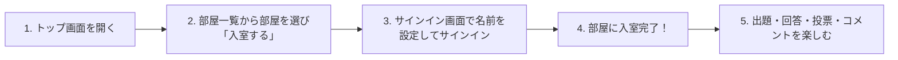
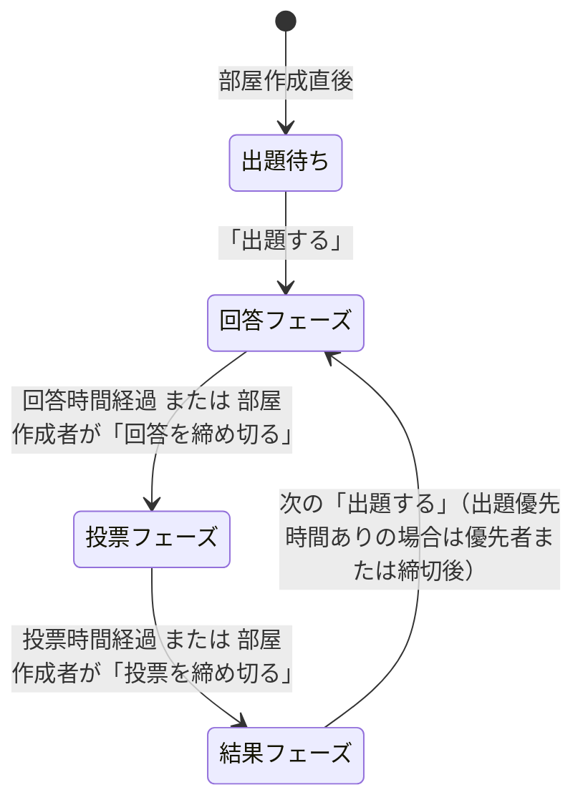
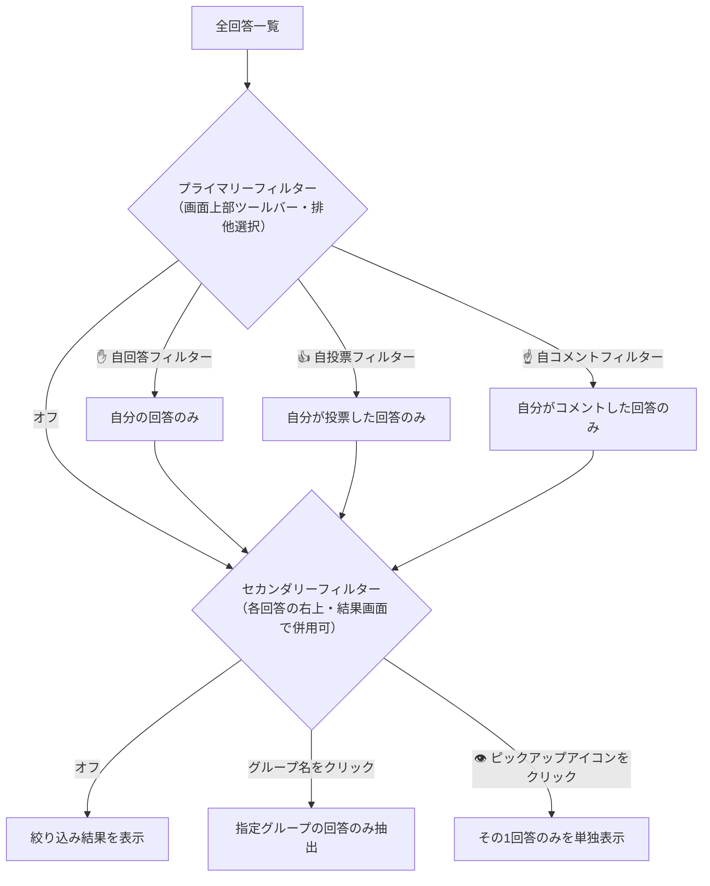
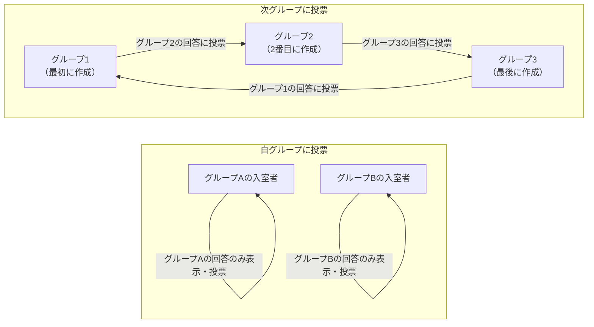

# bǃgǃrǃ（ビギリ）ユーザーマニュアル

**bǃgǃrǃ**（ビギリ — *For Beautiful Oogiri Life*）は、ウェブブラウザー上でリアルタイムに大喜利（お題の出題・回答・投票・結果発表・コメント）を楽しめるオンライン大喜利プラットフォームです。
自由度の高い部屋設定、手書き描画回答、グループ分け投票、統計指標（Zスコア）によるユニコーン（🦄）の授与、CSVログ出力など、少人数の身内部屋から大規模な大会・企画まで柔軟に対応できる機能を備えています。

---

## 目次

1. [サービス概要と基本情報](#1-サービス概要と基本情報)
2. [クイックスタート（初めての方へ）](#2-クイックスタート初めての方へ)
3. [サインインとアカウント・プロフィール管理](#3-サインインとアカウントプロフィール管理)
4. [トップ画面と部屋一覧の使い方](#4-トップ画面と部屋一覧の使い方)
5. [部屋の作成と部屋設定リファレンス](#5-部屋の作成と部屋設定リファレンス)
6. [部屋画面の構成と共通操作](#6-部屋画面の構成と共通操作)
7. [大喜利の進行（出題・回答・投票・結果フェーズ）](#7-大喜利の進行出題回答投票結果フェーズ)
8. [回答の並び替えとフィルター機能](#8-回答の並び替えとフィルター機能)
9. [入室者管理とグループ機能](#9-入室者管理とグループ機能)
10. [過去の結果とログ（CSV）のダウンロード](#10-過去の結果とログcsvのダウンロード)
11. [目的別おすすめ部屋設定プリセット・よくある質問（FAQ）](#11-目的別おすすめ部屋設定プリセットよくある質問faq)

---

## 1. サービス概要と基本情報

### 1.1 基本情報

| 項目 | 内容 |
| :--- | :--- |
| **サービス名** | **bǃgǃrǃ**（ビギリ） ※ロゴの「`ǃ`」は音声学における歯茎吸着音（Alveolar click）を表す記号です。 |
| **サブタイトル** | For Beautiful Oogiri Life |
| **公式サイト** | [https://bigiri.oogiri.org/](https://bigiri.oogiri.org/) |
| **Atomフィード** | [https://bigiri.oogiri.org/atom.xml](https://bigiri.oogiri.org/atom.xml)（新規作成された部屋の情報と作成者名を配信） |
| **公式連絡先・SNS** | ・メール: `bigiri@oogiri.org` ・Bluesky: [@bigiri.oogiri.org](https://bsky.app/profile/bigiri.oogiri.org) ・Twitter (X): [@bigirichan](https://twitter.com/bigirichan) ・ディスカッション（質問・提案）: [GitHub Discussions](https://github.com/oogiri-org/bigiri-docs/discussions) |
| **対応環境** | ECMAScript® 2022 に対応した最新のウェブブラウザー（PC・スマートフォン・タブレット対応） |

### 1.2 ライセンスと著作物に関するルール

* **クリエイティブ・コモンズ・ライセンス**: 各部屋内で特記のない制作物（投稿されたお題や回答など）は、**クリエイティブ・コモンズ 表示 4.0 国際（CC BY 4.0）** ライセンスの下で提供されます。
* **出典の明記と著作権への配慮**: 出題に他者の著作物（画像や文章など）を用いる場合は、現行の著作権制度に照らして許容される形になるよう配慮し、出題画面の **「出典」** 欄に適切な出典を入力してください。違反者にはアクセス禁止措置が講じられる場合があります。

---

## 2. クイックスタート（初めての方へ）

bǃgǃrǃ で大喜利に参加するまでの基本的な流れは以下の通りです。事前登録やアプリのインストールは不要で、ブラウザーからすぐに参加できます。

1. **部屋を探す**: トップ画面の「部屋一覧」から参加したい部屋を見つけ、**「入室する」** ボタンを押します（パスワードが設定されている部屋ではパスワードを入力します）。
2. **サインインする**: まだサインインしていない場合は「サインイン」ダイアログが表示されます。**「新規サインイン」** ボタンを押して表示名（初期値：「お客さん」）を設定するか、Twitter / Bluesky アカウントでソーシャルサインインを行います。
3. **大喜利に参加する**:
   * **回答フェーズ**: お題を見て **「回答する」** ボタンからボケ（回答）を投稿します。
   * **投票フェーズ**: 他の参加者の回答を見て、面白いと思った回答の **「投票する」** ボタンから票を入れます。
   * **結果フェーズ**: 集計結果と順位、獲得したユニコーン（🦄）を確認し、**「コメントする」** ボタンやスマイルボタン（😊）の絵文字リアクションで感想を伝え合います。次の **「出題する」** ボタンでお題を出すこともできます。

---

## 3. サインインとアカウント・プロフィール管理

### 3.1 サインインの方法（3種類）

トップ画面右上の **「サインイン」** メニュー、または未サインイン状態で「部屋を作成する」「入室する」を押すと「サインイン」ダイアログが開きます。以下の3つの方法から選択できます。

| サインイン方法 | 手順・特徴 | ソーシャル連携特典 |
| :--- | :--- | :--- |
| **新規サインイン** （通常サインイン） | 「新規サインイン」ボタンを押し、「名前を設定する」画面で名前（**1〜20文字**、初期値は「`お客さん`」）を入力して「設定する」を押します。 ※背後に自動実行される reCAPTCHA 確認を経て即座にサインインします。 | なし（手軽に参加可能） |
| **Twitterでサインイン** （ソーシャルサインイン） | 「Twitterでサインイン」ボタンを押すと Twitter（X）の認証画面へ遷移し、連携を承認するとサインインします。プロフィール画像とアカウントへのリンクが自動設定されます。 | あり（下記参照） |
| **Blueskyでサインイン** （ソーシャルサインイン） | 「Blueskyでサインイン」ボタンを押し、自分のハンドル（例：`okyakusan.bsky.social`、最大253文字）を入力して「サインイン」を押します。Bluesky の OAuth 認証画面で承認するとサインインし、プロフィール画像とリンクが自動設定されます。 | あり（下記参照） |

#### ソーシャルサインイン（Twitter / Bluesky）のメリット
1. **制限付き部屋への参加**: 部屋設定の「出題者制限」「回答者制限」「投票者制限」が **「有り（ソーシャルサインイン）」** になっている部屋で、部屋作成者から個別指名を受けなくても最初から出題・回答・投票が可能です。
2. **複数部屋の同時作成**: 通常のサインインでは「一度も出題が行われていない（未出題の）部屋」は同時に1つまでしか作成できませんが、ソーシャルサインイン（リンクURLが設定された状態）であれば**未出題のまま複数の部屋を作成**できます。
3. **アカウントの永続性**: サインアウトしても、再度同じソーシャルアカウントでサインインすれば同じユーザーID（戦績・部屋作成者権限など）に復帰できます。

> **注意**: すべての部屋において、その回の**回答フェーズ開始後に新しくサインインしたユーザーはその回では回答できず**、**投票フェーズ開始後に新しくサインインしたユーザーはその回では投票できず**、**結果フェーズ開始後に新しくサインインしたユーザーはその回では出題できません**。既存のサインイン状態を維持したまま入室するか、フェーズが始まる前にサインインを行ってください。

---

### 3.2 名前の変更とソーシャルリンクの設定

ナビゲーションバー（画面上部）に表示されている **自分自身の名前をクリック（タップ）** することで、名前やソーシャルリンクを変更できます。変更を行う画面によって適用範囲が異なります。

#### (1) トップ画面で自分の名前を押した場合（「名前を変更する」画面）
* **サインイン全体での基本の名前**（**1〜20文字**、先頭・末尾の空白不可）を変更します。
* ここで変更した名前は、以降新しく作成する部屋や新しく入室する部屋での初期表示名として使用されます。

#### (2) 部屋画面で自分の名前を押した場合（「名前やリンクを変更する」画面）
* **その部屋内でのみ有効な名前とソーシャルリンク**を設定します。他の部屋やトップ画面の基本名には影響しません。
* **名前**: **1〜20文字**（空欄にして変更すると基本のサインイン名に戻ります）。
* **リンク**: 入室者一覧や部屋ナビゲーションバーの自分の名前に添えられるリンクとアイコンを設定します。
  * **「無し」**: ソーシャルリンクおよびプロフィール画像を非表示にします。
  * **「有り（URL）」**: `http://` または `https://` で始まる **最大150文字** のURLを設定します。URLの先頭文字列に応じて以下のアイコンが自動表示されます（ソーシャルサインイン時の元URLと同一の場合はプロフィール画像も表示されます）：
    * `https://twitter.com/...` : Twitter アイコン
    * `https://x.com/...` : X アイコン
    * `https://bsky.app/...` : Bluesky アイコン
    * 上記以外の任意のURL : ユーザー（人物）アイコン

---

### 3.3 名前へのハッシュ値付加（トリップ機能）

名前を設定・変更する際（サインイン時、トップ画面、部屋内のすべて）、名前に `#任意の文字列` を含めて入力すると、`#` 以降の文字列が**暗号学的ハッシュ関数値（8文字）**に自動変換されて表示されます。

* **仕組み**: 入力した名前が `表示名#秘密のキー` の場合、`表示名` と `秘密のキー` を連結したUTF-8文字列に対して SHA-256 ハッシュを計算し、URL-safe Base64 エンコードした先頭8文字が `#` の後ろに付与されます。
* **変換例**:
  * `びぎりちゃん` → `びぎりちゃん`
  * `びぎりちゃん#abc` → `びぎりちゃん#DnbJh2JQ`
  * `風祭ビギリマナ春子#abc` → `風祭ビギリマナ春子#C2GkNEL6`
* ソーシャルサインインを使わずに本人証明（なりすまし防止）を行いたい場合に便利です。なお、ハッシュ値を付加していても部屋内のリンク設定が「有り（URL）」であればソーシャルリンクはそのまま表示されます。

---

### 3.4 トークン（ディスクリミネーター）と自名前の強調表示

* **自分の名前の強調表示**: 部屋一覧の入室者欄、入室者を見る画面、出題者名、回答者名、投票者名、コメント投稿者名など、画面上のあらゆる場所で**自分自身の名前（およびトークン）はオレンジ色で強調表示**されます。
* **8文字トークン（ディスクリミネーター）**:
  * 各ユーザーには部屋ごとに一意な内部ID（部屋IDとユーザーIDから生成されるハッシュ値）が割り当てられており、その**先頭8文字の英数字**がトークン（ディスクリミネーター）として機能します。
  * 「入室者を見る」画面の右端に常時表示されるほか、**出題者名・回答者名・投票者名・コメント投稿者名・「グループを選択する」画面の入室者名をクリック（タップ）すると、その場で表示が8文字のトークンに切り替わります**（もう一度クリックすると名前に戻ります）。
  * 同名の入室者が複数いる場合や、途中で部屋内の名前を変更した入室者の識別などに活用できます。

---

### 3.5 サインオーバー（別ブラウザーへの引き継ぎ）とサインアウト

* **サインオーバー**:
  * トップ画面または部屋画面上部の **「サインオーバー」** メニューを押すと、引き継ぎ用の **URLリンク**、**「URLをコピーする」ボタン**、および **QRコード** が表示されます。
  * **1時間以内**に別のウェブブラウザー（PCからスマートフォンへの移行や別ブラウザーへの移行など）でそのURLまたはQRコードを開き、「サインイン」ボタンを押すと、現在のサインイン状態をそのまま引き継いでサインインできます。
* **サインアウト**:
  * トップ画面上部の **「サインアウト」** メニューからサインアウトできます。
  * **注意**: 通常サインイン（新規サインイン）の状態で、サインオーバーを控えずにサインアウトすると、元のアカウント状態に戻ることはできなくなります。

---

## 4. トップ画面と部屋一覧の使い方

### 4.1 トップ画面の構成

トップ画面は以下の要素で構成されています。

1. **ナビゲーションバー**: 左に `bǃgǃrǃ` ロゴ、右にユーザー名・サインイン関連メニュー。
2. **ヘッダー（案内エリア）**:
   * サービスロゴ、連絡先リンク（メール、Bluesky、Twitter）。
   * **更新情報**: 直近3件のアップデート内容が表示されます。**「全更新情報を見る」** ボタンを押すと過去のすべての更新履歴をモーダルウィンドウで確認できます。
   * **使用方法**: AI生成による「bǃgǃrǃ ユーザーマニュアル」へのリンクと、質問・提案を行える GitHub「ディスカッション」へのリンクがあります。
3. **部屋一覧**: 現在稼働している部屋の一覧が表示されます。

### 4.2 部屋一覧の並び替えと絞り込み

部屋一覧の右上にあるツールバーで、部屋の表示順や絞り込みを切り替えられます。

* **表示順ドロップダウン**:
  * **「作成順」**（デフォルト）: 部屋が作成された日時の新しい順（降順）に並べます。
  * **「更新順」**: 出題やフェーズ進行など、部屋が最後に更新された日時の新しい順（降順）に並べます（未更新の部屋は作成日時順）。
* **自入室フィルター（🖖 `fa-hand-spock` ボタン）**:
  * ドロップダウンの右隣にあるバルカン・サリュート（🖖）ボタンを押してオン（塗りつぶし状態）にすると、**現在自分が入室している部屋のみ**が表示されます。もう一度押すとオフ（枠線状態）になり、すべての部屋が表示されます。

### 4.3 部屋カード（ダイジェスト）の見方とSNS共有

各部屋のカードには以下の情報とボタンが表示されます。

* **Twitter / Bluesky 共有ボタンと検索リンク**:
  * カード左上の **Twitterボタン** または **Blueskyボタン** を押すと、部屋名・説明の1行目・部屋URL・ハッシュタグ（`#bǃgǃrǃ` と `#部屋名`）が自動入力された状態でポスト作成画面が開きます。参加者の募集や宣伝に便利です。
  * 各ボタンの横にある部屋名リンクを押すと、それぞれのSNSで部屋名を検索した結果ページが開きます。
* **部屋名・説明・アイコン画像**: 説明文内のURLはリンクとしてクリック可能です。
* **部屋の設定一覧表**: 作成者名、作成日時、入室制限、および出題・回答・投票に関するすべてのルール設定が一目で確認できます。
* **操作ボタン**:
  * **「入室する」**: その部屋に入室します。
  * **「部屋を削除する」**: 自分がその部屋の作成者である場合のみ表示され、確認ダイアログを経て部屋を削除できます。
* **カードフッター**: 左側に「更新日時」、右側に現在入室しているメンバーの名前一覧（自分の名前はオレンジ色）が表示されます。

---

## 5. 部屋の作成と部屋設定リファレンス

### 5.1 部屋の作成手順と「履歴を見る」機能

トップ画面の **「部屋を作成する」** ボタンを押すと、部屋作成ダイアログが開きます。

* **設定の自動保存**: 部屋を作成すると、その設定内容（アイコン画像を含む）がブラウザーに自動保存され、次回「部屋を作成する」を開いた際の初期値として自動的にセットされます。
* **「履歴を見る」機能**:
  * 「部屋名」入力欄の右隣にある **「履歴を見る」** ボタンを押すと、同じブラウザーで過去に作成した部屋の一覧（部屋名と作成日時）が表示されます。
  * **「履歴を読み込む」** を押すとその部屋の設定が一括でフォームに反映され、**「履歴を削除する」** を押すと履歴から削除されます。
  * ※同じ部屋名で複数回部屋を作成した場合、履歴には最新の設定のみが保存されます。
* **部屋の存続期間**:
  * 部屋は最終更新日時から **11.5日間** 経過すると自動的に終了・整理されます。

---

### 5.2 部屋設定の全項目一覧（全20項目）

#### (1) 基本設定

| 項目名 | 選択肢・入力制限 | 仕様・解説 |
| :--- | :--- | :--- |
| **部屋名** | 必須（**1〜150文字**） | 部屋のタイトルです。SNS共有時には空白を除いた文字列がハッシュタグにも使われます。 |
| **説明** | 任意（**最大1500文字**、複数行可） | 部屋のルールや案内などを自由に記載できます。行数に応じて入力欄が自動伸張します。文中のURLは自動でリンク化され、1行目はSNS共有時の本文にも含まれます。 |
| **アイコン画像** | 任意（画像ファイル） | トップ画面の部屋一覧および部屋画面の右下フッターに表示される画像です。 面積が最大 $180 \times 180 = 32,400\text{ px}$ 以下になるよう自動縮小（拡大はしない）され、Base64データURL形式で最大65,536文字の容量制限があります。 |
| **カラースキーム** | ・**無し** ・**☀️ ライト** ・**🌙 ダーク** | 部屋に入室した際のデフォルトの画面配色（ライトモード／ダークモード）を指定します。「無し」の場合は入室者のOS・ブラウザーの設定に従います。 |
| **入室制限** | ・**無し** ・**有り（パスワード）** | 「有り（パスワード）」を選択すると、空白を含まない **1〜15文字** のパスワードを設定できます。入室時にパスワードの入力が求められます。 |

#### (2) 出題に関する設定

| 項目名 | 選択肢・入力制限 | 仕様・解説 |
| :--- | :--- | :--- |
| **出題優先時間** | ・**無し** ・**有り（部屋作成者）（秒）** ・**有り（首位回答者）（秒）** ※秒数は1〜6桁の整数 | 結果フェーズ開始直後に、特定のユーザーだけが出題できる優先時間（秒）を設けます。 ・**有り（部屋作成者）**: 指定秒数の間、**部屋作成者のみ**が出題できます。 ・**有り（首位回答者）**: 指定秒数の間、直前の出題で**投票を行った回答者のうち最上位（1位）の回答者のみ**が出題できます（投票した回答者が誰もいない場合は全員出題可）。優先時間中は対象となる首位回答者の名前が結果画面で明滅します。 ※優先時間中でも部屋作成者は「出題優先を締め切る」ボタンでいつでも優先時間を解除できます。 |
| **出題者制限（初期値）** | ・**無し** ・**有り** ・**有り（ソーシャルサインイン）** | 誰が出題できるかの初期制限です。 ・**無し**: 全員が出題可能。 ・**有り**: 初期状態では誰も出題不可（入室後、部屋作成者が「入室者を見る」画面から特定の出題者を指名するための設定）。 ・**有り（ソーシャルサインイン）**: Twitter または Bluesky でサインイン（リンク設定）している入室者のみ出題可能。 ※入室後に「入室者を見る」画面で個別に「出題者へ追加する」を行った場合は、この初期値設定より個別指名が優先されます。 |
| **出題画像制限** | ・**無し** ・**有り（禁止）** | 「有り（禁止）」にすると、出題時に画像を添付できなくなります。 |
| **出題コメント制限** | ・**無し** ・**有り（部屋作成者）** | 結果フェーズでお題に対して投稿できる「出題コメント」を全員に許可するか、部屋作成者のみに制限するかを設定します。 |

#### (3) 回答に関する設定

| 項目名 | 選択肢・入力制限 | 仕様・解説 |
| :--- | :--- | :--- |
| **回答表示** | ・**即時** ・**一斉（投票フェーズまで非表示）** | ・**即時**: 回答が投稿されるたびに全員の画面へリアルタイムに表示されます。 ・**一斉**: 回答フェーズ中は自分の回答のみが表示され、他人の回答は投票フェーズになるまで伏せられます（回答総数のみリアルタイム表示）。また「一斉」の場合のみ、回答フェーズ中に**自分の回答の変更・削除が可能**になります。 |
| **回答時間制限** | ・**無し** ・**有り（秒）** ※秒数は1〜6桁の整数 | 回答フェーズの制限時間です。「無し」の場合は部屋作成者が手動で「回答を締め切る」を押すまで継続します。「有り」の場合は指定秒数が経過すると自動で投票フェーズへ進みます（途中での手動締め切りも可能）。 |
| **回答シャッフル時間** | ・**無し** ・**有り（秒）** ※0〜6桁の整数、**空欄可** | 投票フェーズでの回答の表示順（「設定順」選択時）を、入室者ごとに異なるランダムな順番にシャッフルします。 ・秒数を入力した場合：出題からその秒数以内に投稿された回答をシャッフルします。 ・**空欄（または `0`）にした場合**：`∞` 秒として扱われ、**すべての回答がシャッフル対象**になります。 |
| **回答数制限** | ・**無し** ・**有り（答）** ※1〜6桁の整数 | 1つの出題につき1人が投稿できる最大回答数を制限します。 |
| **回答者名表示** | ・**表示** ・**非表示** ・**一斉（結果フェーズまで非表示）** | ・**表示**: 最初から回答者名を表示します。 ・**非表示**: 結果フェーズや過去の結果・CSVログでも回答者名を一切表示しません（完全匿名）。 ・**一斉**: 回答・投票フェーズ中は回答者名を隠し、結果フェーズで一斉に公開します。 ※どの設定でも**自分の回答には自分の名前が常に表示**されます。 |
| **回答者制限（初期値）** | ・**無し** ・**有り** ・**有り（ソーシャルサインイン）** | 誰が回答できるかの初期制限です。仕組みは「出題者制限（初期値）」と同様です。 |
| **回答コメント制限** | ・**無し** ・**有り（部屋作成者）** | 結果フェーズで各回答に対して投稿できる「回答コメント」を全員に許可するか、部屋作成者のみに制限するかを設定します。 |
| **回答描画制限** | ・**無し** ・**有り（禁止）** | 「有り（禁止）」にすると、回答時に手書きイラスト（描画ボード）を添付する機能が禁止されます。 |

#### (4) 投票に関する設定

| 項目名 | 選択肢・入力制限 | 仕様・解説 |
| :--- | :--- | :--- |
| **投票表示** | ・**即時** ・**一斉（結果フェーズまで非表示）** | ・**即時**: 投票がリアルタイムに公開されます。また「回答表示：即時」かつ「投票表示：即時」の部屋では回答フェーズ中から早期投票が可能です（ただし一度投票した票の変更・削除は不可）。 ・**一斉**: 投票フェーズになってから投票可能となり、結果フェーズまで他人の投票内容は非表示になります。投票フェーズ中に**自分の投票の変更・削除が可能**です。 |
| **投票時間制限** | ・**無し** ・**有り（出題毎+回答毎×）（秒）** ※出題毎：1〜6桁の整数 ※回答毎：最大6文字・小数第1位まで（任意） | 投票フェーズの制限時間を設定します。出題毎の基礎秒数を $T_{\text{base}}$、回答1件あたりの追加秒数を $T_{\text{per\_boke}}$、対象回答数を $N$ とすると、投票時間 $T_{\text{vote}}$（秒）は次式で決まります： $$T_{\text{vote}} = T_{\text{base}} + T_{\text{per\_boke}} \times N$$ ※「投票グループ制限」が有効かつグループが存在する場合は、全回答数ではなく**最も回答数が多いグループの回答数**が $N$ として用いられます。 |
| **投票数制限（出題毎）** | ・**無し** ・**有り（票）** ・**有り（超過可）（票）** ※1〜6桁の整数 | 1つの出題で1人が投じられる合計票数の上限です。 ・**有り（票）**: 合計票数が上限に達すると未投票回答の「投票する」ボタンが「投票を見る」に変わり、それ以上増票できなくなります。 ・**有り（超過可）（票）**: 上限に達するとボタンが「投票を見る」に変わりますが、「投票を見る」画面から**上限を超えて投票することが可能**です。 |
| **投票数制限（回答毎）** | ・**無し** ・**有り（票）** ※1〜6桁の整数 | 1つの回答に対して1人が投じられる最大票数です（例：`1` なら各回答に最大1票、`3` なら同じ回答に3票まで重ねて投票可能）。 |
| **投票者名表示** | ・**表示** ・**非表示** ・**一斉（結果フェーズまで非表示）** | 投票者の名前を常時表示するか、常に非表示にするか、結果フェーズまで伏せて一斉公開するかを設定します。 ※どの設定でも**自分の投票には自分の名前が常に表示**されます。 |
| **投票者制限（初期値）** | ・**無し** ・**有り** ・**有り（ソーシャルサインイン）** | 誰が投票できるかの初期制限です。仕組みは「出題者制限（初期値）」と同様です。 |
| **投票グループ制限** | ・**無し** ・**有り（自グループに投票）** ・**有り（次グループに投票）** | 部屋内でグループを作成した場合の投票対象を制限します。 ・**無し**: すべての回答に投票可能。 ・**有り（自グループに投票）**: 投票フェーズで**自分と同じグループの回答のみ**が表示され、それに投票します。 ・**有り（次グループに投票）**: 投票フェーズで**自分のグループの直後に作成されたグループの回答のみ**が表示されます（最後のグループは最初のグループへ循環）。 |

---

## 6. 部屋画面の構成と共通操作

### 6.1 部屋ナビゲーションバーと画面構成

部屋に入室すると、画面上部のナビゲーションバーに以下のメニューと情報が表示されます。

* **`bǃgǃrǃ` ロゴ**: トップ画面へ戻ります（退室はせず、入室したままの状態を保ちます）。
* **表示切替タブ**（タブを切り替えると、自動的にタブ固有コンテンツの先頭位置までスクロールします）:
  * **「メイン」**: 現在進行中の出題・回答・投票・結果を行うメイン画面です。
  * **「過去の結果」**: その部屋の過去（34.5日以内）の出題結果を参照します。
  * **「ログ（CSV）」**: その部屋の過去（34.5日以内）のログをCSV形式でダウンロードします。
* **「サインオーバー」**: 別ブラウザーへサインイン状態を引き継ぐURLとQRコードを表示します。
* **「退室する」**: 確認ダイアログを表示し、部屋から退室してトップ画面へ戻ります。
* **カラースキーム切替ボタン**:
  * その部屋の画面表示を **「🌓 オート」**（OS/ブラウザー準拠）、**「☀️ ライト」**、**「🌙 ダーク」** の3つから即座に切り替えられます（ここでの選択は一時的なもので保存されません）。
* **ユーザー情報表示（右端）**:
  * **自分の名前**（クリックで部屋内の名前・ソーシャルリンク変更画面を開く）
  * **`@グループ名`**（グループ選択時）
  * **ソーシャルアイコン・プロフィール画像**
  * **獲得ユニコーン累計（🦄）**: その部屋でこれまでに獲得したユニコーンの数だけ `🦄` が並んで表示されます。

### 6.2 部屋コメント（部屋作成者によるアナウンス）

部屋作成者が入室している場合、部屋説明および設定表の下に **「コメントする」** ボタンが表示されます。
* 部屋作成者はフェーズに関係なくいつでも部屋コメント（最大150文字、空文字列可、URL自動リンク化）を投稿し、部屋上部に常時掲示しておくことができます（ローカルルールや進行スケジュールの告知などに便利です）。
* 部屋コメントが1件以上あるときに **「コメントを削除する」** ボタンを押すと、**投稿された部屋コメントのうち最新の1件**が削除されます。

### 6.3 便利な共通操作・キーボードショートカット・長文折りたたみ

#### キーボードショートカット一覧

| 場面 | キー操作 | 動作 |
| :--- | :--- | :--- |
| **すべてのダイアログ（モーダル）** | `Escape`（エスケープキー） | 開いているダイアログウィンドウを閉じる |
| **出題する画面（出題入力欄）** | `Ctrl + Enter` または `Command (Windows) + Enter` | 出題を送信する |
| **回答する画面（回答入力欄）** | `Ctrl + Enter` または `Command (Windows) + Enter` | 回答を送信する |
| **投票する画面（票数ボタンフォーカス時）** | `Space`（スペースキー） | 投票数を1増やす（`+1`） |
| **投票する画面（票数ボタンフォーカス時）** | `Delete`（または `Backspace` キー） | 投票数を1減らす（`-1`） |
| **投票する画面（票数ボタンフォーカス時）** | `Enter`（改行キー） | 投票を送信する |

#### 長文の折りたたみと展開
* 出題（お題）や回答の本文が **150文字** または **10行** を超える場合、超えた位置で自動的に折りたたまれ、末尾に **`[+ 残り文字数]`** ボタンが表示されます。
* このボタンを押すと残りの全文が展開され、ボタンが **`[- 残り文字数]`** に変わります（もう一度押すと再び折りたたまれます）。

#### 画像・描画のホバーズーム
* PCなどのマウスホバー対応環境では、**出題画像**、**回答の手書き描画ボード**、**入室者一覧のプロフィール画像**の上にカーソルを乗せると、2倍に拡大（ズーム）表示されます。

---

## 7. 大喜利の進行（出題・回答・投票・結果フェーズ）

部屋内の「メイン」タブでは、以下のサイクルでゲームが進行します。

---

### 7.1 出題（「出題する」画面）

「出題はありません」の状態、または前回の出題が「結果フェーズ」にあるとき、出題権限を持つ入室者は **「出題する」** ボタンを押してお題を出題できます。

#### 出題優先時間の動作
* 部屋設定で「出題優先時間」が設定されている場合、結果フェーズ開始から指定秒数の間は以下の優先対象者のみが出題できます：
  * **有り（部屋作成者）**: 部屋作成者のみ。
  * **有り（首位回答者）**: 直前の回で**投票を行った回答者のうち第1位となった回答者（首位回答者）**のみ。優先時間中は、結果一覧において**その首位回答者の回答者名が明滅（点滅）表示**されます。
* 優先対象外の入室者には、「出題する」ボタンの横に赤色のタイマーが表示され、タイマーが0になるか部屋作成者が **「出題優先を締め切る」** ボタンを押すまで「出題する」ボタンが無効化されます。

#### 出題フォームの入力項目
1. **出典**（任意、**最大150文字**）:
   * 引用元や画像の出典を入力します（URLは自動でリンク化されます）。
   * 画像ファイルを選択した際、出典欄が空欄であれば自動的に `file:[ファイル名]` が入力され、出典欄にフォーカスが移動します（画像を削除すると自動でクリアされます）。
2. **画像**（出題画像制限が「無し」の場合）:
   * **「画像有り」** ボタンを押して画像ファイルを選択すると、画像お題として出題できます（取り消す場合は「画像無し」または「削除する」を押します）。
   * 画像の縦横サイズを $W \times H$ としたとき、面積が最大 $320 \times 320 = 102,400\text{ px}$ になるよう、縮小倍率 $s = \sqrt{\frac{320 \times 320}{W \times H}}$ が $s < 1$ の場合にアスペクト比を保って自動縮小されます（背景色は白）。
3. **出題（本文）**（必須、**最大1500文字**、複数行可）:
   * お題の文章を入力します。画像を添付して本文を空欄のまま出題した場合は、自動的に絵文字 `🖌️` が本文として設定されます。

---

### 7.2 回答フェーズ

お題が出題されると **「回答フェーズ」**（水色のフェーズタイトル）が始まります。

#### 回答の投稿（「回答する」画面）
**「回答する」** ボタンを押すと、上部にお題（画像・本文）が表示された回答ダイアログが開きます。

1. **手書き描画の添付**（回答描画制限が「無し」の場合）:
   * **「描画有り」** ボタンを押すと、$240 \times 180$ の手書きキャンバス（描画ボード）が表示されます（「描画無し」で解除）。
   * マウスや指・スタイラスペンで自由な線画を描くことができます（サンプリング間隔は最小33.3ミリ秒＝毎秒30ポイント以下）。
   * キャンバス右下のボタンで **Undo（元に戻す ↩️）** と **Redo（やり直す ↪️）** が可能です。中央の数値は現在の描画データ要素数を表し、**最大1500要素**まで描画できます。
   * ダークモード表示時は、描いた黒線が自動的に白系へ反転して見やすく表示されます。
2. **回答本文の入力**（**最大1500文字**、複数行可）:
   * テキストで回答を入力します。描画を添付して本文を空欄のまま回答した場合は、自動的に絵文字 `🖊️` が本文として設定されます。

#### 回答の変更と削除（「回答表示：一斉」の場合のみ）
* 部屋設定の「回答表示」が **「一斉（投票フェーズまで非表示）」** の場合、回答フェーズ中は自分の回答カードに **「回答を変更する」** ボタンと **「回答を削除する」** ボタンが表示されます。
* 「回答を変更する」から内容を修正して再送信すると、回答時刻もその時点に更新されます。

#### 画面右下の回答数カウンター
* 回答一覧の右下には、手のひらアイコン（✋）とともに現在の**総回答数**がリアルタイムに表示されます。
* なお、「投票グループ制限」が有効でグループが作成されている部屋では、回答・投票フェーズ中は `対象グループの回答数/全体の回答数` の形式で表示されます。

---

### 7.3 投票フェーズ

回答が締め切られると **「投票フェーズ」**（緑色のフェーズタイトル）に移行し、回答一覧が公開されます。
※なお、「回答表示：即時」かつ「投票表示：即時」の部屋では、回答フェーズ中から各回答に対して早期投票を行うことも可能です。

#### 投票の方法
各回答カードの右下にあるボタンから投票を行います（一斉回答の部屋では自分の回答には投票ボタンが表示されません）。

1. **通常の投票（「投票する」ボタン）**:
   * **「投票する」** ボタンを押すと投票ダイアログが開きます。
   * 初期値は投票可能であれば `1`（上限到達時は `0`）になっており、`-` / `+` ボタン、またはキーボードの **`Space` キー（増票）・`Delete` キー（減票）・`Enter` キー（送信）** で素早く票数を指定して投票できます。
2. **0票クイック投票（`👍0` ボタン）**:
   * 未投票の回答の「投票する」ボタンの左隣にある **`👍0`** ボタンを押すと、ダイアログを開かずにワンクリックで **0票** を投票できます。
   * **0票投票の役割**: bǃgǃrǃ では、**0票の投票であっても「投票を行った」ものとしてカウント**されます。そのため、他の回答に1票以上投じたいものがない場合でも、1件以上投票（0票を含む）しておけば「出題優先時間：有り（首位回答者）」の優先権対象になったり、同点時の順位決定やユニコーン算定における投票補正を得たりすることができます。また、どこまで回答を読んだかの目印としても使えます。
3. **投票の変更と削除（「投票表示：一斉」の場合のみ）**:
   * 「投票表示」が **「一斉」** の部屋では、投票済みの回答に **「投票を変更する」** ボタンと **「投票を削除する」** ボタンが表示され、投票フェーズが終わるまで何度でも修正・取り消しが可能です。
4. **「投票を見る」画面（自投票一覧の確認・調整・超過投票）**:
   * 回答一覧の上部にある **「投票を見る」** ボタン（1件以上投票すると有効化）、または「投票数制限（出題毎）」の上限に達した際に未投票回答のボタンが変化した **「投票を見る」** ボタンを押すと開きます。
   * 自分が投票した回答の一覧と、右下に **`👍 自分の合計投票数 / 出題毎の投票数制限`** が表示されます。
   * 既存の投票を一覧で確認しながら減票・削除し、そのまま下部に表示される対象回答へ票を振り分けることができます。
   * また、部屋設定の「投票数制限（出題毎）」が **「有り（超過可）」** の場合は、この画面から上限票数を超えてさらに投票を行うことができます。

---

### 7.4 結果フェーズ（順位・Zスコア・ユニコーン🦄・コメント）

投票が締め切られると集計が行われ、**「結果フェーズ」**（赤色のフェーズタイトル）となります。

#### (1) 順位の決定ルール
各回答の順位は、以下の優先順序に従って決定されます：
1. **得票数（合計票数）が多い順**
2. **回答者の投票行動による補正値（プライオリティ）が大きい順**: 得票数が同じ場合、**その回答者が他の回答に対して行った投票が多い方**が上位になります。
3. **回答時刻が早い順（先着順）**: 得票数も回答者の投票行動も同じ場合は、先に回答を投稿した方が上位になります。

#### (2) Zスコア（標準化変量）とユニコーン🦄・アイスクリーム🍦
bǃgǃrǃ では、単なる得票数だけでなく、その回全体の得票分布の中での突出度を表す統計指標 **Zスコア（標準化変量）** が自動計算されます。

全 $N$ 件の回答について、回答 $i$ の得票数を $x_i$、回答者の投票数に基づくプライオリティ補正値（$0 \le p_i < 1$）を加えた**補正得票数**を $y_i = x_i + p_i$ とすると、平均 $\mu$、標準偏差 $\sigma$、および回答 $i$ の **Zスコア** $z_i$ は次式で定義されます：

$$\mu = \frac{1}{N} \sum_{i=1}^{N} y_i, \qquad \sigma = \sqrt{\frac{1}{N} \sum_{i=1}^{N} (y_i - \mu)^2}$$

$$z_i = \begin{cases} \dfrac{y_i - \mu}{\sigma} & (\sigma > 0) \\ 0 & (\sigma = 0) \end{cases}$$

* **Zスコアの数値確認**: 結果フェーズおよび「過去の結果」画面で、各回答の左上にある **「`1位`」「`2位`」などの順位表示をクリック（タップ）すると、小数第4位までのZスコア（例：`2.3456`）に切り替わります**（もう一度押すと順位表示に戻ります）。
* **Zスコアに応じた装飾・絵文字の付与**:

| Zスコア $z_i$ の範囲 | 表示される装飾・絵文字 | 付与される個数・効果 |
| :--- | :--- | :--- |
| **$z_i \ge 2$** | **ユニコーン 🦄** ＋ 順位の下線風ハイライト（薄紫色） | **$\lfloor z_i \rfloor - 1$ 個** の 🦄 が表示されます（$2 \le z_i < 3$ で1個、$3 \le z_i < 4$ で2個……）。 獲得した 🦄 はその部屋の個人累計に加算され、ナビゲーションバーや入室者一覧に表示されます。 |
| **$1 \le z_i < 2$** | 順位の下線風ハイライト（薄紫色） | 順位の下部に薄紫色（Resene Unicorn カラー）のライン装飾が付きます。 |
| **$-1 < z_i < 1$** | 通常の順位表示 | 装飾なし。 |
| **$-2 < z_i \le -1$** | 順位の上線風ハイライト（バニラ色） | 順位の上部にバニラ色（Vanilla カラー）のライン装飾が付きます。 |
| **$z_i \le -2$** | **アイスクリーム 🍦** ＋ 順位の上線風ハイライト（バニラ色） | **$\lfloor -z_i \rfloor - 1$ 個** の 🍦 が表示されます（$-3 < z_i \le -2$ で1個、$-4 < z_i \le -3$ で2個……）。 |

#### (3) 回答ごとの投票内訳の表示
* 各回答カードの右下には、その回答に投票した投票者と票数（1票は `名前 👍`、2票以上は `名前 👍2` の形式）が表示されます。
* 投票バッジの並び順は **投票数の多い順（降順）** であり、同じ票数の場合は **投票日時が早い順（投票順）** になります。

#### (4) 出題コメント・回答コメントとクイックコメント（リアクション）
結果フェーズでは、お題の下部および各回答カードの下部にコメント欄が表示されます（部屋設定で制限されている場合は部屋作成者のみ投稿可能）。

* **テキストコメント**: **「コメントする」** ボタンを押して、最大150文字（空文字列も可、URL自動リンク化）のコメントを投稿できます。※投稿した出題コメント・回答コメントは削除できません。
* **クイックコメント（リアクション）**: 「コメントする」ボタンの左にある **スマイルボタン（😊）** を押すと、以下の **9種類の絵文字** から選んでワンクリックでリアクションを送信できます（出題コメント・回答コメントの両方で利用可能）：
  * `😂` `🤣` `🥰` `🥹` `😭` `😳` `🤔` `😡` `🫡`

---

## 8. 回答の並び替えとフィルター機能

回答一覧の上部にあるツールバー（スクロールしても画面上部に固定表示されるスティッキーバー）および各回答カードのボタンを使って、回答の表示順変更や絞り込みを行えます。

### 8.1 回答の表示順（ソート）

| 表示順名称 | 利用可能なフェーズ | 並び順の仕様 |
| :--- | :--- | :--- |
| **設定順**（デフォルト） | 全フェーズ | ・回答・投票フェーズ：「回答表示：即時」なら**後着順**、「回答表示：一斉」なら**先着順**（回答シャッフル時間が有効な投票フェーズでは**シャッフル順**） ・結果フェーズ・過去の結果：**上位順** |
| **先着順** | 全フェーズ | 回答日時が古い順（回答番号 `1, 2, 3...` の昇順） |
| **後着順** | 全フェーズ | 回答日時が新しい順（回答番号の降順） |
| **上位順** | 全フェーズ | 得票数が多い順（同点時はプライオリティ補正 → 先着順） |
| **下位順** | 全フェーズ | 上位順の逆順 |
| **多コ順** | 結果フェーズ・過去の結果 | その回答に付いた回答コメント数が多い順（同数の場合は上位順と同じ基準） |
| **少コ順** | 結果フェーズ・過去の結果 | 多コ順の逆順 |

---

### 8.2 フィルター機能の階層構造（プライマリー / セカンダリー / 回答別）

bǃgǃrǃ のフィルター機能は、画面上部の**プライマリーフィルター**と、各回答カード上部の**セカンダリーフィルター**の2段階で構成されており、両者を組み合わせて絞り込むことができます。

1. **プライマリーフィルター（画面上部ツールバーのアイコンボタン）**:
   * **✋ 自回答フィルター（`fa-hand-paper`）**: 全フェーズで利用可能。自分の回答のみを表示します（回答フェーズ中は自分の回答数を併記）。
   * **👍 自投票フィルター（`fa-thumbs-up`）**: 投票・結果・過去の結果で利用可能。自分が投票した回答のみを表示します（投票フェーズ中は自分の合計投票数を併記）。
   * **☝️ 自コメントフィルター（`fa-hand-point-up`）**: 結果・過去の結果で利用可能。自分が回答コメントを投稿した回答のみを表示します（結果フェーズ中は自分のコメント数を併記）。
   * ※プライマリーフィルターを切り替えると、セカンダリーフィルターは自動的に解除されます。
2. **セカンダリーフィルター（結果フェーズ・過去の結果で各回答カードの右上に表示）**:
   * **グループフィルター（`グループ名` リンク）**: 回答右上のグループ名を押すと、そのグループの回答のみを表示します（もう一度押すと解除）。
   * **回答ピックアップ（👁️ `fa-eye` アイコン）**: 回答右上の目のアイコンを押すと、**その回答1件のみを単独でピックアップ表示**します（もう一度押すと元の表示に戻ります）。配信での紹介やスクリーンショット撮影に便利です。
3. **回答ごとの自投票フィルター（各回答カード内の得票数 `👍n` ボタン）**:
   * 各回答カード内の右下にある得票数（`👍n`）を押してオン（塗りつぶしアイコン）にすると、その回答の投票者一覧に**自分の投票のみ**が表示されます（もう一度押すと全員の投票表示に戻ります）。

---

## 9. 入室者管理とグループ機能

### 9.1 「入室者を見る」画面と並び替え・権限管理

部屋画面右上の **「入室者を見る」** ボタンを押すと、現在の入室者および退室済みの出題者・回答者・投票者・受刑者の一覧が表示されます（退室済みのユーザーは薄い文字色で表示されます）。

#### 入室者の表示順（10種類）
画面右上のドロップダウンから以下の10通りで並び替えが可能です：
* **「先入順」** / **「後入順」**（デフォルト）：部屋への入室日時が古い順／新しい順
* **「多🦄順」** / **「少🦄順」**：その部屋でのユニコーン（🦄）獲得数が多い順／少ない順（同数の場合は入室日時が新しい順）
* **「昇名順」** / **「降名順」**：表示名の Unicode コードポイント昇順／降順
* **「昇Di順」** / **「降Di順」**：ディスクリミネーター（内部ID・トークン）の Unicode コードポイント昇順／降順
* **「古サ順」** / **「新サ順」**：サインイン（アカウント登録）日時が古い順／新しい順

#### 部屋作成者による権限設定と受刑者（追放）管理
部屋作成者が「入室者を見る」画面を開くと、各入室者の行に以下の操作ボタンが表示されます（スマートフォン等の狭い画面では右端の `…` ボタンで開閉できます）：

1. **「出題者へ追加する」/「出題者から削除する」**: 出題者を個別に指名・解除します。1人でも追加されている間は、指名されたユーザーのみが出題可能になります（全員から削除すると部屋作成時の初期設定に戻ります）。
2. **「回答者へ追加する」/「回答者から削除する」**: 回答者を個別に指名・解除します。
3. **「投票者へ追加する」/「投票者から削除する」**: 投票者を個別に指名・解除します。
4. **「受刑者へ追加する」/「受刑者から削除する」**:
   * 荒らし等の迷惑行為を行うユーザーを「受刑者」に追加します（名前に取り消し線が付きます）。
   * 受刑者に追加された入室者は**即座に強制退室**させられ、再入室や操作ができなくなります。
   * また、受刑者に追加されたユーザーと**同一の発信元から出題・回答・投票・コメントを行おうとした別アカウントも自動的に受刑者へ追加**されます（不正アクセスを試みたユーザーもシステムにより自動で受刑者に追加されます）。

---

### 9.2 グループ機能（「グループを選択する」画面）

部屋画面右上の **「グループを選択する」** ボタンを押すと、入室者を複数のグループ（Aブロック・Bブロック、チーム戦など）に分けるグループ画面が開きます。

#### グループの作成・削除（部屋作成者のみ）
* 部屋作成者は **「グループを作成する」** ボタンから、**グループ名（1〜20文字）** と **説明（最大1500文字、任意）** を入力してグループを作成できます。
* 部屋作成画面と同様に **「履歴を見る」** ボタンがあり、同じブラウザーで過去に作成したグループ設定を読み込んだり削除したりできます。
* 不要になったグループは **「グループを削除する」** ボタンで削除できます。

#### グループの選択と自動分離・投票グループ制限
* グループが作成されると、まだグループに所属していない入室者や新規入室者、所属グループが削除された入室者には自動的に「グループを選択する」画面が表示されます。
* 入室者はラジオボタンを選択するだけでいつでも自分の所属グループを変更できます。
* 部屋設定の **「投票グループ制限」** と組み合わせることで、以下の2種類のグループ別投票を自動運営できます：

* **有り（自グループに投票）**: 投票フェーズで**自分が所属するグループの回答のみ**が表示されます（同ブロック内での予選などに最適）。
* **有り（次グループに投票）**: 投票フェーズで**自分のグループの直後に作成されたグループの回答のみ**が表示されます。最後に作成されたグループの入室者には、最初に作成されたグループの回答が表示されます（自分のいるブロック以外の回答を審査するクロス投票方式に最適）。
* 結果フェーズになると全グループの回答が一斉に表示され、回答右上のグループ名をクリックする「グループフィルター」でグループごとの結果順位を簡単に確認できます。

---

## 10. 過去の結果とログ（CSV）のダウンロード

部屋画面上部のナビゲーションバーから、過去 **34.5日以内** の出題データを参照・取得できます。

### 10.1 「過去の結果」タブ
* その部屋で過去に行われた出題（結果フェーズ確定済みの回）を第1回から順に表示します。
* 画面上部のページネーション番号（100回を超える場合は `1〜100`、`101〜200` などの範囲ボタンも表示）を押して任意の回へ移動できます。
* 結果フェーズと同様に、回答の並び替え（設定順・先着順・後着順・上位順・下位順・多コ順・少コ順）、プライマリーフィルター（自回答・自投票・自コメント）、セカンダリーフィルター（グループ・ピックアップ）、Zスコア表示、名前クリックによる8文字トークン表示がすべて利用可能です。

### 10.2 「ログ（CSV）」タブ
* その部屋の34.5日以内の全出題記録を CSV ファイル（`[部屋ID].csv`）としてダウンロードできます（入室している必要があります）。
* **「ディスクリミネーター付き」スイッチ**:
  * オフ（初期状態）: 通常の表示名で出力されます。
  * オン: 出題者・回答者・投票者・コメント投稿者の名前の後ろに、**改行区切りで8文字のディスクリミネーター（トークン）が付加**された状態で出力されます。途中で名前を変更した入室者の個人別集計をスプレッドシート等で行う際に便利です。
* **グループ名の出力**: グループ機能を使用した場合、CSVの**9番目のカラム**に回答者のグループ名が出力されます。
* リンクをクリックするとサーバー側で処理が開始され、スピナー表示の後にダウンロードが始まります。

---

## 11. 目的別おすすめ部屋設定プリセット・よくある質問（FAQ）

### 11.1 目的別おすすめ部屋設定プリセット

| 設定項目 | ① 誰でも気軽に参加できる雑談・通常大喜利部屋 | ② ガチ大喜利・トーナメント／ブロック予選部屋 | ③ スピード大喜利・リアルタイムオープン部屋 |
| :--- | :--- | :--- | :--- |
| **出題優先時間** | 有り（首位回答者）60秒 | 有り（部屋作成者）300秒 | 無し |
| **出題者制限（初期値）** | 無し | 有り（部屋作成者のみ指名） | 無し |
| **回答表示** | 一斉（投票フェーズまで非表示） | 一斉（投票フェーズまで非表示） | 即時 |
| **回答時間制限** | 有り（180〜240秒） | 有り（180〜300秒） | 有り（120秒） |
| **回答シャッフル時間** | 有り（空欄＝`∞` 秒） | 有り（空欄＝`∞` 秒） | 無し |
| **回答数制限** | 無し（または 2〜3答） | 有り（1〜2答） | 無し |
| **回答者名表示** | 一斉（結果フェーズまで非表示） | 一斉（結果フェーズまで非表示） | 表示 |
| **投票表示** | 一斉（結果フェーズまで非表示） | 一斉（結果フェーズまで非表示） | 即時 |
| **投票時間制限** | 有り（出題毎 `30` + 回答毎 `5.0` 秒） | 有り（出題毎 `60` + 回答毎 `6.0` 秒） | 有り（出題毎 `60` 秒） |
| **投票数制限（出題毎 / 回答毎）** | 無し / 有り（1〜3票） | 有り（3〜5票） / 有り（1〜2票） | 無し / 有り（1票） |
| **投票者名表示** | 一斉（結果フェーズまで非表示） | 一斉（結果フェーズまで非表示） | 表示 |
| **投票グループ制限** | 無し | 有り（次グループに投票 または 自グループに投票） | 無し |

---

### 11.2 よくある質問（FAQ）

* **Q. 部屋を作ったのに新しい部屋をもう1つ作れません（「部屋を作成する」ボタンが押せません）。**
  * **A.** 通常のサインインでは、一度も出題が行われていない「未出題」の部屋は同時に1つまでしか作成できません。作成した部屋で1回以上出題を行うか、その部屋を削除するか、または Twitter / Bluesky でソーシャルサインインを行ってください。
* **Q. 途中から部屋に入ったのに「回答する」や「投票する」ができません。**
  * **A.** 回答フェーズや投票フェーズが始まった**後**に「新規サインイン」等で新しくアカウントを作成した場合、不正防止のためその進行中のフェーズでは回答・投票ができません。次の出題からは通常通り参加できます。また、部屋設定で回答者制限・投票者制限がかけられている場合は、ソーシャルサインインを行うか部屋作成者による追加が必要です。
* **Q. 1位になったのに次の出題優先時間に出題できませんでした。**
  * **A.** 「出題優先時間：有り（首位回答者）」で優先されるのは、**その回に投票を行った回答者の中での1位**です。自分が1件も投票していなかった場合は優先権が付与されません。投票したい回答がない場合でも `👍0` ボタンで0票を投じておくと投票参加者として扱われます。
* **Q. 自分の回答を修正・削除したいのですがボタンが見当たりません。**
  * **A.** 回答の変更・削除ができるのは、部屋設定の「回答表示」が **「一斉（投票フェーズまで非表示）」** に設定されている部屋の回答フェーズ中のみです。「即時」表示の部屋では投稿後の変更・削除はできません（投票についても同様に「投票表示：一斉」の部屋でのみ変更・削除が可能です）。
* **Q. スマートフォンとPCで同じアカウントを使えますか？**
  * **A.** はい。現在使っている端末のナビゲーションバーから **「サインオーバー」** を選び、表示されたQRコードまたはURLをもう一方の端末のブラウザーで1時間以内に開くことで、同じサインイン状態を引き継いで利用できます。
