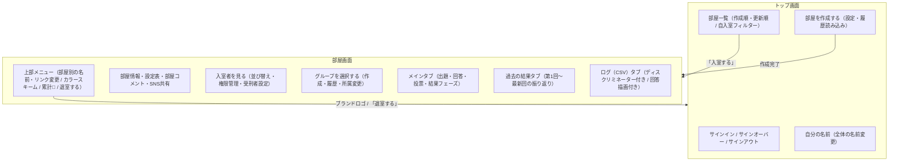
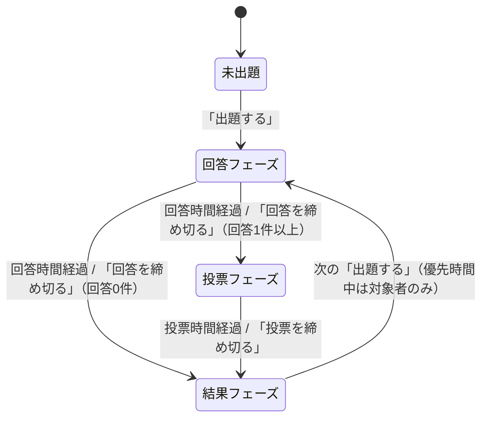
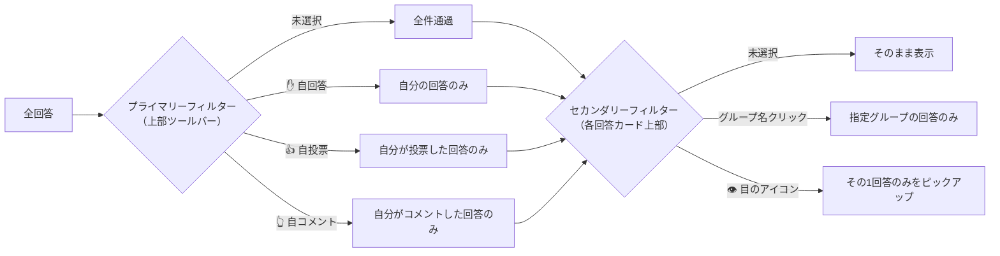
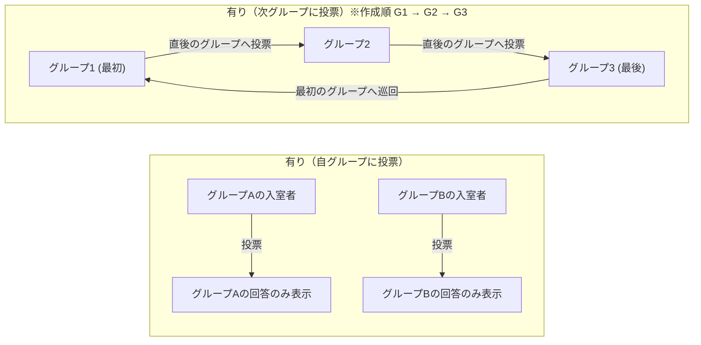

# bǃgǃrǃ ユーザーマニュアル

> **対象バージョン**: 1.140.0（2026年11月23日更新時点）

**bǃgǃrǃ**（ビギリ / *For Beautiful Oogiri Life*）は、ウェブブラウザー上でリアルタイムに大喜利（お題に対するボケ・回答の投稿と相互投票）を楽しめるオンライン大喜利サービスです。少人数の気軽な部屋から、グループ分けや各種制限を活用した大人数の大会・企画まで、幅広いスタイルに対応しています。

---

## 目次

1. [サービスの基本構成と全体の流れ](#1-サービスの基本構成と全体の流れ)
2. [クイックスタート（はじめて遊ぶ方へ）](#2-クイックスタートはじめて遊ぶ方へ)
3. [サインイン・アカウント・プロフィール管理](#3-サインインアカウントプロフィール管理)
4. [トップ画面と部屋一覧の使い方](#4-トップ画面と部屋一覧の使い方)
5. [部屋の作成と設定項目リファレンス](#5-部屋の作成と設定項目リファレンス)
6. [ゲーム進行と各フェーズの操作](#6-ゲーム進行と各フェーズの操作)
7. [順位決定・補正得票数・Zスコア・ユニコーン](#7-順位決定補正得票数zスコアユニコーン)
8. [回答の並び替えと2段階フィルター](#8-回答の並び替えと2段階フィルター)
9. [部屋画面の共通機能・入室者管理・受刑者](#9-部屋画面の共通機能入室者管理受刑者)
10. [グループ機能と投票グループ制限](#10-グループ機能と投票グループ制限)
11. [過去の結果とログ（CSV）ダウンロード](#11-過去の結果とログcsvダウンロード)
12. [キーボードショートカット・便利操作一覧](#12-キーボードショートカット便利操作一覧)
13. [データの保持期間・ライセンス・注意事項](#13-データの保持期間ライセンス注意事項)

---

## 1. サービスの基本構成と全体の流れ

bǃgǃrǃは大きく分けて**トップ画面**（部屋を探したり作成したりするロビー）と**部屋画面**（実際に大喜利を行う空間）の2階層で構成されています。部屋の中では「**出題 → 回答フェーズ → 投票フェーズ → 結果フェーズ**」という1ゲーム（第1回、第2回…）のサイクルを繰り返して進行します。

### 動作環境

- **対応ブラウザー**: ECMAScript 2022に対応した最新のモダンウェブブラウザー（PC・スマートフォン・タブレット対応）。
- 画面幅に応じてレイアウトやボタン群が最適化されるレスポンシブデザインを採用しています。

---

## 2. クイックスタート（はじめて遊ぶ方へ）

1. **サインインする**
   - トップ画面右上の **「サインイン」** を押します。
   - 手軽に始める場合は **「新規サインイン」** を押し、名前（初期値は「お客さん」）を入力して **「設定する」** を押します。Twitter（X）またはBlueskyアカウントによるソーシャルサインインも選べます。
2. **部屋を探して入室する**
   - トップ画面の「部屋一覧」で遊びたい部屋のカードを探し、設定表や説明を確認して **「入室する」** を押します（鍵マーク 🔒 がある部屋ではパスワードを入力します）。
   - グループが設定されている部屋では、入室時に「グループを選択する」画面が表示されるので、参加するグループを選択します。
3. **お題に回答する（回答フェーズ）**
   - 出題（お題）が出されると「回答フェーズ」が始まります。**「回答する」** ボタンを押してテキストや手描きイラストを入力し、送信します。
4. **面白い回答に投票する（投票フェーズ）**
   - 回答が締め切られると「投票フェーズ」になり、みんなの回答が表示されます。気に入った回答の **「投票する」** ボタンを押して票を入れます（投じる票がない場合でも、投票参加の意思表示として **`👍0`** ボタンで0票を投じることができます）。
5. **結果を見て感想を送り合う（結果フェーズ）**
   - 投票が締め切られると「結果フェーズ」になり、順位・得票数・ユニコーン🦄などが発表されます。スマイルボタン（😊）からの絵文字リアクションや **「コメントする」** ボタンで感想を投稿できます。

---

## 3. サインイン・アカウント・プロフィール管理

部屋の閲覧自体はサインインなしでも可能ですが、**部屋の作成**や**部屋への入室**を行うにはサインインが必要です（未サインインのまま「部屋を作成する」や「入室する」を押した場合も自動的に「サインイン」ダイアログが開きます）。

### 3.1 サインイン方法の種類と違い

「サインイン」ダイアログでは、通常のサインインと2種類のソーシャルサインインを利用できます。

| サインイン種別 | 手順・認証方式 | 主な特徴・権限の違い |
| :--- | :--- | :--- |
| **新規サインイン**（通常） | 「新規サインイン」→「名前を設定する」で名前を入力（reCAPTCHAによる確認あり） | アカウント連携不要で即座に利用可能。未出題のまま保持できる自作部屋は**1つまで**。 |
| **Twitterでサインイン** | Twitter（X）の認証画面で連携を承認 | プロフィール画像とアカウントURLを取得。ソーシャルサインイン制限のある部屋で対象権限を得られる。**未出題のまま複数の部屋を作成可能**。 |
| **Blueskyでサインイン** | `@` に続けてハンドル（例：`alice.bsky.social`、最大253文字）を入力しOAuth認証 | アカウントの広い読み書き権限は求めず、**本人確認のみ**を要求（本稼動仕様）。プロフィール画像とURLを取得し、ソーシャルサインイン制限や複数部屋作成に対応。 |

> **プロフィール画像のフォールバック**: ソーシャルサインインで設定されたプロフィール画像が読み込めない場合は、自動的にデフォルトのアバター画像が表示されます。

### 3.2 名前の設定・変更と部屋別プロフィール

名前の初期値は **「お客さん」** です。最大 **20文字** まで設定でき、先頭・末尾の空白は自動的に除去されます（空欄のまま確定した場合は `Undefined` になります）。

bǃgǃrǃでは、**全体の基本名**と**特定の部屋内での名前・リンク**を使い分けることができます。なお、独立した「名前を変更する」メニューは廃止されており、**ナビゲーションバーに表示されている自分の名前自体をクリックする**ことで設定画面が開きます。

1. **全体の名前を変更する（トップ画面）**
   - トップ画面上部のナビゲーションバーにある **自分の名前** をクリックすると「名前を変更する」ダイアログが開きます。
   - ここで変更した名前は、これから新しく入室する部屋やトップ画面での表示名に反映されます。
2. **部屋ごとに名前やソーシャルリンクを変更する（部屋画面）**
   - 部屋画面上部のナビゲーションバーにある **自分の名前** をクリックすると「名前やリンクを変更する」ダイアログが開きます。
   - **名前**: その部屋の中だけで表示される名前（最大20文字）に変更できます。他の部屋やトップ画面の名前には影響しません。
   - **リンク**: 入室者一覧やメニューバーに表示するソーシャルリンクを **「無し」** または **「有り（URL）」**（`http://` または `https://` で始まる最大150文字のURL）から選択・変更できます。
   - リンク先URLに応じてアイコンが自動判別されます（`twitter.com`・`x.com`・`bsky.app` は各ブランドアイコン、その他のURLは人物アイコン）。部屋内で名前を変更している場合や、名前にハッシュ値（トリップ）を付加している場合でもリンクを表示できます。

### 3.3 トリップ（ハッシュ値付加）とディスクリミネーター（トークン）

同名プレイヤーのなりすまし防止や個体識別のために、2つの仕組みが用意されています。

- **名前に付加するハッシュ値（トリップ機能）**
  - 名前を設定・変更する際、`名前#任意の文字列` のように `#` に続けて秘密の文字列を入力すると、`#` 以降が暗号学的ハッシュ関数によって **8文字の文字列** に変換されて表示されます（例：`お客さん#mykey` → `お客さん#98M86ywP`）。
  - ソーシャルサインインを使わずに複数の部屋をまたいで本人であることを示したい場合に有効です。
- **ディスクリミネーター（トークン）**
  - 各部屋において、入室者ごとに一意な **8文字の識別文字列**（ディスクリミネーター／トークン）が自動的に割り当てられます。
  - 「入室者を見る」画面の各入室者カードの右端に常時表示されるほか、以下の箇所で**名前をクリック**すると、表示が名前とトークン（等幅フォント）の間で切り替わります。
    - メイン画面および「過去の結果」画面の出題者名・回答者名・投票者名・コメント投稿者名
    - 「グループを選択する」画面内の入室者名

### 3.4 サインオーバー（別ブラウザー・別端末への引き継ぎ）

通常のサインイン状態や現在のアカウント状態を、スマートフォンや別のPCブラウザーに引き継ぎたい場合は **「サインオーバー」** を使用します。

1. トップ画面または部屋画面上部の **「サインオーバー」** を押します。
2. 引き継ぎ用の **専用URL** と **QRコード** が生成されます（**有効期限は発行から1時間以内**）。
3. **「URLをコピーする」** ボタンを押してURLをコピーするか、別端末のカメラでQRコードを読み取ってリンクを開きます。
4. 移動先のブラウザーで「サインオーバー」確認ダイアログが表示されるので、**「サインイン」** を押すと引き継ぎが完了します。

### 3.5 サインアウト

- トップ画面上部の **「サインアウト」** からサインアウトできます（最短時間制限はありません）。
- **注意**: 「新規サインイン」（通常サインイン）を利用している場合、事前にサインオーバー等で引き継ぎを行わずにサインアウトすると、元のユーザー情報（作成者権限や入室状態など）には戻れなくなります。

---

## 4. トップ画面と部屋一覧の使い方

### 4.1 トップ画面の上部エリア

- **公式連絡先・アカウント**: メールアドレス（`bigiri@oogiri.org`）、Bluesky（`@bigiri.oogiri.org`）、Twitter / X（`@bigirichan`）へのリンクが並んでいます。
- **更新情報**: 直近のアップデート内容が3件表示されます。**「更新情報を全て見る」** ボタンを押すと、過去の全リリース履歴をダイアログウィンドウで閲覧できます。
- **使用方法**: AI生成による「bǃgǃrǃ ユーザーマニュアル」および、質問や機能提案を行えるGitHub上の「ディスカッション」へのリンクが掲載されています。
- **Atomフィード**: 「部屋一覧」見出しの上にあるフィードリンク（`https://bigiri.oogiri.org/atom.xml`）をRSS/Atomリーダーに登録すると、新しく作成された部屋の情報を購読できます。

### 4.2 部屋一覧の並び替えと「自入室フィルター」

部屋一覧の右上にあるコントロールから、表示順の切り替えと絞り込みが行えます。

- **表示順ドロップダウン**
  - **「作成順」**（初期値）：部屋が作成された日時が新しい順（降順）に並べます。
  - **「更新順」**：出題などが行われた最終更新日時が新しい順（降順）に並べます。現在アクティブに進行している部屋を探すのに便利です。
- **自入室フィルター（🖖 ボタン）**
  - 表示順ドロップダウンの横にあるスポックハンド（🖖）ボタンを押してオン（塗りつぶし状態）にすると、**現在自分が入室している部屋のみ**が表示されます。もう一度押すと解除されます。

### 4.3 部屋カードの見方

各部屋のカードには以下の情報が集約されています。

- **SNS共有・検索リンク（カード左上）**:
  - Twitter（X）ボタンおよびBlueskyボタンを押すと、部屋名・説明の1行目・部屋のURL・ハッシュタグ（`#bǃgǃrǃ` と空白を除いた `#部屋名`）が自動入力された投稿画面が開きます。
  - ボタン横の部屋名リンクを押すと、それぞれのSNSで部屋名をキーワード検索した結果が開きます。
- **部屋の基本情報と設定一覧**:
  - 部屋名、アイコン画像、説明文（文中のURLは自動的にリンク化）、およびその部屋の全ルール設定が3列の表形式で表示されます。
  - 出題回数と最終更新日時（未出題の場合は「出題はありません」）、入室制限がある場合は鍵マーク（🔒）が表示されます。
- **操作ボタン**:
  - **「入室する」**：その部屋に入室して部屋画面へ遷移します。
  - **「部屋を削除する」**：自分がその部屋の作成者である場合のみ表示され、確認ダイアログを経て部屋を削除できます。
- **入室者フッター**:
  - 現在の入室者数（🖖）と入室者名の一覧が表示されます。自分が入室している部屋では、**自分の名前が強調色**で表示されます。

---

## 5. 部屋の作成と設定項目リファレンス

トップ画面の **「部屋を作成する」** ボタンを押すと、部屋作成ダイアログが開きます。

> **部屋作成の制限について**: 通常のサインイン（「新規サインイン」）では、**自分が作成した「未出題」の部屋が既に1つ存在する場合、その部屋で1回以上出題するか部屋を削除するまで新しい部屋を作成できません**（「部屋を作成する」ボタンが無効になります）。TwitterまたはBlueskyによる**ソーシャルサインイン**を行っている場合は、未出題のまま複数の部屋を作成できます。

### 5.1 設定の自動保存と「履歴を見る」機能

- **直近設定の自動引き継ぎ**: 部屋を作成すると、アイコン画像を含む設定内容がブラウザーに記憶され、次回「部屋を作成する」を開いた際の初期値になります。
- **部屋作成履歴（「履歴を見る」）**:
  - 「部屋名」入力欄の右にある **「履歴を見る」** ボタンを押すと、同じブラウザーで過去に作成した部屋の履歴（部屋名・説明・作成日時）が一覧表示されます。
  - **「履歴を読み込む」** を押すとその設定が一括でフォームに反映され、**「履歴を削除する」** で履歴から削除できます。同一の部屋名で部屋を作成した場合、履歴には最新の設定のみが残ります。

### 5.2 基本設定項目

| 項目名 | 選択肢・入力仕様 | 初期値 | 詳細説明 |
| :--- | :--- | :--- | :--- |
| **部屋名** | 必須・1〜150文字（先頭・末尾の空白不可） | 前回値 | 部屋のタイトル。SNS共有時のハッシュタグにも利用されます。 |
| **説明** | 任意・最大1,500文字（複数行可） | 無し | 部屋の趣旨やハウスルールなどを記載できます。行数に応じて入力欄が自動伸張し、URLは自動でリンクになります。 |
| **アイコン画像** | 任意・画像ファイル選択 | 前回値 | 面積が $180 \times 180 = 32{,}400\text{ px}^2$ 以下になるようアスペクト比を保って自動縮小されます（容量制限あり。「削除する」で解除可能）。 |
| **カラースキーム** | `無し` / `☀️ ライト` / `🌙 ダーク` | `無し` | 入室時のデフォルト配色を指定します（入室後に各ユーザーがメニューバーから一時変更することも可能です）。 |
| **入室制限** | `無し` / `有り（パスワード）`（空白なし1〜15文字） | `無し` | パスワードを設定すると鍵付き部屋になります。部屋作成者本人はパスワード入力なしで入室できます。 |

### 5.3 出題に関する設定

| 項目名 | 選択肢・入力仕様 | 初期値 | 詳細説明 |
| :--- | :--- | :--- | :--- |
| **出題優先時間** | `無し` / `有り（部屋作成者）（秒）` / `有り（首位回答者）（秒）` （秒数は最大6桁の非負整数） | `無し` （秒数欄 `60`） | 結果フェーズ移行後、指定秒数の間だけ次の出題権を特定ユーザーに優先付与します。 ・**部屋作成者**: 指定秒数の間、部屋作成者のみが出題可能。 ・**首位回答者**: 指定秒数の間、**その回に投票を行った回答者のうち最上位の回答者**のみが出題可能（結果画面で該当回答の**回答者名が明滅**します。投票していない回答者は対象外で、該当者不在時は誰でも出題可能）。 ※部屋作成者は「出題優先を締め切る」で途中解除できます。 |
| **出題者制限（初期値）** | `無し` / `有り` / `有り（ソーシャルサインイン）` | `無し` | ・**無し**: 入室者全員が出題可能。 ・**有り**: 部屋作成直後は**部屋作成者のみ**を出題者に登録（後から「入室者を見る」画面で追加・削除可能）。 ・**有り（ソーシャルサインイン）**: TwitterまたはBlueskyでサインインしている入室者のみ出題可能。 |
| **出題画像制限** | `無し` / `有り（禁止）` | `無し` | `有り（禁止）` にすると、出題時に画像を添付できなくなります（テキストお題専用部屋）。 |
| **出題コメント制限** | `無し` / `有り（部屋作成者）` | `無し` | `有り（部屋作成者）` にすると、出題へのコメントおよびリアクションを部屋作成者のみが行えます。 |

### 5.4 回答に関する設定

| 項目名 | 選択肢・入力仕様 | 初期値 | 詳細説明 |
| :--- | :--- | :--- | :--- |
| **回答表示** | `即時` / `一斉（投票フェーズまで非表示）` | `一斉` | ・**即時**: 投稿された回答がその場で全員に表示されます。 ・**一斉**: 回答フェーズ中は自分の回答だけが見え、投票フェーズ開始時に全員の回答が一斉公開されます（回答締め切りまで自分の回答の変更・削除が可能）。 |
| **回答時間制限** | `無し` / `有り（秒）` （最大6桁の非負整数） | `有り`（`180`秒） | 出題から回答フェーズが自動終了するまでの制限時間です。`無し` の場合は部屋作成者が「回答を締め切る」を押すまで継続します。 |
| **回答シャッフル時間** | `無し` / `有り（秒）` （空欄＝`∞`、または最大6桁の非負整数） | `有り`（空欄＝`∞`） | 投票フェーズ等で「設定順」を選んだ際の並び順を制御します。 ・**無し**: 投稿順（一斉時は先着順、即時時は後着順）で表示。 ・**有り（空欄 `∞`）**: **全回答**を入室者ごとに異なる乱数シードでシャッフル表示。 ・**有り（秒数指定）**: 出題から指定秒数以内の回答のみをシャッフルし、それ以降の回答は投稿順のまま後ろに配置します。 |
| **回答数制限** | `無し` / `有り（答）` （最大6桁の正の整数） | `有り`（`1`答） | 1回の出題につき1人が投稿できる回答数の上限です。 |
| **回答者名表示** | `表示` / `非表示` / `一斉（結果フェーズまで非表示）` | `一斉` | ・**表示**: 最初から回答者名を表示。 ・**非表示**: 結果フェーズ・過去の結果・CSVログを含め回答者名を非表示（完全匿名）。 ・**一斉**: 回答・投票フェーズ中は伏せ、結果フェーズで一斉公開します。 |
| **回答者制限（初期値）** | `無し` / `有り` / `有り（ソーシャルサインイン）` | `無し` | 出題者制限と同様。`有り` にすると初期状態では部屋作成者のみが回答者に設定され、「入室者を見る」から参加者を追加できます。 |
| **回答コメント制限** | `無し` / `有り（部屋作成者）` | `無し` | `有り（部屋作成者）` にすると、結果フェーズでの各回答へのコメント・リアクションを部屋作成者のみに制限します。 |
| **回答描画制限** | `無し` / `有り（禁止）` | `無し` | `有り（禁止）` にすると、回答時の手描きイラスト（描画キャンバス）機能を禁止します。 |

### 5.5 投票に関する設定

| 項目名 | 選択肢・入力仕様 | 初期値 | 詳細説明 |
| :--- | :--- | :--- | :--- |
| **投票表示** | `即時` / `一斉（結果フェーズまで非表示）` | `一斉` | ・**即時**: 投票すると即座に得票数・投票者が反映されます（投票後の変更・削除は不可）。回答表示も `即時` の場合は回答フェーズ中から投票できます。 ・**一斉**: 結果フェーズまで得票状況を伏せます（投票フェーズ終了まで自分の投票の変更・削除が可能）。 |
| **投票時間制限** | `無し` / `有り（出題毎+回答毎×）（秒）` （出題毎：最大6桁整数、回答毎：小数第1位まで・最大4文字） | `有り` （`60` + `0.0`×秒） | 投票フェーズの制限時間を回答数に応じて自動延長できます（計算式は後述）。`無し` の場合は部屋作成者が「投票を締め切る」を押すまで継続します。 |
| **投票数制限（出題毎）** | `無し` / `有り（票）` / `有り（超過可）（票）` （最大6桁の正の整数） | `無し` （票数欄 `5`） | 1回の出題で1人が投じられる合計票数の上限です。 ・**有り（票）**: 合計票数が指定値を超えないよう厳密に制限します。 ・**有り（超過可）（票）**: 現在の合計投票数が設定値未満であれば、**最後の1回の投票で設定値を超えて投票すること**を許可します。 |
| **投票数制限（回答毎）** | `無し` / `有り（票）` （最大6桁の正の整数） | `有り`（`3`票） | 1つの回答に対して1人が投じられる票数の上限です。 |
| **投票者名表示** | `表示` / `非表示` / `一斉（結果フェーズまで非表示）` | `一斉` | 誰がどの回答に何票入れたかの名前表示を、常時表示／完全非表示／結果フェーズで一斉公開から選択します。 |
| **投票者制限（初期値）** | `無し` / `有り` / `有り（ソーシャルサインイン）` | `無し` | 投票できる入室者の初期制限です（「入室者を見る」画面からいつでも個別変更可能）。 |
| **投票グループ制限** | `無し` / `有り（自グループに投票）` / `有り（次グループに投票）` | `無し` | グループ作成時の投票対象を制御します（詳細は「[10. グループ機能と投票グループ制限](#10-グループ機能と投票グループ制限)」を参照）。 |

#### 投票時間制限の計算式

「投票時間制限」を `有り（出題毎+回答毎×）（秒）` に設定し、出題毎の基本秒数を $T_0$、回答毎の追加秒数を $T_b$（空欄時は $0$）とした場合、投票時間 $T_{\text{vote}}$（秒）は次式で決まります。

$$
T_{\text{vote}} = T_0 + T_b \times M
$$

ここで $M$ は対象回答数であり、通常は全体の回答数 $N$ が用いられますが、「投票グループ制限」が有効かつ部屋にグループが存在する場合は、各グループ $g$ の回答数 $N_g$ の最大値 $M = \max_{g} N_g$ が採用されます。

なお、「回答表示：即時」かつ「投票表示：即時」の組み合わせで投票時間制限を設定している場合は、各回答が投稿された時刻からそれぞれ個別に $T_{\text{vote}}$ 秒間の投票タイマーが動作します。

---

## 6. ゲーム進行と各フェーズの操作

部屋の「メイン」タブでは、以下の状態遷移に従って大喜利が進行します。回答が1件も投稿されずに回答フェーズが終了した場合は、投票フェーズをスキップして即座に結果フェーズへ移行します。

### 6.1 出題する

「出題はありません」の状態、または「結果フェーズ」中（出題優先時間による制限がない状態、または自分が優先対象者の場合）に、出題権限を持つ入室者は **「出題する」** ボタンを押してお題を出せます。

- **出典**（任意・最大150文字）：画像や引用元のURL・書名などを記載できます（URLは自動でリンク化されます）。ローカル画像を選択した際は初期値としてファイルURLが自動入力され、画像を削除するとクリアされます。
- **画像お題**（「出題画像制限」が `無し` の場合）：
  - **「画像有り」** ボタンを押して画像ファイルを選択します（「画像無し」や「削除する」で取り消し可能）。
  - 画像は面積 $S = W \times H$ が $320 \times 320 = 102{,}400\text{ px}^2$ を超える場合、アスペクト比を維持したまま倍率 $r = \sqrt{102{,}400 / (W \times H)}$ で自動縮小されます（透過画像の背景は白で描画されます）。
  - 画像を添付すると出題本文のプレースホルダーが `🖌️` に変わり、**出題本文を空欄にした「画像のみのお題」**も投稿できます。
- **出題本文**：最大 **1,500文字**（画像がない場合は空白以外の文字が1文字以上必須）。入力中に `Ctrl + Enter` または `Command (Windows) + Enter` を押すことでも即座に出題できます。

### 6.2 回答フェーズ

出題が行われると **「回答フェーズ」** が始まり、残り時間のプログレスバー（時間制限がある場合）が表示されます。

- **回答の投稿（「回答する」ダイアログ）**
  - ダイアログのヘッダーには現在のお題文と出題画像が縮小表示され、フッターには残り時間タイマーが表示されます（入力中に制限時間を迎えるとダイアログは自動的に閉じます）。
  - **テキスト回答**: 最大 **1,500文字**（手描き描画がない場合は空白以外の文字が1文字以上必須）。複数行入力すると行数に合わせて入力欄が自動で広がります。`Ctrl + Enter` または `Command (Windows) + Enter` で送信可能です。
  - **手描き回答描画**（「回答描画制限」が `無し` の場合）：
    - **「描画有り」** ボタンを押すと、$240 \times 180\text{ px}$ の手描きキャンバスが表示されます（「描画無し」で非表示に戻せます）。
    - マウスドラッグ、タッチ操作、スタイラスペンで黒い線画を描けます。
    - キャンバス右下のボタンで **元に戻す（Undo）**・**やり直す（Redo）** が行え、中央に現在のデータ要素数が表示されます（上限は **最大1,500要素**）。
    - 描画データがある場合、回答本文のプレースホルダーが `🖊️` に変わり、**テキストなしの「イラスト（フリップ）のみ」での回答**も可能です。
- **投稿済み回答の変更・削除（「回答表示：一斉」の場合）**
  - 回答表示が「一斉」の部屋では、回答フェーズ中に限り自分の回答カードに **「回答を変更する」** と **「回答を削除する」** ボタンが表示され、締め切りまで何度でも修正・取り消しができます。
- **部屋作成者の操作**
  - 部屋作成者は **「回答を締め切る」** ボタンを押すことで、制限時間前でも手動で回答を締め切って次のフェーズへ進められます（回答時間制限が「無し」の部屋ではこのボタンで進行します）。

#### 長文の折りたたみと画像のズーム表示

- 出題文や回答文が **10行を超える** か **150文字を超える** 場合、超過位置に **`＋残文字数`** ボタンが表示され、後半が折りたたまれます。ボタンを押すと全文が展開され、もう一度押すと（`－残文字数`）再び折りたたまれます。
- 出題画像および回答の手描きイラストをクリック（タップ）すると、画面上で拡大（ズーム）表示できます。

### 6.3 投票フェーズ

回答フェーズが終了すると、集計準備のスピナー表示を経て **「投票フェーズ」** が開始されます（回答表示が「即時」かつ投票表示が「即時」の場合は回答フェーズ中から投票可能です）。自分の回答（一斉回答時など）には投票ボタンは表示されません。

- **通常の投票（「投票する」ダイアログ）**
  - 各回答カードの **「投票する」** ボタンを押すとダイアログが開きます。
  - 初期値は投票可能な状態であれば `1`（上限に達している場合は `0`）に設定されています。
  - `－` / `＋` ボタンで票数を調整して **「投票する」** を押します。ダイアログを開いた直後は票数カウンターにフォーカスが当たっているため、**`Space` キーで増票、`Delete` キーで減票、`Enter` キーで確定**というキーボード操作だけで素早く連続投票できます。
- **0票クイック投票（`👍0` ボタン）**
  - 未投票の回答カードには、「投票する」ボタンの左隣に **`👍0`** ボタンが表示されます。これを押すとダイアログを開かずにワンクリックで **0票** を投じることができます。
  - **0票投票の活用場面**: bǃgǃrǃでは**「その出題で1回でも投票（0票を含む）を行った回答者」**であることが、後述する「補正得票数」や「出題優先時間（首位回答者）」の対象条件になります。どの回答にも1票以上を入れたくない場合や、自分の回答以外に高評価をつけたくない場合でも、いずれかの回答に `👍0` を押しておくことで「投票に参加した」と記録されます。
- **投票の確認・変更・削除**
  - 「投票表示：一斉」の部屋では、投票済みの回答カードに **「投票を変更する」**・**「投票を削除する」** ボタンが表示され、投票締め切りまで自由に調整できます。
  - 回答一覧上部の自投票フィルター横にあるリストボタン（または「投票数制限（出題毎）」の上限に達した際に未投票カードに表示される **「投票を見る」** ボタン）を押すと **「投票を見る」** ダイアログが開き、自分が投票した回答一覧と **合計投票数／出題毎の上限票数**（例：`👍 5/5`）を確認しながらその場で変更・削除できます。
- **「有り（超過可）」設定時の挙動**
  - 「投票数制限（出題毎）」が `有り（超過可）（票）`（上限 $L$ 票）の部屋では、現在の合計投票数が $L$ 票未満である限り、次の1回の投票で合計が $L$ 票を超える票数（回答毎の上限の範囲内）を投じることができます。合計が $L$ 票以上に達した後は、他の未投票回答へは1票以上の追加投票ができなくなります。
- **部屋作成者の操作**
  - 部屋作成者は **「投票を締め切る」** ボタンを押すことで、制限時間前でも投票を終了して結果フェーズへ移行できます。

### 6.4 結果フェーズとコメント・リアクション

投票が締め切られるとスコア集計が行われ、**「結果フェーズ」** に移行します。

- 各回答カードに **順位**、**回答者名**（非表示設定を除く）、**グループ名**（設定時）、**合計得票数**、および **投票者ごとの内訳**（投票数の多い順、同数の場合は投票順）が表示されます。
- **回答毎の自投票フィルター**: 各回答カードの得票数表示（`👍n`）をクリックすると、その回答に対する**自分の投票のみ**に絞り込んで表示を切り替えられます。
- **コメントとクイックコメント（リアクション）**:
  - **出題に対するコメント・リアクション**: 全フェーズを通じて、出題文の下にスマイルボタン（😊）と **「コメントする」** ボタンが表示されます（「出題コメント制限」がある場合は部屋作成者のみ）。
  - **回答に対するコメント・リアクション**: 結果フェーズ中、各回答カードのフッターにスマイルボタン（😊）と **「コメントする」** ボタンが表示されます（「回答コメント制限」がある場合は部屋作成者のみ）。
  - **クイックコメント（リアクション）**: スマイルボタン（😊）を押すと、以下の **9種類の絵文字** から選んでワンクリックでリアクションコメントを送信できます。
    > 😂　🤣　🥰　🥹　😭　😳　🤔　😡　🫡
  - **テキストコメント**: 「コメントする」ボタンから最大 **150文字**（空文字列も可、URLは自動リンク化）のコメントを投稿できます。自分のコメントは名前部分が強調色で表示されます。
- **出題優先時間の進行**:
  - 「出題優先時間」が設定されている部屋では、結果フェーズ開始と同時に優先時間のタイマーが動作します。
  - `有り（首位回答者）` の場合、優先権を持つ1位回答者の名前がカードヘッダーで**明滅（点滅）**します。部屋作成者は **「出題優先を締め切る」** ボタンで優先時間を即座に終了させることも可能です。

---

## 7. 順位決定・補正得票数・Zスコア・ユニコーン

結果フェーズおよび「過去の結果」画面では、単なる得票数だけでなく、投票参加状況を加味した**補正得票数**と統計的な**Zスコア（標準化変量）**が算出されます。

### 7.1 順位の決定ルール（同点時の優先順位）

回答の順位は、以下の優先順位で厳密に決定されます。

1. **得票数**が多い順（降順）
2. 得票数が同じ場合は、**回答者の投票数に基づく補正値**が大きい順（その回に投票を行った回答者が、未投票の回答者より優先されます）
3. 補正値も同じ場合は、**回答の投稿日時が早い順**（先着順）
4. 投稿日時も同一の場合は、内部IDの辞書順

### 7.2 補正得票数のZスコア計算式

ある出題における全回答数を $N$ とし、各回答 $i \in \{1, 2, \dots, N\}$ の得票数を $v_i$、回答者の投票数による補正値を $p_i$ としたとき、**補正得票数**を $x_i = v_i + p_i$ と定義します。

全回答の補正得票数の平均 $\mu$ と母標準偏差 $\sigma$ はそれぞれ次式で求められます。

$$
\mu = \frac{1}{N} \sum_{i=1}^{N} x_i, \qquad \sigma = \sqrt{\frac{1}{N} \sum_{i=1}^{N} (x_i - \mu)^2}
$$

これを用いて、各回答 $i$ の **Zスコア** $z_i$ は次のように算出されます。

$$
z_i = \begin{cases} \dfrac{x_i - \mu}{\sigma} & (\sigma > 0) \\[6pt] 0 & (\sigma = 0) \end{cases}
$$

> **Zスコアの数値確認**: 結果フェーズや「過去の結果」画面で、各回答の右上に表示されている **順位（`1位` など）をクリック**すると、小数点以下4桁のZスコア数値（例：`2.3456`）と順位表記を切り替えられます。

### 7.3 ユニコーン（🦄）・アイスクリーム（🍦）・上下線の表示基準

算出されたZスコア $z_i$ に応じて、順位の装飾およびシンボルが付与されます。

| Zスコア $z_i$ の範囲 | 順位の装飾 | 付与されるシンボルと個数 | 意味合い |
| :--- | :--- | :--- | :--- |
| $z_i \ge 2$ | **下線**あり | **ユニコーン 🦄** を $\lfloor z_i \rfloor - 1$ 個 （$z_i \ge 2$ で1個、以降 $+1$ ごとに1個増加） | 突出して高い評価を得た回答（部屋内の累計ユニコーンに加算） |
| $1 \le z_i < 2$ | **下線**あり | なし | 平均より1標準偏差以上高い評価を得た回答 |
| $-1 < z_i < 1$ | 装飾なし | なし | 標準的な得票範囲の回答 |
| $-2 < z_i \le -1$ | **上線**あり | なし | 平均より1標準偏差以上低い回答 |
| $z_i \le -2$ | **上線**あり | **アイスクリーム 🍦** を $\lfloor -z_i \rfloor - 1$ 個 （$z_i \le -2$ で1個、以降 $-1$ ごとに1個増加） | 平均から大きく下方に離れた回答 |

獲得したユニコーン（🦄）はその部屋における個人の累計獲得数として記録され、**部屋画面上部のメニューバー**（自分の名前の横）および **「入室者を見る」画面**に表示されます。

---

## 8. 回答の並び替えと2段階フィルター

メイン画面（回答・投票・結果フェーズ）および「過去の結果」画面では、回答一覧の上部に固定表示（スティッキー表示）されるツールバーから、表示順の変更や多彩な絞り込みが行えます。フェーズが切り替わると表示順やフィルターは初期状態にリセットされます。

### 8.1 回答の表示順（ソート）

| 表示順ラベル | 利用可能な画面 | 並び順の内容 |
| :--- | :--- | :--- |
| **設定順**（初期値） | 全フェーズ・過去の結果 | 部屋設定に従う標準順序（回答・投票フェーズでは一斉/即時・シャッフル設定順、結果フェーズ・過去の結果では順位順） |
| **先着順** | 全フェーズ・過去の結果 | 回答の投稿日時が早い順（古い順） |
| **後着順** | 全フェーズ・過去の結果 | 回答の投稿日時が遅い順（新しい順） |
| **上位順** | 全フェーズ・過去の結果 | 得票スコアが高い順 |
| **下位順** | 全フェーズ・過去の結果 | 得票スコアが低い順 |
| **多コ順** | 結果フェーズ・過去の結果 | 回答についたコメント（リアクション含む）が多い順（同数時は順位順） |
| **少コ順** | 結果フェーズ・過去の結果 | 回答についたコメントが少ない順 |

### 8.2 プライマリーフィルターとセカンダリーフィルター

回答の絞り込みは**プライマリーフィルター**（上部ツールバー）と**セカンダリーフィルター**（各回答カードのヘッダー）の2階層で動作します。オンになっているボタンはアイコンが塗りつぶし（ソリッド）表示になります。

1. **プライマリーフィルター**（いずれか1つを選択可能。切り替えるとセカンダリーフィルターは解除されます）
   - **自回答フィルター（✋）**：全フェーズ・過去の結果で利用可能。自分が投稿した回答のみを表示します（回答フェーズでは横に自分の回答数が表示されます）。
   - **自投票フィルター（👍）**：投票フェーズ・結果フェーズ・過去の結果で利用可能。自分が投票した回答のみを表示します（投票フェーズでは横に自分の合計投票数が表示されます）。
   - **自コメントフィルター（👆）**：結果フェーズ・過去の結果で利用可能。自分がコメントまたはリアクションを送った回答のみを表示します（横に該当件数が表示されます）。
2. **セカンダリーフィルター**（結果フェーズ・過去の結果の各回答カード上で操作）
   - **グループフィルター**：回答者名の左に表示される **グループ名** をクリックすると、そのグループに属する回答だけを抽出します（もう一度押すと解除）。
   - **回答ピックアップ（👁️）**：回答カード右上の目のアイコンを押すと、**その回答1件だけ**を画面に単独表示します。配信での振り返りやスクリーンショット撮影に便利です（もう一度押すと解除）。

---

## 9. 部屋画面の共通機能・入室者管理・受刑者

### 9.1 ナビゲーションバーとカラースキーム・退室操作

部屋画面の上部メニューからは以下の操作が行えます。

- **タブ切り替え（「メイン」／「過去の結果」／「ログ（CSV）」）**: タブを切り替えると、部屋情報ヘッダーの下にある各タブのコンテンツ領域まで自動的にスクロールします。
- **カラースキーム切り替えボタン**: 部屋の配色を **「◐ オート」**（ブラウザーやOSの設定に従う）／**「☀️ ライト」**／**「🌙 ダーク」** からその場で切り替えられます（この切り替えは一時的なものでブラウザーには保存されません）。
- **「退室する」**: 確認ダイアログを開き、部屋から退室してトップ画面へ戻ります（退室後も、過去に出題・回答・投票を行っていた場合は部屋の記録上の入室者履歴には残ります）。
- **部屋コメント（部屋作成者専用）**: 部屋設定表の下にある **「コメントする」** ボタンから、部屋全体に常時表示されるアナウンス文（最大150文字、URL自動リンク化）を複数行追加できます。**「コメントを削除する」** を押すと、投稿済みの部屋コメントのうち**最新の1件**が削除されます。

### 9.2 「入室者を見る」画面と並び替え

部屋の **「入室者を見る」** ボタンを押すと、現在の入室者数とメンバー一覧（過去に出題・回答・投票した退室者を含む）が表示されます。右上のドロップダウンから以下の **10種類の表示順** を選べます。

- **先入順** ／ **後入順**：部屋への入室日時が古い順／新しい順
- **多🦄順** ／ **少🦄順**：その部屋でのユニコーン獲得数が多い順／少ない順
- **昇名順** ／ **降名順**：表示名のUnicodeコード順（昇順／降順）
- **昇Di順** ／ **降Di順**：ディスクリミネーター（8文字トークン）のUnicodeコード順（昇順／降順）
- **古サ順** ／ **新サ順**：アカウントのサインイン（登録）日時が古い順／新しい順

### 9.3 権限の個別付与と「受刑者」（強制退室）機能

部屋作成者が「入室者を見る」画面を開くと、各入室者の行に管理ボタン群が表示されます（画面幅の狭いスマートフォン等では `…` ボタンで操作パネルを開閉できます）。

- **ロール（役割）の個別設定**
  - **「出題者へ追加する」／「出題者から削除する」**
  - **「回答者へ追加する」／「回答者から削除する」**
  - **「投票者へ追加する」／「投票者から削除する」**
  - **仕様上のポイント**: いずれかのロールに1人でも入室者が追加されている間は、その登録リストに入っているユーザーのみが該当操作を行えます（部屋作成画面で設定した「ソーシャルサインイン」制限よりも、ここでの個別リストが優先されます）。登録メンバーを全員削除すると個別制限が解除され、部屋作成時の初期設定（「無し」または「ソーシャルサインイン」）に戻ります。
- **受刑者（強制退室・BAN）管理**
  - **「受刑者へ追加する」** を押すと、対象の入室者は**強制退室**となり、その部屋への再入室や操作ができなくなります。入室者一覧では名前に**取り消し線**が付いて表示されます。
  - 誤って指定した場合などは **「受刑者から削除する」** で解除できます。

---

## 10. グループ機能と投票グループ制限

大人数の大喜利大会で予選ブロックを分けたい場合や、チーム戦を行いたい場合は **グループ機能** を使用します。

### 10.1 グループの作成・履歴・選択

部屋の **「グループを選択する」** ボタンを押すとグループ管理・選択ダイアログが開きます。

1. **グループの作成・削除（部屋作成者のみ）**
   - **「グループを作成する」** ボタンを押し、**グループ名**（必須：1〜20文字、先頭・末尾の空白不可。同名グループの重複作成も可）と **説明**（任意：最大1,500文字）を入力して作成します。
   - グループ名横の **「履歴を見る」** ボタンから、同じブラウザーで過去に作成したグループ設定を読み込んだり（**「履歴を読み込む」**）、履歴から削除したり（**「履歴を削除する」**）できます。
   - 不要になったグループは **「グループを削除する」** で削除できます。
2. **入室者のグループ選択**
   - 部屋作成者がグループを作成すると、まだグループに所属していない入室者、後から入室してきた入室者、および所属グループが削除された入室者には自動的に「グループを選択する」ダイアログが表示されます。
   - 入室者は希望するグループのラジオボタンを選ぶだけで即座に所属を変更でき、ナビゲーションバーや入室者一覧の名前の横に `@グループ名` が表示されます。

### 10.2 「投票グループ制限」の動作パターン

部屋作成時の「投票グループ制限」の設定に応じて、投票フェーズで各入室者に表示される回答が以下のように切り替わります（グループが1つも作成されていない場合は、いずれの設定でも通常通り全員の回答が表示されます）。

- **無し**：投票フェーズでも全グループの回答が全員に表示されます。グループはチーム表示や結果フェーズでの「グループフィルター」、CSV集計用の属性として利用できます。
- **有り（自グループに投票）**：投票フェーズにおいて、**自分と同じグループの回答者の回答だけ**が表示されます（グループ未選択の入室者には未選択の回答のみが表示されます）。複数ブロックの同時進行に最適です。
- **有り（次グループに投票）**：投票フェーズにおいて、**自分のグループの直後に作成されたグループの回答だけ**が表示されます。自分のグループが最後に作成されたグループである場合は、**最初に作成されたグループの回答**が表示されます（グループ未選択の場合は未選択の回答のみ表示）。自分の出場ブロック以外のブロックを審査する方式に最適です。

> **グループ投票時の回答数表示**: 「投票グループ制限」が有効でグループが存在する場合、回答フェーズおよび投票フェーズの右下に表示される回答数カウンターは `対象グループの回答数/全体の回答数`（例：`✋ 6/18`）の形式で表示されます。結果フェーズになると全グループの回答が一斉に公開されます。

---

## 11. 過去の結果とログ（CSV）ダウンロード

### 11.1 「過去の結果」タブ

- その部屋で行われた直近 **34.5日以内** の終了済みゲーム（第1回〜最新回）を、画面上部のページネーションで切り替えて閲覧できます。
- 結果フェーズと同じく、7種類の表示順切り替え、プライマリー／セカンダリーフィルター、順位クリックによるZスコア表示、回答毎の自投票フィルター、画像のズーム表示がすべて利用可能です（読み取り専用のためコメントの追加はできません）。

### 11.2 「ログ（CSV）」タブと出力フォーマット

部屋の「ログ（CSV）」タブでは、直近 **34.5日以内** の出題・回答・得票データを1つのCSVファイル（UTF-8 BOM付き、ファイル名 `<部屋名>.csv`）としてダウンロードできます。リンクをクリックするとサーバー側で生成・転送が行われ、処理中はスピナーが表示されます。

画面下のスイッチで **2つの付加オプション** を個別にオン／オフできます。

1. **ディスクリミネーター付き**
   - オンにすると、出題者名・回答者名・各投票者名のセルにおいて、名前の後ろに**改行（LF）区切りで8文字のディスクリミネーター（トークン）**が付加されます。名前を途中で変更した参加者の名寄せや、同名参加者の区別を行う集計に便利です。
2. **回答描画付き**
   - オンにすると、手描きの回答描画がある回答について、回答本文セルの先頭に **SVG形式のデータURI**（`data:image/svg+xml,...`）が1行付加され、改行に続けて回答本文が出力されます。
   - このデータURI文字列をウェブブラウザーのアドレス欄に貼り付けて開くことで、手描きイラストを画像として表示・確認できます（SVG変換の仕様上、線の太さなどは部屋画面上のキャンバス表示と異なって見える場合があります）。

#### CSVファイルのカラム（列）構成

CSVにはヘッダー行はなく、1回答につき1行（順位順）で出力されます（回答が0件だった出題は第1〜第4カラムのみ出力されます）。

| 列番号 | 内容 | 備考 |
| :---: | :--- | :--- |
| **1** | 部屋名 | 部屋のタイトル |
| **2** | 出題番号 | 第何回の出題かを表す数値（`1`, `2`, ...） |
| **3** | 出題者名 | 「ディスクリミネーター付き」オン時は `出題者名` + 改行 + `8文字トークン` |
| **4** | 出題文 | 出典がある場合は `出典` + 改行 + `出題本文` |
| **5** | 順位 | その出題内での順位（`1`, `2`, ...） |
| **6** | 回答者名 | 「回答者名表示：非表示」の場合は空欄。オン時は改行 + `8文字トークン` |
| **7** | 回答文 | 「回答描画付き」オンかつ描画ありの場合は `SVGデータURI` + 改行 + `回答本文` |
| **8** | 得票数 | その回答が獲得した合計票数 |
| **9** | グループ名 | 回答時の所属グループ名（未所属・グループ未使用時は空欄） |
| **10** | 第1投票者名 | 最も早く投票した投票者の名前（「投票者名表示：非表示」時は空欄） |
| **11** | 第1投票者の票数 | 第1投票者が投じた票数（`0`, `1`, `2`, ...） |
| **12以降** | 投票者名・票数の繰り返し | 以降、投票日時順（古い順）に「投票者名」「票数」が2列1組で並びます |

---

## 12. キーボードショートカット・便利操作一覧

PCブラウザー等で素早く操作するためのキーボードショートカットやマウス操作の一覧です。

| 場面 | 操作・キー | 動作 |
| :--- | :--- | :--- |
| **出題ダイアログ・回答ダイアログ** | `Ctrl + Enter` または `Command (Windows) + Enter` | 入力中の出題文・回答文をそのまま送信する |
| **投票ダイアログ**（初期フォーカス時） | `Space` キー | 投票数を1票増やす（`+1`） |
| **投票ダイアログ**（初期フォーカス時） | `Delete` キー | 投票数を1票減らす（`-1`） |
| **投票ダイアログ**（初期フォーカス時） | `Enter` キー | 現在の票数で投票を確定・送信する |
| **各種ダイアログウィンドウ全般** | `Esc`（エスケープ）キー | 開いているダイアログウィンドウを閉じる（キャンセル） |
| **各種ダイアログウィンドウ全般** | ヘッダー部分をドラッグ | ダイアログの位置を移動する（背後のお題や回答を確認したい時に便利） |
| **投票フェーズの未投票回答カード** | `👍0` ボタンクリック | ダイアログを開かずに即座に0票を投票する |
| **結果フェーズ・過去の結果** | 順位（`1位` など）をクリック | 順位表示とZスコア（小数第4位まで）の表示を切り替える |
| **結果フェーズ・過去の結果** | 得票数（`👍n`）をクリック | その回答に対する自分の投票のみを表示する（回答別自投票フィルター） |
| **部屋内・過去の結果・グループ画面** | 出題者・回答者・投票者等の名前をクリック | 表示名と8文字のディスクリミネーター（トークン）を切り替える |
| **出題画像・手描き回答描画** | 画像・キャンバスをクリック | 画像を拡大（ズーム）表示する |

---

## 13. データの保持期間・ライセンス・注意事項

1. **部屋の存続期間（11.5日間）**
   - 部屋の作成日時または最終更新日時から **11.5日間** 更新がない部屋は、自動的に部屋一覧から削除されます。
2. **過去の結果・ログ（CSV）の保持範囲（34.5日間）**
   - 継続して利用されている部屋であっても、「過去の結果」画面での閲覧および「ログ（CSV）」からのダウンロード対象となるのは直近 **34.5日以内** の出題に限られます。長期保存したい記録がある場合は、早めに「ログ（CSV）」からダウンロードして手元に保管してください。
3. **コンテンツのライセンス（CC BY 4.0）**
   - 各部屋内で特段の記載がない投稿・著作物は、**Creative Commons Attribution 4.0 International（CC BY 4.0）** ライセンスの下で提供されます。
4. **著作権および利用マナーへの配慮**
   - 出題に画像や文章などの著作物を用いる場合は、出典欄を適切に活用するなど、現行の著作権制度に照らして許容される範囲・形態となるよう十分に配慮してください。違反が確認された場合、サイト運営側の判断によりアクセス禁止措置が講じられる場合があります。
