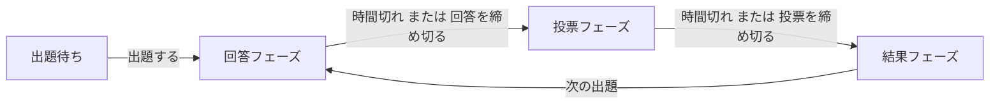
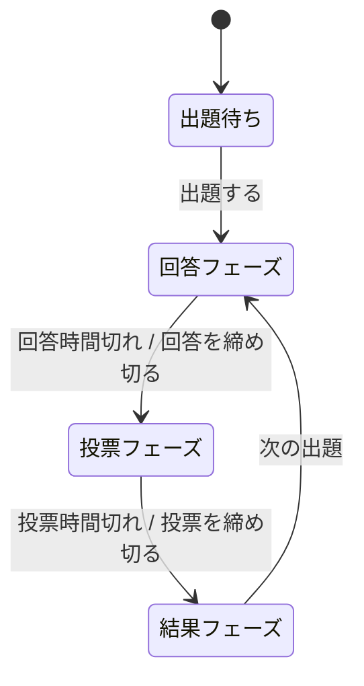
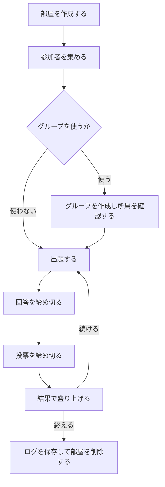
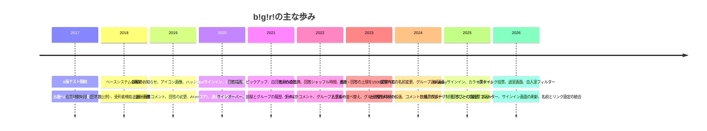

# bǃgǃrǃ ユーザーマニュアル

作成日: 2026-10-13 / 対象バージョン: 1.138.6（2026-10-10 リリース）

このマニュアルは、リリースノートの全履歴（2017年6月公開の 0.1.0 から 2026年10月公開の 1.138.6 まで、508件）と現在の画面仕様をもとに、現在有効な機能だけを体系的に整理した日本語の利用手引書です。内部実装の更新、依存パッケージの更新、細かな文言・レイアウト・フォントの調整のみの版は原則として省略し、実際に遊ぶために必要な操作、設定、制限、注意点に絞って解説します。画面上の名称や仕様は今後の更新で変わる場合がありますので、迷った場合は画面上の部屋設定の表示とトップ画面の更新情報をあわせて確認してください。

---

## 目次

1. はじめに
2. 基本用語とアイコンの意味
3. 動作環境とデータの寿命
4. トップ画面の使い方
5. サインインと名前の管理
6. 部屋の作り方
7. 部屋設定の一覧と意味
8. 部屋への入室と部屋画面の見方
9. 遊び方の流れとフェーズ
10. 出題する
11. 回答する
12. 投票する
13. 結果の見方と順位の仕組み
14. コメントとリアクション
15. 絞り込みと並び替え
16. グループ機能
17. 入室者の管理
18. カラースキームの切り替え
19. 過去の結果とログの保存
20. 部屋作成者のための運営ガイド
21. キーボード操作と入力上限の早見表
22. 困ったときの確認事項とよくある質問
23. 最近の主な変更点
24. 廃止・変更された機能について
25. 更新の歴史とライセンス・マナー

---

## 1. はじめに

### 1.1 bǃgǃrǃとは

bǃgǃrǃ（読み: ビギリ）は、ブラウザーだけで遊べる大喜利専用のウェブサービスです。サブタイトルは「For Beautiful Oogiri Life」です。アプリケーションをインストールする必要はなく、対応ブラウザーでトップ画面を開けば部屋一覧を閲覧でき、サインインすればそのまま参加できます。

基本的な遊び方は次の繰り返しです。

1. 誰かが出題（お題を出す）
2. みんなが回答（ボケを投稿する）
3. みんなが投票（面白い回答に票を入れる）
4. 結果発表（順位と得票を見る）

「部屋」と呼ばれる遊び場ごとにルールを細かく変えられるため、身内だけのゆるい遊びから、制限時間や投票数制限を設けた大人数の大会形式まで、幅広い遊び方に対応できます。初めての方は、まず第4章から第5章でサインインし、第8章から第13章の流れに沿って1回分を体験してみてください。部屋を作る方は第6章と第7章、部屋を運営する方は第20章もあわせて読んでください。

### 1.2 このマニュアルの読み方

- 第4章から第5章は、全員が最初に必要とする操作です。
- 第6章から第7章は、部屋を作る人向けの設定解説です。参加だけの方は読み飛ばして構いません。
- 第8章から第16章は、部屋に入ってからの遊び方です。
- 第17章は部屋作成者向けの管理操作、第20章は運営の進め方です。
- 困った場合は第22章を確認してください。キーボード操作や文字数上限は第21章にまとめています。

---

## 2. 基本用語とアイコンの意味

### 2.1 基本用語

| 用語 | 意味 |
|---|---|
| 部屋 | 遊び場の単位。部屋ごとに設定、出題、入室者が独立しています |
| 入室者 | 部屋に入った人。出題・回答・投票・コメントにはサインインと入室が必要です |
| 部屋作成者 | 部屋を作った人。締め切り操作、入室者管理、部屋の削除などができます |
| 出題（お題） | 回答のお題を出すこと。出題する人を出題者と呼びます |
| 回答（ボケ） | お題に対するボケ。回答する人を回答者と呼びます |
| 投票 | 回答に対する評価。投票する人を投票者と呼びます |
| フェーズ | 出題待ち、回答フェーズ、投票フェーズ、結果フェーズという進行段階 |
| トークン | 入室者ごとに割り当てられる8文字の英数字。正式にはディスクリミネーターとも呼ばれ、同名の人の判別に使います |
| ユニコーン | 高評価の回答に付く🦄の目印。部屋ごとの累計が記録されます |
| 受刑者 | 強制退室の対象となった入室者。出題・回答・投票・コメントができなくなります |
| グループ | 入室者を分けるチーム。部屋の中でのみ有効です |

### 2.2 よく出てくるアイコンと表示

画面では文字のボタンに加えて、次のような印が使われます。正確な形は端末のフォントによって多少変わります。

| 表示 | 意味 |
|---|---|
| 手の形の印 | 自分に関する絞り込み（自入室・自回答など） |
| 親指を上げた印と数字 | 得票数。押すと自分の投票だけを表示できます |
| 指差しの印 | 自分がコメントした回答への絞り込み |
| 笑顔の印 | リアクション（クイックコメント）の絵文字選択 |
| 目の印 | その回答だけを表示するピックアップ |
| 歯車や一覧を開く印 | 設定や入室者一覧などの画面を開く操作 |
| 回転する印 | 処理中（スピナー）。実行ボタンに重なって表示されます |
| 🦄 | ユニコーン。高評価の目印です |
| 🍦 | アイスクリーム。低評価側の目印です |

自分の名前は他の人の名前と色で区別されます。退室した人の名前は薄く、強制退室となった人の名前は取り消し線付きで表示されます。

---

## 3. 動作環境とデータの寿命

### 3.1 動作環境

- 現代的なブラウザーでの利用を前提としています。対象とする言語仕様は ECMAScript 2022 相当です。
- Internet Explorer、旧式の Edge、古い Firefox、Safari、Chrome（60未満）など、非常に古いブラウザーは対象外です。対応するブラウザーの最低バージョンは今後引き上げられる場合があります。
- 絵文字の表示には Noto Color Emoji 系のフォントが使われます。端末によって絵文字の見た目が異なる場合があります。
- Safari の特定バージョンでは、データ取得の遅延に対処するため一時的に通信方式が変更されていることがあります。動作が重い場合は、時間をおいて再度試してください。
- スマートフォンなどの幅の狭い画面でも利用できます。部屋作成者向けの操作ボタン群は、狭い画面では開閉式になります。
- 大きな更新の直後に表示が崩れたり古い画面のままになったりした場合は、ブラウザーの再読み込み（リロード）を試してください。特に案内があった場合は必ず再読み込みしてください。

### 3.2 データの寿命

| 対象 | 目安 |
|---|---|
| 部屋の存続期間 | 最終更新日時から約11.5日間 |
| 過去の結果として見られる期間 | 約34.5日以内の出題 |
| ログとして保存できる期間 | 約34.5日以内の出題 |
| サインオーバー用URLの有効期限 | 発行から1時間以内 |

部屋は最終更新から約11.5日が経過すると終了します。記録を残したい場合は、早めに第19章のログ保存を行ってください。部屋が終了した後に同じ内容を再現することはできませんので、長期の大会などでは定期的な保存をおすすめします。

---

## 4. トップ画面の使い方

最初に開く画面です。上から順に、操作用のバー（ナビゲーションバー）、サービス紹介、部屋一覧が並びます。

### 4.1 上部のバー

- サインイン前は「サインイン」ボタンが表示されます。
- サインイン後は自分の名前が表示されます。名前の部分を押すと、名前の変更ができます（第5章）。
- ソーシャルサインインをしている場合は、画面上部にプロフィール画像やアカウントへのリンクが表示されることがあります。
- 「サインオーバー」で別端末への引き継ぎができます（5.5節）。
- 「サインアウト」でサインアウトします（5.6節）。

### 4.2 サービス紹介部分

- サイト名、サブタイトル、連絡先（メール、Bluesky、Twitter）が表示されます。
- 「更新情報」には直近の変更が表示されます。「更新情報を見る」ボタンで全履歴をダイアログウィンドウで確認できます。
- 「使用方法」には、AIで試験的に生成されたユーザーマニュアルへのリンクと、意見交換用の GitHub ディスカッションへのリンクがあります。質問や提案はディスカッションの利用が案内されています。
- 作品の権利表示としてクリエイティブ・コモンズのライセンスが掲示されています。部屋の中で特に注記のない作品は、クリエイティブ・コモンズ 表示 4.0 国際ライセンス（CC BY 4.0）のもとで提供されるものとして扱われます（第25章）。

トップ画面の更新情報は「更新情報」と「使用方法」に分かれて表示されます。更新情報では、得票の評価指標の表記として「Zスコア」という用語が使われます（13.2節）。

### 4.3 部屋一覧

- 部屋の更新を購読するための Atom フィードの案内があります。フィードには部屋作成者名が含まれます。
- 「部屋を作成する」ボタンで新規作成します（第6章）。サインインしていない場合や、作成条件を満たしていない場合は押せません。
- 並び順はドロップダウンリストで「作成順」と「更新順」を切り替えられます。いずれも日時の新しいものが上に来る降順です。
- 一覧の先頭にある手の形のボタンが「自入室フィルター」です。押してオンにすると、自分が入室している部屋だけが表示されます。もう一度押すと解除されます。部屋が多いときに自分の参加部屋を探すのに便利です。
- 部屋が1件もない場合は「部屋はありません」と表示されます。

### 4.4 部屋のカードの見方

1件の部屋は1枚のカードで表示されます。

- アイコン画像、部屋名、説明、作成者と作成日時、更新日時が表示されます。
- 説明文の中に書かれた URL は自動でリンクになります。
- 部屋名の横には投稿用ボタンと検索用リンクがあります。投稿用ボタンは部屋名をハッシュタグにした投稿文面を用意し、Twitter と Bluesky の両方に対応しています。投稿文面には部屋名と説明の1行目が入ります。検索用リンクは部屋名をハッシュタグとして検索します。
- 入室制限の有無など、部屋設定の一覧が小さな文字で表示されます。
- 入室者の名前が並びます。自分の名前は色で区別されるため、一覧から自分が入っているかが分かります。
- 部屋作成者本人のカードには削除用ボタンが表示されます（6.6節）。
- 「入室する」ボタンで部屋に入ります（第8章）。

---

## 5. サインインと名前の管理

出題、回答、投票、コメントにはサインインが必要です。閲覧だけならサインインなしでも部屋一覧や部屋の中を見ることができますが、参加操作はできません。

### 5.1 新規サインイン（通常のサインイン）

1. トップ画面で「サインイン」を押します。
2. 表示されたダイアログで「新規サインイン」ボタンを押します。現在の画面では、通常のサインインはこのボタンを押して進める方式になっています。
3. 「名前を設定する」ダイアログで名前を入力します。
4. 名前の初期値は「お客さん」です。そのまま使うこともできます。
5. 確認処理（画像認証による確認）を経てサインインが完了します。

名前は最大で20文字程度まで入力できます。前後に空白だけの名前など、形式が正しくない場合は「名前が有効ではありません」と表示され、進めません。

通常のサインインでは、サインアウト後に同じ状態へ戻ることはできません。サインオーバー（5.5節）で引き継ぎ先を用意していない場合は、サインアウトの確認画面の注意書きをよく読んでから実行してください。

### 5.2 ソーシャルサインイン

Twitter と Bluesky のアカウントによるサインインに対応しています。

- 「Twitterでサインイン」ボタンで認証します。認証のたびに Twitter の認証画面が表示されます。
- 「Blueskyでサインイン」ボタンでは、ハンドル（例として `alice.bsky.social` のような形式）を入力して認証します。当面は試験稼働とされています。ハンドルの形式が正しくない場合はエラーが表示されます。
- Twitter での認証経路には一時的な措置が入ることがあり、予告なく変更・終了する場合があります。サインインできない場合は、一度 Twitter 側からログアウトしてから試す、またはブラウザーに保存された Twitter のサイトデータを削除してから試す方法が案内されています。

ソーシャルサインインの利点は次の通りです。

- 名前の横にプロフィール画像とアカウントへのリンクが表示されます。プロフィール画像を読み込めない場合は、既定の画像が表示されます。
- 「有り（ソーシャルサインイン）」に制限された部屋や、制限項目に参加できます。
- Twitter でサインインしている場合は、出題していない部屋を複数持つことができます。通常のサインインでは未出題の部屋は1つまでです（6.5節）。

ソーシャルサインインをしていない人が、ソーシャルサインインをしていると見なされることはありません。不具合が修正済みのため、表示がおかしい場合は再読み込みして確認してください。

### 5.3 名前にハッシュ値を付ける

名前に `#文字列` を付けると、`#` 以降が暗号学的ハッシュ関数の値（8文字）に変換されて表示されます。同じ文字列からは常に同じ値が作られるため、合言葉を知らない他人は同じ表示を再現できず、なりすまし防止に使えます。いわゆるトリップに近い機能です。

- 例: 「びぎりちゃん」に合言葉を付けると、表示上は「びぎりちゃん」に `#` と8文字の記号が付いた形になります。
- ハッシュ値付きの名前は、入室者一覧やログでの判別にも使えます。同名の人が複数いる場合は、名前を押して表示されるトークン（2.1節）とあわせて確認してください。
- 現在は、部屋の中で名前を変更している場合や名前にハッシュ値を付けている場合でも、入室者一覧のソーシャルリンクの表示はリンク設定（5.4節）に従います。以前のような自動での非表示にはなりません。

### 5.4 名前とリンクの変更

名前の変更は、名前自体を押して行います。従来あった独立した「名前を変更する」メニューは廃止され、トップ画面でも部屋画面でも名前自体が変更メニューになっています。

トップ画面での変更:

- 上部の自分の名前を押すと、全体で使う名前を変更できます。
- 変更はサインアウトせずに行えます。

部屋画面での変更:

- 上部の自分の名前を押すと、その部屋だけで使う名前と、入室者一覧に表示するソーシャルリンクを設定できます。
- 名前を空欄にすると、全体の名前が使われます。
- リンクは「無し」か「有り（URL指定）」を選べます。有りの場合は表示先の URL を入力します。
- グループに入っている場合は、名前の後に所属グループ名が付いて表示されます。

### 5.5 サインオーバー（別ブラウザーへの引き継ぎ）

別のブラウザーや端末に、同じサインイン状態を引き継げます。スマートフォンからパソコンへ移る場合などに使います。

1. トップ画面または部屋画面で「サインオーバー」を押します。
2. 引き継ぎ用 URL と二次元コード（QRコード）が表示されます。「URLをコピーする」ボタンで URL を複写できます。ボタンのオン・オフの見た目はフィルター系ボタンと共通の表現です。
3. 引き継ぎ先のブラウザーで、発行から1時間以内にその URL を開きます。
4. 引き継ぎ先でサインイン操作を行うと引き継ぎが完了します。

引き継ぎ用 URL はパスワードと同様に扱い、他人に見せないでください。URL を知った人は同じサインイン状態を引き継げてしまいます。

### 5.6 サインアウトと退室

- サインアウトはトップ画面から行います。引き継ぎをしていない通常のサインインでは、サインアウト後に同じ状態へ戻ることはできません。
- 退室は部屋画面の「退室する」から行います（7.3節）。退室しても、過去の出題者・回答者・投票者としての記録は入室者一覧などに残ります。退室した人の名前は薄く表示されます。

サインインに関する画面遷移は更新で変更されることがあります。案内に従って進めれば、途中で名前の設定に戻る場合があります。

---

## 6. 部屋の作り方

部屋を作るにはサインインが必要です。作った人が部屋作成者となり、締め切り操作や入室者管理ができるようになります。

### 6.1 作成手順

1. トップ画面で「部屋を作成する」を押します。
2. ダイアログに部屋名、説明、アイコン画像、カラースキーム、入室制限、出題・回答・投票の設定を入力します。各設定の意味は第7章で解説します。
3. 「部屋を作成する」を押すと作成されます。作成処理中はボタンに重ねて進行表示（スピナー）が出て、二重に押せないようになっています。

入力内容が正しくない項目には「部屋名が有効ではありません」「説明が有効ではありません」のようなメッセージが表示されます。メッセージを確認して修正してください。主な文字数上限は第21章にまとめています。

### 6.2 基本項目

| 項目 | 内容 |
|---|---|
| 部屋名 | 必須です。最大150文字程度です。一覧のカードや投稿文面にも使われます |
| 説明 | 任意です。複数行の入力ができ、入力欄は行数に応じて伸びます。最大1500文字程度です。文中の URL は自動でリンクになります |
| アイコン画像 | 部屋の右下に常に表示される小さな画像です。容量制限があり、制限を超えている場合や有効な画像でない場合はエラーになります。部屋一覧にも表示されます |
| カラースキーム | 部屋の既定の配色を「無し」「ライト」「ダーク」から選べます（第18章） |
| 入室制限 | 「無し」か「有り（パスワード）」を選べます。有りにするとパスワード入力欄が有効になります。パスワードは最大15文字程度です |

部屋作成画面の各項目のうち、直近に使った設定値が次回の初期値になるものがあります。続けて似た部屋を作る場合は、前回の設定が残っているか確認してから変更してください。

かつて部屋作成を外部サービスへ通知する設定がありましたが、現在この通知機能は廃止されています。作成画面に通知先を入力する項目はなく、部屋作成が外部へ自動通知されることはありません。

### 6.3 履歴機能

同じブラウザーで作った部屋の設定を再利用できます。

- 部屋名の横の「履歴を見る」ボタンで、過去に作成した部屋の設定一覧を開けます。一覧には作成日時が表示されます。
- 「履歴を読み込む」でその設定を入力欄に呼び出し、「履歴を削除する」で履歴から消せます。
- 同じ部屋名で部屋を作成した場合、履歴には最新の設定のみが残されます。
- 履歴はブラウザーごとに保存されます。別のブラウザーや端末では表示されません。

### 6.4 設定の組み合わせ例

迷った場合の目安です。詳細は第7章を確認してください。

| 遊び方 | 設定の目安 |
|---|---|
| 身内でのゆるい大喜利 | 回答表示は即時、投票表示は即時、時間制限と数制限は無し |
| 初心者向けの練習部屋 | 回答表示は一斉、回答者名表示は一斉、投票数制限は無し |
| 大人数の大会形式 | 回答時間制限と投票時間制限を設定し、回答数制限と投票数制限で票を均等に配る |
| チーム対抗戦 | グループを作成し、投票グループ制限を自グループまたは次グループに設定する（第16章） |
| 作品の鑑賞会形式 | 回答表示は一斉、回答者名表示は非表示または一斉にして作者を伏せる |

### 6.5 作成できる部屋の数

通常のサインインでは、出題がまだ行われていない部屋（未出題の部屋）を1つまでしか持てません。すでに未出題の部屋がある場合は「部屋を作成する」ボタンが押せなくなります。先にその部屋で出題するか、その部屋を削除してください。Twitter でサインインしている場合はこの制限がなく、未出題のまま複数の部屋を作成できます。

### 6.6 部屋の削除

部屋作成者は、トップ画面の自分の部屋のカードから部屋を削除できます。削除は確認ダイアログで実行します。削除した部屋は元に戻せません。必要な記録がある場合は、先に第19章のログを保存してください。

---

## 7. 部屋設定の一覧と意味

部屋作成時に決めるルールです。作成後は部屋一覧のカードと部屋画面の上部に、現在の設定が表形式で表示されます。参加する前にこの表を見ると、その部屋の遊び方が分かります。

表記の約束:

- 「（初期値）」と付く制限は、部屋作成直後の値という意味です。作成後に入室者一覧で個別に指定した場合は、そちらが優先されます（17.3節）。
- 「有り（秒）」「有り（票）」「有り（答）」などは、有効にしたうえで数値を入力する設定です。数値が正しくない場合はエラーが表示されます。
- 秒数や票数を空欄にできる設定では、空欄の扱いが設定ごとに決まっています。各項目の説明を確認してください。

### 7.1 出題まわり

| 設定名 | 選択肢 | 意味 |
|---|---|---|
| 出題優先時間 | 無し、有り（部屋作成者）、有り（首位回答者） | 結果発表後の一定秒数、特定の人だけが出題できる仕組みです。秒数を指定します |
| 出題者制限（初期値） | 無し、有り、有り（ソーシャルサインイン） | 出題できる人を絞ります。「有り」は入室者一覧での個別指定と連動します |
| 出題画像制限 | 無し、有り（禁止） | 有り（禁止）にすると画像付きの出題ができません |
| 出題コメント制限 | 無し、有り（部屋作成者） | 有りにすると出題へのコメントは部屋作成者だけができます |

出題優先時間の補足です。

- 「有り（部屋作成者）」では、指定秒数の間は部屋作成者だけが出題できます。
- 「有り（首位回答者）」では、前回のお題で1位だった回答者だけが出題できます。ただし、そのお題で投票していない人は、1位でも優先の対象になりません。
- 優先時間中は、結果画面で該当する回答の回答者名が明滅（点滅）表示になります。出題ボタンの明滅は行われません。
- 対象外の人の「出題する」ボタンは、優先時間中は押せません。残り時間は赤く表示されます。
- 部屋作成者は「出題優先を締め切る」で、優先時間を途中で終わらせて全員が出題できる状態に戻せます。

### 7.2 回答まわり

| 設定名 | 選択肢 | 意味 |
|---|---|---|
| 回答表示 | 即時、一斉 | 即時は投稿され次第みんなに見えます。一斉は投票フェーズまで他人の回答が見えません |
| 回答時間制限 | 無し、有り（秒） | 出題からの制限時間です。過ぎると自動で締め切られます |
| 回答シャッフル時間 | 無し、有り（秒） | 指定秒数以内に投稿された回答を、投票フェーズで人ごとにランダムな順序で表示します |
| 回答数制限 | 無し、有り（答） | 1人が1つのお題に出せる回答数の上限です |
| 回答者名表示 | 表示、非表示、一斉 | 非表示は常に隠します。一斉は結果フェーズまで隠します |
| 回答者制限（初期値） | 無し、有り、有り（ソーシャルサインイン） | 回答できる人を絞ります |
| 回答コメント制限 | 無し、有り（部屋作成者） | 有りにすると回答へのコメントは部屋作成者だけができます |
| 回答描画制限 | 無し、有り（禁止） | 有りにすると手描きの線画（回答描画）を付けられません |

補足です。

- 回答シャッフル時間は投票フェーズでの見た目の順序を変えるだけで、結果フェーズの順位計算には影響しません。秒数を空欄にすると、すべての回答がシャッフルの対象になります。
- 回答者名表示が非表示や一斉でも、自分の回答の回答者名は本人には常に表示されます。
- 回答表示が一斉の部屋では、自分の回答だけは締め切り前でも確認でき、変更・削除ができます（11.4節）。

### 7.3 投票まわり

| 設定名 | 選択肢 | 意味 |
|---|---|---|
| 投票表示 | 即時、一斉 | 即時は投票がすぐ反映されます。一斉は結果フェーズまで他人の投票が見えません |
| 投票時間制限 | 無し、有り（出題毎＋回答毎×） | 出題ごとの基本秒数に、回答数×回答ごとの秒数を足した時間が制限時間になります |
| 投票数制限（出題毎） | 無し、有り（票）、有り（超過可）（票） | 1つのお題全体に入れられる合計票数の上限です |
| 投票数制限（回答毎） | 無し、有り（票） | 1つの回答に入れられる票数の上限です |
| 投票者名表示 | 表示、非表示、一斉 | 回答者名表示と同じ考え方です |
| 投票者制限（初期値） | 無し、有り、有り（ソーシャルサインイン） | 投票できる人を絞ります |
| 投票グループ制限 | 無し、有り（自グループに投票）、有り（次グループに投票） | グループ機能と連動して投票対象を絞ります（16.6節） |

投票時間制限は次の式で決まります。$T$ を制限時間（秒）、$T_g$ を出題毎の秒数、$T_b$ を回答毎の秒数、$N$ を回答数とします。

$$T = T_g + T_b \times N$$

たとえば出題毎が $60$ 秒、回答毎が $10$ 秒、回答数が $12$ 件なら、制限時間は $60 + 10 \times 12 = 180$ 秒です。グループで投票対象が絞られている場合は、$N$ には全体の回答数ではなく、表示された回答数が最も多いグループの回答数が使われます。

投票数制限（出題毎）に「有り（超過可）」を選んだ場合、上限到達後は「投票する」ボタンが「投票を見る」ボタンに変わりますが、投票の内容を表示する画面では上限を超えて投票を続けられます（12.5節）。投票者名表示が非表示や一斉でも、自分の投票の投票者名は本人には常に表示されます。

---

## 8. 部屋への入室と部屋画面の見方

### 8.1 入室手順

1. トップ画面のカードで「入室する」を押します。
2. パスワード付きの部屋では入力ダイアログが出ます。パスワードを入力して送信します。パスワードが違う場合はエラーが表示されます。
3. 部屋のメイン画面が表示されます。
4. グループが作られている部屋では、最初にグループを選ぶ画面が出ることがあります（16.3節）。選ぶまで遊びに参加できません。

入室にはサインインが必要です。サインインしていない場合は、先に第5章の手順でサインインしてください。

### 8.2 途中から入った場合の注意

フェーズの途中から入った人には、そのお題への参加に制限があります。

| 入ったタイミング | 制限 |
|---|---|
| 回答フェーズの途中 | そのお題には回答できません。次のお題から回答できます |
| 投票フェーズの途中 | そのお題には投票できません。次のお題から投票できます |
| 結果フェーズの途中 | 次の出題はできません。次のお題の回答から参加できます |

これは、途中参加によって締め切り直前の駆け込みや結果を見てからの出題が有利になるのを防ぐための仕様です。出題・回答・投票の制限（第7章）に加えて、この途中参加の制限にも従わない操作は受け付けられません。

### 8.3 退室手順

1. 部屋画面の上部で「退室する」を押します。
2. 退室する画面で内容を確認し、退室を実行します。

退室は専用の画面で確認してから行います。退室しても過去の出題・回答・投票・コメントの記録は残り、入室者一覧にも退室者として表示されます。再度入りたい場合は、トップ画面からもう一度「入室する」を押してください。

### 8.4 上部の操作バー（部屋画面）

- サイト名を押すとトップ画面に戻ります。
- 「メイン」「過去の結果」「ログ（CSV）」のタブで部屋内の画面を切り替えます。切り替えると、その画面の内容の位置まで自動で移動します。
- 自分の名前を押すと、その部屋での名前とリンクの変更ができます（5.4節）。グループに入っている場合は名前の後に所属グループ名が付きます。
- ユニコーン🦄の累計が表示されます。その部屋で自分が獲得したユニコーンの合計数です。
- カラースキーム切り替えボタン（オート・ライト・ダーク）があります（第18章）。
- 「サインオーバー」と「退室する」のボタンがあります。

フェーズタイトルの表示にはアニメーションが付けられています。タブ切り替えやフェーズの切り替わりは、この表示でも確認できます。

### 8.5 部屋情報部分

メイン画面の上部には次の内容が表示されます。

- 投稿用ボタンと部屋名の検索リンク。部屋名をハッシュタグにした投稿や検索ができます。Twitter と Bluesky に対応しています。
- 部屋名、説明文、出題・回答・投票の設定表（第7章）。
- 「グループを選択する」ボタン。グループの確認と所属の変更ができます（第16章）。
- 「入室者を見る」ボタン。入室者一覧が開きます（第17章）。
- 部屋作成者によるお知らせ文（部屋コメント）。部屋作成者がいつでも投稿でき、複数件が表示されます。削除は最新の1件ずつ行えます。
- 右下には部屋名とアイコン画像が常に表示されます。スクロールしても位置は変わりません。

---

## 9. 遊び方の流れとフェーズ

1つのお題は番号付きで管理され、画面上部のフェーズ表示で現在の段階が分かります。フェーズは次の4つを繰り返します。

| フェーズ | 状態 | 終わり方 |
|---|---|---|
| 出題待ち | お題がまだない状態 | 誰かが出題すると回答フェーズへ進みます |
| 回答フェーズ | 回答を募集中 | 時間切れ、または部屋作成者の締め切りで投票フェーズへ進みます |
| 投票フェーズ | 投票を募集中 | 時間切れ、または部屋作成者の締め切りで結果フェーズへ進みます |
| 結果フェーズ | 順位と投票内容を公開中 | 次の出題で新しいお題の回答フェーズへ進みます |

### 9.1 締め切りとタイマー

- 時間制限がある場合は、フェーズ表示の横やボタンの横に残り時間が表示されます。出題優先時間中の残り時間は赤く表示されます。
- 回答時間制限・投票時間制限が設定されている部屋では、時間切れで自動的に次のフェーズへ進みます。
- 部屋作成者は時間切れを待たずに進めることができます。回答フェーズでは「回答を締め切る」、投票フェーズでは「投票を締め切る」を押します。いずれも確認ダイアログで実行します。
- 出題優先時間中は「出題優先を締め切る」で優先を終わらせることができます。
- フェーズの切り替え中は「集計中」などの表示が出ることがあります。表示が切り替わるまで少し待ってください。
- 投票表示が一斉の部屋では、投票は投票フェーズになってから行います。投票表示が即時で回答表示が即時の部屋では、回答フェーズの途中から投票できる場合があり、その場合の投票ボタンのタイマーは各回答の投稿時刻を基準に動作します。

### 9.2 部屋作成者だけができる進行操作

| 操作 | できるタイミング |
|---|---|
| 回答を締め切る | 回答フェーズ |
| 投票を締め切る | 投票フェーズ |
| 出題優先を締め切る | 出題優先時間中 |

これらはいずれも部屋作成者専用です。一般の入室者は時間切れを待つか、部屋作成者に依頼してください。運営の進め方は第20章にまとめています。

---

## 10. 出題する

出題待ちのとき、または結果フェーズで「出題する」ボタンを押すと、出題の入力ダイアログが開きます。出題できるのは、出題優先時間と出題者制限の条件を満たした入室者だけです。

### 10.1 入力項目

| 項目 | 内容 |
|---|---|
| 出典 | お題の出典や引用元です。最大150文字程度です。著作物をお題に使う場合は、必ず適切な出典を入力してください。文中の URL は自動でリンクになります |
| 画像 | 「画像有り」でファイル選択を開き、「画像無し」で閉じます。選択後は削除で取り消せます。画像禁止の部屋では使えません |
| 本文 | お題の文章です。1文字以上、最大1500文字です。入力欄は行数に応じて伸びます。画像だけの出題では、画像のファイル名が本文の初期値になることがあります |

出典欄は、写真や文章などの著作物をそのままお題にする場合に特に重要です。出典が不明な素材は使わないでください。

### 10.2 送信方法

- 「出題する」ボタンを押します。
- 本文欄で Ctrlキー＋Enter、またはメタキー（Windowsキー・Commandキー）＋Enter でも送信できます。Enter のみでは送信されず、改行になります。
- 送信中はボタンに重ねて進行表示が出ます。ダイアログは Escキーで閉じられます。

### 10.3 出題の表示

- 出題者名とお題本文が表示されます。出題者名を押すとトークン表示に切り替わり、もう一度押すと名前に戻ります。
- 長い出題は折りたたまれます。150文字を超えた位置、または10行を超えた位置に「残りを表示する」ボタン（残り文字数付き）が出て、押すと続きが表示されます。10行を超えた位置にも途中のボタンが出るため、非常に長い文章でも途中から開けます。再度押すと折りたたみに戻ります。
- 出題画像の背景は白で表示されます（カラースキームがライトの場合の背景色と同じ色です）。画像の読み込み方式の改善により、表示が安定しています。
- 同時に複数の人が出題しようとした場合の競合に対処する仕組みがあります。競合した場合は画面の案内に従い、必要に応じて再読み込みしてください。

### 10.4 誰が出題できるか

- 出題者制限が無しなら、入室者全員が出題できます。ただし結果フェーズの途中参加者は出題できません（8.2節）。
- 出題者制限が有りの場合は、入室者一覧で出題者に指定された人だけが出題できます。
- 出題者制限が有り（ソーシャルサインイン）の場合は、ソーシャルサインインしている人だけが出題できます。
- 出題優先時間中は、優先対象者（部屋作成者または首位回答者）だけが出題できます。優先対象の回答の回答者名が明滅表示されるため、結果画面で誰が優先かが分かります。

---

## 11. 回答する

回答フェーズで「回答する」ボタンを押すと、回答の入力ダイアログが開きます。上部にお題が表示されるため、見ながら書けます。

### 11.1 入力項目

| 項目 | 内容 |
|---|---|
| 回答文 | 1文字以上、最大1500文字です。入力欄は行数に応じて伸びます |
| 描画 | 「描画有り」で手描き用のキャンバスが開きます。描画禁止の部屋では使えません |

送信は「回答する」ボタン、または本文欄での Ctrlキー＋Enter、メタキー＋Enter で行います。出題と同様に Enter のみでは送信されません。

### 11.2 手描きの線画を添える（回答描画）

回答に手描きの線画を付ける機能です。文字だけでは伝わりにくいボケの補足に使えます。

- 「描画有り」を選ぶとキャンバスが開きます。マウスやタッチで線を描けます。
- 「元に戻す」「やり直す」ボタンで描き直しができ、現在の要素数が表示されます。要素数には上限があり、上限に達するとそれ以上描けません。
- 描いた線画は回答本文の横に表示されます。描画の表示には専用の描画方式が使われ、端末の性能に合わせて滑らかさが調整されます。
- 部屋設定の回答描画制限が有り（禁止）の部屋では、描画自体が表示されません。

### 11.3 送信と制限

- 回答数制限の上限に達すると「回答する」ボタンが押せなくなります。
- 回答者制限が有りの場合は、指定された人だけが回答できます。有り（ソーシャルサインイン）の場合はソーシャルサインインしている人だけです。
- 回答フェーズの途中から入った人は、そのお題には回答できません。
- 直前に削除した回答がある場合、その内容が次回の回答欄の初期値として残ります。書き直しの再投稿に便利です。
- 出題者本人の回答も可能です。部屋設定で特に禁じられている場合を除き、出題者も回答者として参加できます。

### 11.4 変更と削除

- 自分の回答には、条件を満たす場合に「回答を変更する」と「回答を削除する」の操作が表示されます。変更すると回答時刻も更新されます。削除は確認後に実行されます。
- 回答表示が一斉の部屋では、締め切り前は自分の回答だけが見えるため、その場で推敲できます。回答表示が即時の部屋でも、自分の回答の変更・削除は締め切りまで可能です。
- 一斉表示の部屋では、回答する処理と削除する処理が軽量化されており、大人数でも比較的速く反映されます。

### 11.5 回答の見え方

- 回答はカード形式で並びます。上部に回答者名と回答番号が出ます。回答者名表示の設定により匿名になりますが、自分の回答名は本人にだけ見えます。
- 長い回答は出題と同様に折りたたまれ、150文字または10行を超えた部分はボタンで展開できます。
- 描画付きの回答では、本文の横に線画が表示されます。
- 一覧の末尾には回答数の表示があります。グループがある部屋では結果フェーズ前は自グループ分と全体分の内訳が表示され、投票グループ制限がない場合はグループ毎の回答数は表示されません。
- 回答者名を押すとトークン表示に切り替わります。同名の人の判別に使ってください。
- 回答フェーズでは自分の回答だけを絞り込む自回答フィルターが使えます（第15章）。回答数も併せて表示されます。

---

## 12. 投票する

投票フェーズでは、各回答の下部に投票用の操作が出ます。投票表示が即時の部屋では、回答フェーズの途中から投票できる場合があります（9.1節）。

### 12.1 基本操作

| ボタン | 動作 |
|---|---|
| 投票する | 票数を指定するダイアログを開きます |
| 0票ボタン（親指印と「0」） | ダイアログを開かずに0票を入れます |
| 投票を変更する | 投票済みの回答で、取り消さずに票数を直します |
| 投票を削除する | 投票を取り消します。確認後に実行されます |
| 投票を見る | 自分が投票した回答の一覧を開きます（12.6節） |

自分の回答には投票できません。「面白いと思ったが票は入れたくない」「見た記録だけ残したい」という場合は、0票クイック投票が便利です。0票の投票は得票数には加算されませんが、投票者名だけが表示され、自投票フィルターの対象にもなります。

### 12.2 票数指定ダイアログ

- 上部にお題と対象の回答が表示されます。
- 増減ボタンで票数を指定します。指定できる範囲は投票数制限（回答毎）と投票数制限（出題毎）の範囲内です。超過可の部屋では出題毎の上限を超えて増やせます。
- 開いた直後は票数ボタンに焦点（フォーカス）が当たっています。その状態では、スペースキーで1票増やし、Deleteキーで1票減らし、Enterキーで送信できます。マウスを使わずに投票できます。
- 票数の初期値は、前回の設定や部屋の設定に応じた値になります。部屋の更新で初期値の決め方が変わることがあるため、送信前に必ず数値を確認してください。
- すでに投票済みの回答では「投票を変更する」から同じダイアログが開き、一旦削除しなくても票数を減らすことができます。
- ダイアログは Escキーで閉じられます。

### 12.3 投票できる条件

- 投票者制限が有りの場合は、入室者一覧で投票者に指定された人だけが投票できます。有り（ソーシャルサインイン）の場合はソーシャルサインインしている人だけです。
- 投票フェーズの途中から入った人は、そのお題には投票できません。
- 投票数制限（出題毎）を使い切った場合は「投票する」ボタンが「投票を見る」ボタンに変わります。超過可の部屋では、「投票を見る」から開く画面で引き続き投票できます。
- 制限に従わない操作は受け付けられません。不正な操作を試みた場合は、自動的に受刑者に追加されることがあります（17.4節）。

### 12.4 投票の表示

- 各回答に投票者名と票数が表示されます。投票者名表示の設定により匿名になりますが、自分の投票は本人にだけ見えます。
- 1票の場合は専用の印だけで、2票以上の場合は印と数字で、0票の場合は名前だけで表示されます。
- 回答ごとの投票は票数の多い順に並びます。票数が同じ場合は投票した順です。
- 投票表示が一斉の部屋では、結果フェーズまで他人の投票は見えません。即時の部屋では投票され次第反映されます。

### 12.5 自分の投票一覧（投票を見る）

- 投票フェーズでは回答一覧の上部にも「投票を見る」ボタンがあります。投票済みの場合に押せます。機能は自投票フィルターと同等です。
- 押すと、自分が投票した回答だけがお題とともに表示されます。一覧上で変更や削除ができます。
- 末尾に自分の合計票数が表示されます。投票数制限（出題毎）がある場合は「合計／上限」の形で対比できます。各回答の合計の横には出題毎の上限が表示されるため、残り票数が計算できます。たとえば上限が $10$ 票で合計が $7$ 票なら、残りは $10 - 7 = 3$ 票です。
- 投票をすべて削除したいときも、この一覧からまとめて操作すると速く済みます。

---

## 13. 結果の見方と順位の仕組み

投票が締め切られると結果フェーズになり、各回答に順位が付きます。結果フェーズでは並び替え、絞り込み、コメント、次の出題ができます。

### 13.1 順位の決め方

順位は次の順で決まります。

1. 得票数が多い回答が上位です。
2. 得票数が同じ場合は、そのお題で回答者本人が投じた票の数が多い方が上位です。
3. それも同じ場合は、回答が早い方が上位です。

つまり、投票しなかった回答者は同点のときに不利になります。回答するだけでなく、他の人の回答にも投票することが、公平な遊び方として案内されています。回答シャッフル時間の設定は順位に影響しません。

### 13.2 評価指標（Zスコア）と装飾

各回答は、得票数を回答者本人の投票数で補正した「補正得票数」をもとに、相対的な指標（Zスコア）で評価されます。$x$ をある回答の補正得票数、$\mu$ をそのお題のすべての回答の補正得票数の平均、$\sigma$ をその標準偏差とすると、Zスコア $z$ は次の式で計算されます。

$$z = \frac{x - \mu}{\sigma}$$

Zスコアに応じて、順位の表示は次のように変わります。

| Zスコア | 順位の表示 |
|---|---|
| $z \ge 1$ | 順位に下線が付きます |
| $z \ge 2$ | 順位とともにユニコーン🦄が付きます。$z$ が1上がるごとに🦄が1つ増えます（$z \ge 3$ で2つ、$z \ge 4$ で3つ、…） |
| $z \le -1$ | 順位に上線が付きます |
| $z \le -2$ | 順位とともにアイスクリーム🍦が付きます。$z$ が1下がるごとに🍦が1つ増えます |

- 順位の表示（「1位」など）を押すと、Zスコアの数値が小数付きで表示されます。もう一度押すと順位表示に戻ります。
- ユニコーンの算定は回答者自身の投票行動で補正されます。回答だけでなく投票にも参加することが、ユニコーン獲得につながります。
- 獲得したユニコーンの累計は、部屋画面上部のバーと入室者一覧に表示されます。いずれも部屋ごとの累計です。
- 以前は低評価側の目印にモアイ像が使われていましたが、現在はアイスクリーム🍦に変更されています。

### 13.3 結果画面のその他の表示

- 回答カードの右側に得票数（親指印と数字）が表示されます。この得票数を押すと、その回答への自分の投票だけを表示するフィルターがオンになります（15.4節）。
- 回答の下には投票者名が並びます。名前を押すとトークン表示に切り替わります。
- 回答者がグループに入っている場合は、見出しにグループ名が表示されます。グループ名を押すとグループフィルターになります（第15章）。
- 出題優先時間中は、首位回答者の回答の回答者名が明滅します。次の出題権が誰にあるかの目印です。

### 13.4 結果フェーズでできること

- 回答の並び替え（上位順・下位順・コメント数順など、第15章）
- 自回答・自投票・自コメントなどの絞り込み（第15章）
- 出題と回答へのコメントとリアクション（第14章）
- 次の出題（出題優先時間がある場合は対象者に注意してください）

---

## 14. コメントとリアクション

コメントには、部屋作成者専用のお知らせと、結果フェーズで誰でも書ける出題・回答へのコメントの2系統があります。

### 14.1 種類と権限

| 種類 | 書ける人 | 書ける時期 | 削除 |
|---|---|---|---|
| 部屋のお知らせ（部屋コメント） | 部屋作成者 | いつでも | 最新の1件ずつ削除できます |
| 出題へのコメント | 入室者（部屋作成者のみに制限可） | 結果フェーズ | 削除できません |
| 回答へのコメント | 入室者（部屋作成者のみに制限可） | 結果フェーズ | 削除できません |

部屋設定の出題コメント制限・回答コメント制限が有り（部屋作成者）の部屋では、部屋作成者以外はコメントできません。第7章の設定表で事前に確認してください。

### 14.2 出題・回答へのコメント

- 結果フェーズで「コメントする」ボタンが表示されます。出題にも回答にも、それぞれコメントできます。
- 押すと1行入力のダイアログが開きます。コメントは最大150文字程度で、空文字の投稿も可能です。
- 投稿者名付きで表示されます。名前を押すとトークンが表示され、もう一度押すと名前に戻ります。文中の URL は自動でリンクになります。
- 回答も投票もしていない人でもコメントできます。感想だけを伝えたい場合にも使えます。
- 過去の結果画面でもコメントを閲覧できますが、新規投稿はできません（第19章）。

### 14.3 リアクション（クイックコメント）

文字を入力せずに絵文字だけで反応を伝える機能です。

- 「コメントする」ボタンの横にある笑顔の印のボタンを押し、一覧から絵文字を選ぶだけで投稿できます。
- 現在選べる絵文字は次の9種類です: 😂 🤣 🥰 🥹 😭 😳 🤔 😡 🫡
- 絵文字の種類は更新で入れ替えられることがあります。このマニュアルの作成時点では上記の9種類です。
- 出題へのコメントと回答へのコメントの両方で使えます。すでに同じ絵文字を投稿している場合は、その絵文字が選択中として表示されます。

短い反応をすばやく返したいときに便利です。言葉で伝えたい場合は通常のコメントを使ってください。

---

## 15. 絞り込みと並び替え

回答一覧の上部に、並び替えと絞り込みの操作がまとまっています。この操作部分は下方にスクロールしても表示され続けるため、長い一覧でもいつでも操作できます。

### 15.1 並び替え（表示順）

| 名称 | 内容 | 使える場面 |
|---|---|---|
| 設定順 | 部屋設定に基づく既定の順序 | すべてのフェーズ |
| 先着順 | 回答時刻の古い順 | すべてのフェーズ |
| 後着順 | 回答時刻の新しい順 | すべてのフェーズ |
| 上位順 | 順位の良い順 | すべてのフェーズ |
| 下位順 | 順位の悪い順 | すべてのフェーズ |
| 多コ順（コメント数順） | コメントの多い順 | 結果フェーズと過去の結果 |
| 少コ順（コメント数順） | コメントの少ない順 | 結果フェーズと過去の結果 |

ドロップダウンリストから選びます。投票フェーズで回答シャッフル時間が設定されている場合は、投票中の見た目の順序が人ごとに異なるため、並び替えの結果もその範囲で反映されます。

### 15.2 自分関係の絞り込み（プライマリーフィルター）

自分に関係する回答だけを表示する絞り込みです。ボタンのオン・オフで見た目が変わります。

| ボタン | 名称 | 効果 |
|---|---|---|
| 手の印 | 自回答フィルター | 自分の回答だけを表示します。回答フェーズでは自分の回答数が併記されます |
| 親指の印 | 自投票フィルター | 自分が投票した回答だけを表示します。投票フェーズでは自分の合計票数が併記されます |
| 指差しの印 | 自コメントフィルター | 自分がコメントした回答だけを表示します。結果では自分のコメント数が併記されます |

自回答・自投票・自コメントの各フィルターは「プライマリーフィルター」として扱われます。いずれかを切り替えると、後述のグループフィルターとピックアップ（セカンダリーフィルター）は解除されます。まず大まかに自分の関係分を絞り、必要に応じてさらに絞る、という順序で使うのが基本です。

### 15.3 グループフィルターとピックアップ（セカンダリーフィルター）

プライマリーフィルターの結果を、さらに絞るための絞り込みです。両方を併用できます。

- 回答の見出しにあるグループ名を押すと、そのグループの回答だけを表示します。もう一度押すと解除されます。
- 回答の見出しにある目の印を押すと、その回答だけを表示するピックアップになります。もう一度押すと元の表示に戻ります。

### 15.4 回答ごとの自分の投票表示

各回答の得票数（親指印と数字）を押すと、その回答に付いた投票のうち自分の投票だけが表示されます。もう一度押すと全員分に戻ります。全体の絞り込みとは独立に、回答単位で切り替えられます。

### 15.5 トップ画面の自入室フィルター

トップ画面の部屋一覧先頭の手の形のボタンで、自分が入っている部屋だけを表示します（4.3節）。部屋画面のフィルターとは別の機能です。

---

## 16. グループ機能

入室者をグループに分けて、チーム対抗戦などに使う機能です。グループはその部屋の中でのみ有効で、他の部屋には持ち越されません。

### 16.1 グループを選ぶ画面

部屋画面の「グループを選択する」ボタンで開きます。

- グループが一覧表示され、グループ名、説明、所属人数、メンバー名が表示されます。メンバー名を押すとトークンが表示されます。
- グループを選ぶと、すぐに所属が変わります。いつでも選び直せます。
- 部屋作成者にはグループの作成ボタンと削除ボタンが表示されます。
- 自分が入っているグループは、部屋画面上部の自分の名前の後にも表示されます。

### 16.2 グループの作成と削除（部屋作成者）

- 部屋作成者が名前と説明を入力して作成します。グループ名は最大20文字程度、説明は最大1500文字程度です。名前の重複や空文字も許されます。
- 作成画面には履歴機能があります。グループ名の横の履歴ボタンを押すと、同じブラウザーで作成したグループの一覧が表示され、「読み込む」で設定を呼び出し、「削除する」で履歴から消せます。同じグループ名で作成した場合は、履歴には最新の設定のみが残ります。
- 削除は確認後に実行されます。所属していた人にはグループを選ぶ画面が表示されます（16.3節）。

### 16.3 所属が決まる流れ

- 部屋作成者がグループを追加すると、まだグループに入っていない入室者には自動でグループを選ぶ画面が表示されます。グループが追加された状態では、回答・投票フェーズで自分と同じグループの回答だけが表示される「グループ分離」が常に有効になります（16.5節）。
- グループが追加された後に入室した人には、最初にグループを選ぶ画面が表示されます。
- 入っていたグループが削除された人にも、グループを選ぶ画面が表示されます。
- 現在の仕様では、入室時に自動で特定のグループへ割り当てられる初期グループの機能はありません。各自が画面で選ぶ方式です。

### 16.4 グループ名が表示される場面

| 場面 | 表示 |
|---|---|
| 部屋画面上部 | 自分の名前の後に所属グループ名 |
| 回答の見出し | 回答者のグループ名。押すとグループフィルターになります |
| 入室者一覧 | 名前の前にグループ名 |
| ログ（CSV） | 回答者名にグループ名が付加され、専用の列にも出力されます |

### 16.5 グループ分離

部屋作成者がグループを追加すると、回答フェーズと投票フェーズでは自分と同じグループの回答だけが表示されるようになります。結果フェーズでは全員分が表示されます。

- グループが1つもない部屋では、通常の表示と変わりません。
- 投票時間制限の計算で使う回答数 $N$ は、全体ではなく表示された回答数が最も多いグループの回答数になります（7.3節の式を参照してください）。
- チーム外の回答が見えなくなるため、他チームの動向を気にせず自分のチームに集中できます。結果で全体を見て驚く、という楽しみ方もできます。

### 16.6 投票グループ制限

部屋設定の投票グループ制限で、投票できる対象をさらに制御できます。グループ分離による表示の絞り込みに加えて働きます。

| 設定 | 投票フェーズで表示・投票できる対象 |
|---|---|
| 無し | グループ分離の通常動作（自グループの回答のみ） |
| 有り（自グループに投票） | 自分と同じグループの回答だけ |
| 有り（次グループに投票） | 自分のグループの直後に作成されたグループの回答だけ。自分のグループが最後の場合は、最初に作成されたグループが対象です。グループ未選択の場合は、グループを選んでいない人の回答だけが対象です |

制限を設定しても、グループが作成されていなければ設定がない場合と同じ動作になります。運用前にグループを作成し、全員が所属を選んだことを入室者一覧で確認してください。

---

## 17. 入室者の管理

### 17.1 入室者一覧画面

部屋画面の「入室者を見る」ボタンで開きます。

表示内容は次の通りです。

- 名前。自分は色で区別されます。退室者は薄く、強制退室者（受刑者）は取り消し線付きで表示されます。退室した出題者・回答者・投票者も一覧に含まれます。
- ソーシャルサインインをしている人やリンク設定をしている人は、プロフィール画像やアカウントへのリンクが表示されます。画像を読み込めない場合は既定の画像になります。
- その部屋で獲得したユニコーン🦄の累計が表示されます。
- トークン（8文字の英数字）が表示されます。
- 末尾に入室者数が表示されます。

### 17.2 並び替え

入室者一覧の表示順はドロップダウンリストで変えられます。

| 名称 | 内容 |
|---|---|
| 先入順・後入順 | 入室日時の古い順・新しい順 |
| 多🦄順・少🦄順 | ユニコーン獲得数の多い順・少ない順 |
| 昇名順・降名順 | 名前の文字コード順 |
| トークン順 | トークン（ディスクリミネーター）の文字コード順 |
| 古サ順・新サ順 | サインイン日時の古い順・新しい順 |

人数が多い部屋で特定の人を探す場合は、名前順やトークン順が便利です。

### 17.3 出題者・回答者・投票者の個別指定（部屋作成者）

部屋作成者には各入室者に操作ボタンが表示されます。幅の狭い画面では、省略ボタンで操作ボタン群を開閉できます。

- 出題者へ追加・削除
- 回答者へ追加・削除
- 投票者へ追加・削除

ルールは次の通りです。

- 1人でも指定すると、その項目は指定された人だけが操作できるようになります。この場合、部屋作成時に設定した初期値はその項目について無視されます。
- 全員の指定を解除すると、部屋作成時の設定に戻ります。
- 指定された人の名前は、部屋画面の設定表にも表示されます。参加者は設定表で誰が担当かを確認できます。

司会進行役だけが出題する形式や、審査員だけが投票する形式にしたい場合に使います。

### 17.4 強制退室（受刑者）

- 部屋作成者は入室者一覧から「受刑者へ追加」ができます。追加された入室者は強制退室となり、その部屋で出題・回答・投票・コメントができなくなります。自分自身を受刑者に追加することはできません。
- 受刑者に追加された場合、同一の発信元から利用している入室者もあわせて追加されます。
- 部屋設定の出題優先や回答数制限、投票数制限などに従わない不正な操作を試みた入室者は、自動的に受刑者に追加されます。通常の操作をしている限り、自動追加の対象にはなりません。
- 「受刑者から削除」で解除できます。解除後は通常通り入室し直せます。

荒らし対策のための機能です。誤って追加した場合は「受刑者から削除」で戻してください。

### 17.5 トークンの確認方法

出題者名、回答者名、投票者名、コメント投稿者名、グループのメンバー名を押すと、その人のトークンが表示されます。入室者一覧のトークンと照合することで、同名の人の本人確認ができます。なりすましが疑われる場合は、まずトークンを確認してください。

---

## 18. カラースキームの切り替え

### 18.1 部屋画面での一時的な切り替え

部屋画面の上部バーにあるカラースキームボタンで、その場の配色を切り替えます。

| 選択 | 動作 |
|---|---|
| オート | ブラウザーやOSの設定に従います |
| ライト | 常に明るい配色になります |
| ダーク | 常に暗い配色になります |

この選択は保存されません。画面を開き直すと、部屋の既定値（18.2節）に戻ります。一時的に見づらい場合だけ切り替える用途です。

### 18.2 部屋の既定値

部屋作成時のカラースキーム設定で、部屋の既定値を決められます。「無し」の場合はオートとして扱われます。既定値がライトやダークの部屋では、入室した直後からその配色で表示されます。

出題画像の背景は白で表示されます。ダーク配色でも画像部分だけは白背景になるため、画像の色味はライト配色に近い見え方になります。

---

## 19. 過去の結果とログの保存

### 19.1 過去の結果タブ

部屋画面の「過去の結果」タブで開きます。

- 約34.5日以内の出題を、結果フェーズと同じ形式で閲覧できます。順位、得票、コメント、Zスコアの表示も同じです。
- 上部のページ送りでお題を選びます。出題数が多い場合は、一定範囲ごとにまとめて切り替えます。
- 表示順の変更（上位順・下位順・コメント数順など）と絞り込み（自回答・自投票・自コメント、グループフィルター、ピックアップ）が使えます。
- 閲覧専用です。投票やコメントの新規投稿はできません。

### 19.2 ログ（CSV）タブ

「ログ（CSV）」タブで開きます。出題・回答・投票・コメントの記録をファイルとして保存できます。

1. 画面の案内に従い、ダウンロード用 URL を選択します。URL を選択するまではダウンロードは始まりません。
2. 押すとサーバー側の処理中であることが表示され、完了するとファイルが保存されます。データ量が多い場合は時間がかかることがあります。
3. ダウンロードには、その部屋に入室している必要があります。

保存される内容と形式は次の通りです。

- 出題、回答、投票、コメントの各記録が含まれます。
- スイッチをオンにすると、名前にトークンを付加した形式で保存できます。名前の後に改行区切りでトークンが付きます。ハッシュ値付きの名前では、ハッシュ値の後にトークンが付加されます。同名の人の判別に便利です。
- グループを利用している部屋では、回答者名にグループ名が付加され、専用の列にもグループ名が出力されます。
- 保存できるのは約34.5日以内の出題分です。古い記録が必要な場合は、期間内に保存してください。

大会の記録や作品集を作る場合は、部屋が終了する約11.5日よりも前に、余裕を持って保存することをおすすめします。

---

## 20. 部屋作成者のための運営ガイド

部屋作成者は、進行の締め切り、参加権限の指定、グループの作成、お知らせの投稿、部屋の削除を担当します。ここでは運営の流れをまとめます。

### 20.1 部屋作成者だけができること

| 操作 | 場所 |
|---|---|
| 回答を締め切る・投票を締め切る | メイン画面（各フェーズ） |
| 出題優先を締め切る | メイン画面（優先時間中） |
| 部屋のお知らせを投稿・削除する | メイン画面の部屋情報部分 |
| グループを作成・削除する | グループを選択する画面 |
| 出題者・回答者・投票者を個別に指定する | 入室者を見る画面 |
| 受刑者へ追加・削除する | 入室者を見る画面 |
| 部屋を削除する | トップ画面の部屋カード |

### 20.2 運営の流れ

1. 部屋を作成し、設定表に間違いがないか確認します。特に時間制限と投票数制限は、参加人数に合わせて余裕を持たせてください。
2. 参加者が集まったら、必要に応じてグループを作成し、全員が所属を選んだことを入室者一覧で確認します。
3. 最初の出題をします。出題優先時間が有り（部屋作成者）の部屋では、最初の進行も作成者が担います。
4. 回答フェーズでは残り時間を見ながら、必要なら「回答を締め切る」で進めます。全員の回答が揃ったように見えても、入力中の人がいる場合があるため、締め切り前に一言アナウンスすることをおすすめします。
5. 投票フェーズでも同様に、投票数の合計表示を見ながら「投票を締め切る」で進めます。
6. 結果フェーズではコメントやリアクションで場を温め、次の出題へつなげます。出題優先時間中は対象者の名前が明滅しているため、迷子が出にくくなっています。
7. 終了後は、必要に応じて「ログ（CSV）」タブから記録を保存し、部屋を削除します。

### 20.3 運営のコツ

- 時間制限は短すぎると初心者が置いていかれます。回答時間制限と投票時間制限は、回答数を考えて長めに設定し、慣れてきたら短くしてください。投票時間制限は回答数に応じて自動で伸びる式（7.3節）なので、基本秒数を控えめにしても後半が窮屈になりにくくなっています。
- 投票数制限（出題毎）を設定すると、全員が同じ持ち票で競えます。超過可にすると、上限後も気に入った回答へ追加で票を入れられます。大会では通常の有り、交流会では超過可や無しが向いています。
- 回答者名表示を一斉または非表示にすると、作者を伏せて作品だけで評価できます。結果後の種明かしが楽しみになります。
- 荒らしや誤操作があった場合は、まず入室者一覧で状況を確認してください。強制退室（受刑者）は強い措置です。誤りであれば「受刑者から削除」で戻せます。
- 部屋のお知らせには、その日のルールや休憩の案内を書いておくと、途中参加者にも伝わります。古いお知らせは最新のものから1件ずつ削除できます。

---

## 21. キーボード操作と入力上限の早見表

### 21.1 キーボード操作

| 場面 | 操作 | 動作 |
|---|---|---|
| 出題・回答の本文欄 | Ctrlキー＋Enter | 入力内容を送信します |
| 出題・回答の本文欄 | Windowsキー＋Enter、Commandキー＋Enter | 入力内容を送信します |
| 出題・回答の本文欄 | Enterのみ | 改行します。送信されません |
| 票数指定ダイアログ | 票数ボタンに焦点がある状態でスペースキー | 1票増やします |
| 票数指定ダイアログ | 票数ボタンに焦点がある状態でDeleteキー | 1票減らします |
| 票数指定ダイアログ | 票数ボタンに焦点がある状態でEnterキー | 投票を送信します |
| 各種ダイアログ | Escキー | ダイアログを閉じます |

票数指定ダイアログは開いた直後に票数ボタンへ焦点が当たっているため、スペースキーとEnterキーだけでも投票が完結します。

### 21.2 入力上限の目安

画面の検証条件に基づく目安です。数え方（改行を含むかどうかなど）で境界の扱いが変わる場合があるため、上限ぎりぎりの長文では余裕を持ってください。

| 項目 | 上限の目安 |
|---|---|
| 名前 | 20文字 |
| 部屋名 | 150文字 |
| 部屋の説明 | 1500文字 |
| 入室パスワード | 15文字 |
| 出題の本文 | 1500文字（1文字以上） |
| 出題の出典 | 150文字 |
| 回答の本文 | 1500文字（1文字以上） |
| コメント | 150文字（空文字も可） |
| グループ名 | 20文字 |
| グループの説明 | 1500文字 |

文字数を超えた場合は「有効ではありません」というメッセージが表示され、送信できません。長文は150文字（出題・回答はあわせて10行）を超えた部分が折りたたまれて表示されます。

### 21.3 表示まわりの早見表

- 複数行の入力欄は、行数に合わせて自動的に伸びます。
- 実行中のボタンには回転する印が重なって表示され、処理中であることが分かります。
- ダイアログは Escキーで閉じられます。確認が必要な操作では、実行前に確認画面が出ます。
- 名前（出題者・回答者・投票者・コメント投稿者・グループメンバー）を押すとトークン表示に切り替わり、もう一度押すと名前に戻ります。
- 本文中の URL は自動でリンクになります（部屋の説明、出題の出典、コメントなど）。
- 自分の名前は目立つ色で表示されます。退室者は薄く、受刑者は取り消し線付きです。

---

## 22. 困ったときの確認事項とよくある質問

### 22.1 ボタンが出ない・押せない

**「部屋を作成する」ボタンが押せません。**
サインインしていないか、未出題の部屋をすでに持っている場合です。既存の部屋で出題するか削除するか、ソーシャルサインイン（Twitter）を検討してください（6.5節）。

**「出題する」ボタンが押せません。**
出題優先時間中、出題者制限の対象外、結果フェーズの途中参加、のいずれかの可能性があります。結果画面の残り時間表示（赤色）と部屋の設定表を確認してください（7.1節、8.2節）。

**「回答する」ボタンが押せません。**
回答数制限の上限に達した、回答者制限の対象外、回答フェーズの途中参加、のいずれかの可能性があります。設定表と自分の回答数を確認してください。

**「投票する」ボタンが押せません。**
自分の回答には投票できません。投票数制限（出題毎）を使い切った場合はボタンが「投票を見る」に変わります。超過可の部屋では「投票を見る」から追加投票できます（12.5節）。

**グループが選べません。**
グループがまだ作成されていない部屋では、選択画面に候補が出ません。部屋作成者にグループの作成を依頼してください。

### 22.2 表示が古い・動かない

- まずブラウザーの再読み込みを試してください。大きな更新の直後は特に有効です。
- フェーズが切り替わらない場合は、集計中の表示が終わるまで待ってください。それでも変わらない場合は再読み込みしてください。
- Safari でデータ取得が遅れる場合は、時間をおいて再度試してください。特定バージョン向けに一時的な通信方式の変更が行われていることがあります。
- プロフィール画像が表示されない場合は、読み込みに失敗して既定の画像になっている可能性があります。再読み込みで改善することがあります。

### 22.3 サインインできない

- 通常のサインインは「新規サインイン」ボタンを押す方式です。ダイアログの奥にボタンがないか確認してください（5.1節）。
- Bluesky サインインでは、ハンドルの入力形式を確認してください（5.2節）。
- Twitter サインインが失敗する場合は、一度 Twitter からログアウトしてから試す、ブラウザーに保存された Twitter のサイトデータを削除してから試す方法があります。これらの措置は予告なく変わる場合があります（5.2節）。
- 別の端末へ移る場合は、サインアウトする前にサインオーバーの URL を発行してください（5.5節）。通常のサインインはサインアウト後に復旧できません。

### 22.4 同名の人の区別と、なりすましへの対処

名前を押すとトークンが表示されます。入室者一覧のトークンと照合してください。常連同士では、名前にハッシュ値（合言葉）を付ける方法（5.3節）が有効です。ログを保存する際は、トークン付きの形式を選ぶと後から判別できます（19.2節）。

### 22.5 その他

**部屋が見つかりません。**
部屋は最終更新から約11.5日で終了します（3.2節）。トップ画面の並び順を「更新順」にし、自入室フィルターで自分の部屋に絞ると探しやすくなります。

**過去のお題が見られません。**
過去の結果とログは約34.5日以内の出題が対象です（19.1節）。期間を過ぎた記録は表示されません。

**絵文字が選べません。**
リアクションは結果フェーズのコメント欄でのみ使えます。笑顔の印のボタンから選んでください（14.3節）。絵文字の種類は更新で入れ替えられることがあります。

---

## 23. 最近の主な変更点

対象バージョン（1.138.6）時点の直近のおもな変更のうち、操作に影響するものを抜粋します。日付は公開日です。

- 2026年9月19日（1.138.3）: リアクション（クイックコメント）の絵文字を一部入れ替えました。現在の9種類は14.3節の通りです。
- 2026年8月29日（1.138.0）: 部屋設定の表記「投票者首位」を「首位回答者」に変更しました。出題優先時間中に優先された出題者の「出題する」ボタンの明滅を廃止し、代わりに該当する回答の回答者名が明滅するようになりました。
- 2026年8月以降（1.137.x）: フェーズタイトルのアニメーションを変更しました。実行中スピナーが実行ボタンに重なるレイアウトになりました。トップ画面の案内が「更新情報」と「使用方法」に分かれました。
- 2026年7月18日（1.137.0）: サインイン画面で、通常のサインインは「新規サインイン」ボタンを押す方式になりました。
- 2026年7月4日（1.136.1）: 複数行入力フィールドが、行数に従って自動で伸張するようになりました。
- 2026年6月27日（1.136.0）: 入室者を見る画面の表示順に「古サ順」「新サ順」（サインイン日時の古い順・新しい順）を追加しました。
- 2026年6月20日（1.135.0）: トップ画面に自入室フィルターを実装しました。入室者を見る画面での新規登録者マークは廃止されました。
- 2026年6月14日（1.134.1）: トップ画面に GitHub ディスカッションへのリンクを追加しました。
- 2026年6月13日（1.134.0）: 回答ごとの自投票フィルター（得票数を押して自分の投票だけを表示）を実装しました。自回答・自投票・自コメントをプライマリーフィルター、グループフィルターとピックアップをセカンダリーフィルターとして整理し、フィルターボタンと URL コピーボタンのオン・オフのデザインを入れ替えました。
- 2026年4月18日（1.131.0）: 「退室する」画面を追加し、サインインの画面遷移を一部変更しました。
- 2026年4月4日（1.128.0）: 「名前を変更する」メニューを廃止し、名前自体を押して変更する方式に統一しました。部屋画面では名前からソーシャルリンクの URL と表示の有無も設定できるようになりました。
- 2026年3月14日（1.127.0）: 部屋画面のメニューバーに、その部屋で獲得したユニコーンの累計を表示するようにしました。
- 2026年2月23日（1.126.2）: 「投票を見る」画面で、投票数の合計の横に投票数制限（出題毎）を表示するようにしました。
- 2026年2月14日（1.126.0）: 0票クイック投票を実装しました。出題・回答の本文欄でメタキー＋Enter による送信と、Escキーでダイアログを閉じる操作に対応しました。
- 2026年2月2日（1.125.0）: 票数指定ダイアログで、開いた直後に票数ボタンへ初期フォーカスが当たるようになり、スペースキー・Deleteキー・Enterキーでの操作に対応しました。
- 2026年1月（1.124.x）: 出題画像の背景色をグレーから白へ変更しました。クイックコメントの絵文字を一部入れ替えました。
- 2025年12月20日（1.124.0）: トップ画面で部屋の表示順を「作成順」「更新順」から選べるようになりました。

これら以外の版の多くは、依存パッケージの更新や軽微なレイアウト調整のみのため、省略しています。

---

## 24. 廃止・変更された機能について

リリースノート上で廃止・変更が明示されたもののうち、現在は使えない、または探し方が変わった代表例を整理します。古い案内を見て操作を探す場合の参考にしてください。

### 24.1 廃止された機能

- 部屋作成を外部サービスへ通知する機能（通知機能そのものが廃止されています）
- 出題優先時間中の、優先された出題者の「出題する」ボタンの明滅（代わりに回答者名が明滅します）
- 入室者を見る画面での新規登録者マーク
- 回答の見出しを押してその回答までスクロールする機能、「投票を見る」画面で最後に投票した回答へ自動スクロールする機能
- 「名前を変更する」独立メニュー（名前自体を押す方式に統一されました）
- 部屋内で名前を変更した場合や、名前にハッシュ値を付けた場合にソーシャルリンクを自動で表示しない特例（リンク設定に従う方式になりました）
- グループの初期グループ設定（各自がグループを選ぶ方式になりました）と、部屋設定の「グループ分離」項目（グループを追加すると常に分離が有効になる方式になりました）
- 入室者への称号の付与機能
- Mastodon のホームタイムラインからお題を設定する機能
- 公式 Discord サーバーへの案内と連携

### 24.2 名称・仕様が変更された機能

- 出題優先時間の対象表記は「首位回答者」に統一されました。旧表記「投票者首位」と同じ意味です。
- 得票評価の表記は「標準化変量」から「Zスコア」に変更されました。計算方法は13.2節の通りです。
- 低評価側の目印は、モアイ像からアイスクリーム🍦に変更されました。
- 自分の名前への接頭辞・接尾辞を設定する機能は廃止され、部屋ごとの名前変更（5.4節）に置き換わりました。
- 「グループを見る」画面は「グループを選択する」画面に変わり、所属の選択が中心になりました。
- 残りの文章を表示するボタンの見た目や、フィルターのオン・オフの表現は、更新で入れ替えられています。機能自体は第15章の通りです。

現在の操作は、このマニュアル本文の記述が正となります。

---

## 25. 更新の歴史とライセンス・マナー

### 25.1 更新の歴史

bǃgǃrǃは、2017年6月の α版テスト開始から継続的に更新されています。おもな節目を示します。

### 25.2 お問い合わせ

- 質問や提案は、トップ画面の「使用方法」から移動できる GitHub ディスカッションが案内されています。
- 連絡先として、トップ画面上部にメール、Bluesky、Twitter のアカウントが掲示されています。
- 不具合の報告では、使用しているブラウザーとそのバージョン、操作の手順、表示されたメッセージを添えていただくと、確認がスムーズです。

### 25.3 ライセンス

各部屋の中で特に注記のない作品は、クリエイティブ・コモンズ 表示 4.0 国際ライセンス（CC BY 4.0）のもとで提供されます。作品を外部で紹介する場合は、作者名の表示など、ライセンスの条件に従ってください。

### 25.4 利用上のマナーと注意

- 他の人の作品や発言を尊重してください。コメントやリアクションも、相手への敬意を持って使ってください。
- 出題に著作物を使う場合は、出典を明記し、著作権に配慮してください（10.1節）。
- 不正なアクセスや、制限を回避しようとする操作はしないでください。自動的に受刑者へ追加される場合があります（17.4節）。
- 部屋のパスワードとサインオーバーの URL は、他人に見せないでください（5.5節）。
- 部屋と記録には寿命があります（3.2節）。大切な記録は早めにログとして保存してください（19.2節）。

---

*本書は、リリースノート（2017年6月から2026年10月、バージョン 0.1.0 から 1.138.6 まで）と、現在の画面の構成・表記をもとに作成しました。機能の追加や変更により、内容が実際の画面と異なる場合があります。*
